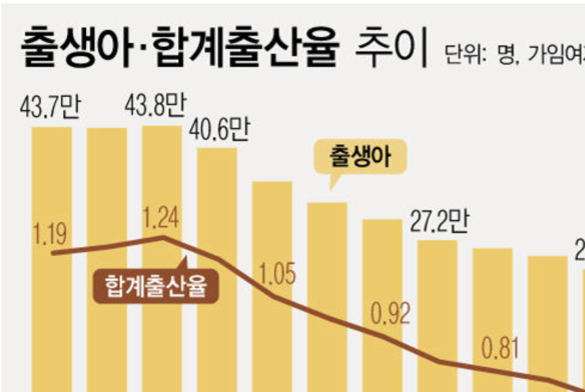
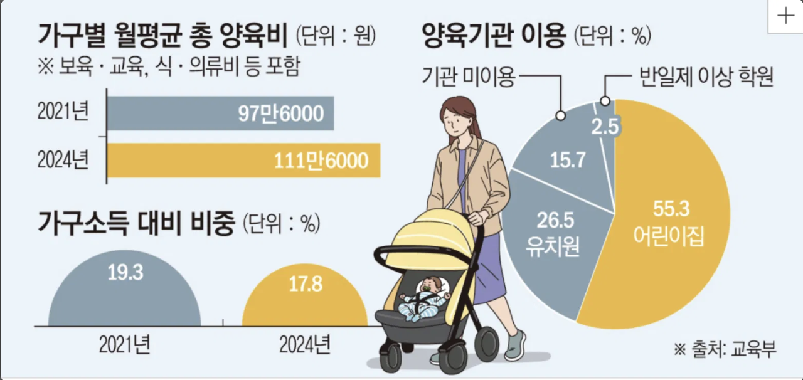
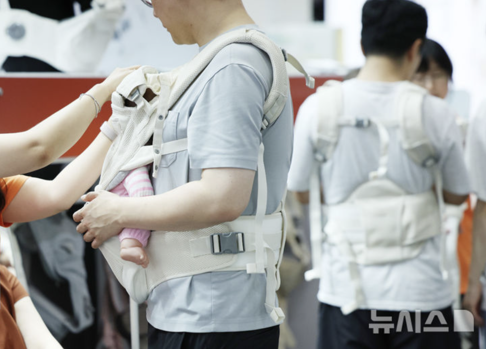
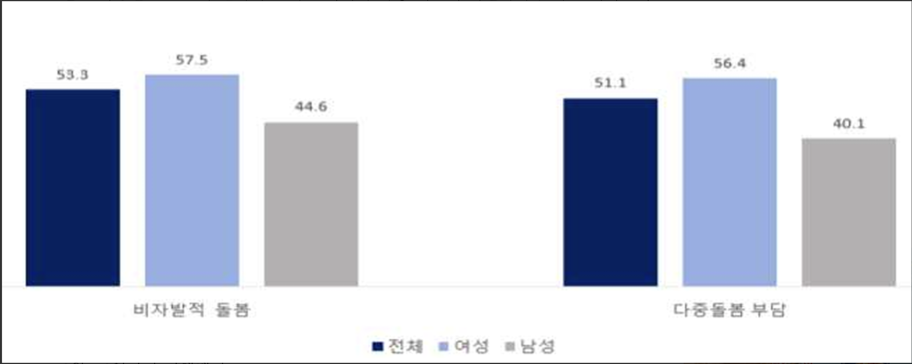

# 육아 IRP 자료조사

> 육아 IRP(Individual Resource Planning)의 문제 정의와 비즈니스 모델을 뒷받침하는 근거 자료 모음
> 최종 정리: 2026-10-24

## 한눈에 보기

### Part A. 육아 환경 — 누가, 얼마나 육아를 하고 있나

| # | 주장 | 핵심 수치 | 출처 |
|---|---|---|---|
| 1 | 아이 키우는 집이 다시 늘고 있다 | 2025년 출생아 25만 4,500명 (+6.8%), 합계출산율 0.80명 | 국가데이터처 (2026.02) |
| 2 | 맞벌이가 기본이 됐다 | 막내 6세 이하 가구 맞벌이 56.5%, 18세 미만 자녀 가구 60.4% | 국가데이터처 (2026.06) |
| 3 | 육아는 돈이 드는 운영이다 | 영유아 가구 월평균 양육비 111만 6천 원 (역대 최대) | 교육부 보육실태조사 (2025.05) |
| 4 | 아빠의 육아 참여가 늘고 있다 | 육아휴직자 중 남성 36.8% (역대 최고) | 고용노동부 (2025.10) |
| 5 | 결국 조부모가 돌봄을 떠받친다 | 손주 돌봄 조부모 하루 평균 6시간, 46.8%가 그만두고 싶어 함 | 한국여성정책연구원 (2026.05) |

### Part B. 핵심 문제 — 부모는 무엇이 힘든가

| # | 주장 | 핵심 수치 | 출처 |
|---|---|---|---|
| 6 | 시간도, 돌봐줄 사람도 부족하다 | 양육 시간 부족 63.6%, 돌봐줄 사람 부족 59.4% | 수원시정연구원 (2025) |
| 7 | 육아는 끝없이 기억하고 계획하는 일이다 | 정신적 부담(Mental Load)이 불안·우울과 관련 | PLOS ONE (2026) |
| 8 | 그 기억과 계획은 한 사람에게 몰린다 | 어머니가 인지적 가사노동의 72.6% 담당 | Aviv 외, Archives of Women's Mental Health (2025) |

**발표 흐름**: 아이 키우는 집은 늘고(1) → 대부분 맞벌이라 시간이 없고(2) → 돈이 많이 들며(3) → 아빠도 참여하지만(4) → 결국 할머니가 하루 6시간씩 돌보고, 그 절반은 지쳐 있다(5) → 부모는 시간과 돌봐줄 사람이 모자라고(6) → 진짜 부담은 육아용품·일정·돌봄 인력을 계속 기억하고 조율하는 정신적 노동이며(7) → 그 노동은 엄마 한 사람에게 몰려 있다(8) → **그래서 AI가 반복적인 관리·예측·조율을 준비하고, 돌보는 사람들 사이를 잇는 가정용 운영 시스템(ERP)이 필요하다**

---

# Part A. 육아 환경

## 1. 합계출산율 증가 — 아이 키우는 집이 다시 늘고 있다

- **링크**: https://www.newsis.com/view/NISX20260225_0003525439
- **출처**: 국가데이터처 「2025년 출생·사망통계(잠정)」, 뉴시스 보도 (2026-02-25)

*이미지 출처: 위 링크 기사 (자료: 국가데이터처)*

### 기사 내용
2025년 출생아 수가 전년보다 크게 늘며 2010년 이후 가장 큰 증가 폭을 기록했다. 합계출산율도 0.8명대로 올라서며 2016년부터 이어진 하락세가 2024년을 기점으로 2년 연속 반등했다. 늘어난 출생아의 대부분은 첫째 아이다.

### 핵심 수치

| 항목 | 수치 |
|---|---|
| 2025년 출생아 수 | 254,500명 (전년 대비 +16,100명, +6.8%) |
| 2025년 합계출산율 | 0.80명 (전년 대비 +0.05명, 2021년 이후 4년 만에 0.8명대) |
| 첫째아 출생 | 158,700명, 전체의 62.4% |
| 35세 이상 산모 비중 | 37.3% (통계 작성 이후 최고) |

### 우리 주장과의 연결
- **시장 규모**: 타깃 고객(48개월 미만 아이를 키우는 가정)이 줄어드는 시장이 아니라 다시 커지는 시장이다.
- **첫째아 62.4%**: 육아가 처음인 부모가 많다 → 무엇을 언제 챙겨야 할지 모르는 부모에게 운영 도우미가 필요하다.

### 발표 활용 문장
> "2025년 아이 울음소리는 15년 만에 가장 크게 늘었고, 그중 62%가 첫째 아이입니다. 육아가 처음인 부모가 많아지고 있습니다."

---

## 2. 맞벌이 가구 수 역대 최대 — 시간이 부족한 가정

- **링크**: https://www.hankyung.com/article/202606184276i
- **출처**: 국가데이터처 「2025년 하반기 지역별고용조사」 기반, 한국경제 보도 (2026-06-18)

### 기사 내용
배우자가 있는 가구 중 맞벌이 비중이 통계 작성 이후 최고치를 기록했다. 특히 18세 미만 자녀를 둔 가구의 맞벌이 비율이 처음으로 60%를 넘었고, 막내가 6세 이하인 가구의 맞벌이 비율이 자녀 연령대 중 가장 크게 늘었다.

### 핵심 수치

| 항목 | 수치 |
|---|---|
| 유배우 가구 중 맞벌이 | 48.6%, 약 615만 가구 (전년 대비 +0.6%p, 역대 최고) |
| 18세 미만 자녀 가구 맞벌이 | 60.4% (+1.9%p, 처음으로 60% 돌파) |
| **막내 자녀 6세 이하 가구 맞벌이** | **56.5% (+3.3%p, 자녀 연령대 중 최대 증가)** |
| 가구주 연령별 최고 | 30대 63.3% |

### 우리 주장과의 연결
- **핵심 타깃 검증**: 영유아 가정의 절반 이상이 맞벌이 → 부모 둘 다 낮에 집에 없고, 조부모·시터·어린이집과 돌봄을 나눠야 한다.
- **돌봄 교대 인수인계** 기능이 필요한 이유: 돌보는 사람이 하루에도 여러 번 바뀐다.

### 발표 활용 문장
> "막내가 6세 이하인 가정의 절반 이상이 맞벌이입니다. 이 집들은 매일 엄마, 아빠, 할머니, 어린이집이 돌봄을 나눠 맡습니다."

---

## 3. 육아는 돈이 많이 든다 — 육아 자재 MRP의 근거

- **링크**: https://www.etoday.co.kr/news/view/2471950
- **출처**: 교육부 「2024년 보육실태조사」(3년 주기 법정조사), 이투데이 보도 (2025-05-20)

*이미지 출처: 위 링크 기사 (자료: 교육부)*

### 기사 내용
영유아를 키우는 가구의 월평균 양육비가 2004년 조사 시작 이후 처음으로 100만 원을 넘어 역대 최대를 기록했다. 보육·교육비와 식비, 의류비 등을 포함한 금액이다. 소득 대비 비중은 3년 전보다 다소 낮아졌다.

### 핵심 수치

| 항목 | 수치 |
|---|---|
| 월평균 총 양육비 (2024) | 111만 6천 원 (역대 최대, 처음으로 100만 원 돌파) |
| 2021년 대비 | 97만 6천 원 → 111만 6천 원 (+14만 원) |
| 가구소득 대비 비중 | 19.3% (2021) → 17.8% (2024) |
| 양육기관 이용 | 어린이집 55.3%, 유치원 26.5%, 기관 미이용 15.7%, 반일제 이상 학원 2.5% |
| 조사 규모 | 2,494가구, 어린이집 3,058곳 |

> 참고: 기저귀·분유 등 소모품만 따로 나눈 수치는 기사에 없음

### 우리 주장과의 연결
- **육아 자재 MRP**: 육아는 매달 100만 원 넘게 집행하는 "작은 사업장 운영"이다. 소모품을 떨어지기 전에, 필요한 만큼만 사는 계획이 비용과 스트레스를 줄인다.
- **불용재고 방지**: 아이가 빨리 커서 작아진 기저귀가 남는 낭비를 사이즈업 예측으로 줄인다.
- **돌봄 교대 인수인계**: 영유아의 절반 이상이 어린이집을 다닌다 → 등·하원마다 돌봄을 맡는 사람이 바뀐다.
- **커머스 BM 근거**: 구매 시점을 아는 서비스는 구매로 이어지는 연결 고리가 된다.

### 발표 활용 문장
> "영유아 가정은 매달 110만 원이 넘는 돈을 육아에 씁니다. 회사라면 이 정도 예산을 엑셀 없이 운영하지 않습니다."

---

## 4. 남성의 육아 참여 확대 — 가족 모두가 보는 운영 시스템

- **링크**: https://www.newsis.com/view/NISX20251028_0003379724
- **출처**: 고용노동부, 뉴시스 보도 (2025-10-28)

*이미지 출처: 뉴시스*

### 기사 내용
2025년 1~9월 육아휴직급여를 받은 사람이 이미 전년 한 해 전체 인원을 넘어섰고, 그중 남성 비중이 역대 최고를 기록했다. 정부는 2026년부터 육아를 위해 하루 1시간 늦게 출근해도 임금을 깎지 않는 기업을 지원하는 제도를 새로 도입하는 등 일·육아 병행 지원을 늘린다.

### 핵심 수치

| 항목 | 수치 |
|---|---|
| 육아휴직급여 수급자 (2025년 1~9월) | 141,909명 (전년 동기 대비 +37.0%) |
| 남성 수급자 | 52,279명, **전체의 36.8% (역대 최고)** |
| 전년 동기 남성 비중 | 32.1% (+4.7%p) |
| 중소기업 근로자 비중 | 58.2% |
| 신설 제도 (2026) | 육아기 10시 출근제: 임금 삭감 없이 하루 1시간 단축 시 사업주에 월 30만 원 지원 |

### 우리 주장과의 연결
- **분담 리포트**: 아빠도 육아에 참여하고 싶어 하지만, 무엇을 언제 해야 하는지는 엄마 머릿속에 있다 → 가족 모두가 같은 정보를 보는 시스템이 필요하다. (8번 자료가 이를 수치로 뒷받침)
- **아빠 타깃 마케팅**: "기저귀 MRP", "운영 리포트" 같은 회사 언어는 육아에 새로 참여하는 아빠들에게 특히 잘 통한다.
- **기업 복지 BM**: 정부가 기업의 육아 지원을 장려하는 흐름이다.

### 발표 활용 문장
> "이제 육아휴직자 셋 중 한 명은 아빠입니다. 아빠도 함께 운영할 수 있도록, 엄마 머릿속에 있던 정보를 가족 모두가 보이게 만듭니다."

---

## 5. 조부모 손주 돌봄 실태 — 돌봄 교대 인수인계·할머니 화면의 근거

- **링크**: https://www.heraldk.com/article/2026050723100059699
- **출처**: 한국여성정책연구원 「가족 내 손자녀 돌봄 현황과 정책방안 연구」 중 '노인의 손자녀 돌봄 실태조사', 헤럴드경제 보도 (2026-05)

*이미지 출처: 위 링크 기사 (자료: 한국여성정책연구원)*

### 기사 내용
최근 반년 동안 손주를 정기적으로 돌본 조부모를 조사한 결과, 대부분 평일 거의 매일 하루 6시간 넘게 손주를 돌보고 있었다. 절반 가까이는 돌봄을 그만두고 싶다고 답했고, 절반 이상은 원하지 않지만 거절하지 못해 돌봄을 맡고 있었다. 돌봄 이후 육체적 피로와 정신적 스트레스가 늘었다는 응답이 많았지만, 손주·자녀와의 관계는 좋아졌다는 응답도 많았다. 취학 전 아이를 조부모가 돌보는 가장 큰 이유는 부모의 늦은 퇴근이었다.

### 핵심 수치

| 항목 | 수치 |
|---|---|
| 조사 대상 | 최근 6개월간 주 15시간 이상 만 10세 미만 손주를 돌본 만 55~74세 조부모 1,063명 |
| 조사 시기·방식 | 2025년 7월 28일~8월 18일, 온라인 조사 |
| **돌봄 시간** | **평일 주 4.6일, 하루 평균 6.04시간 (주당 26.83시간)** |
| **그만두고 싶다** | **46.8%** (여성 49.0%, 남성 42.5%) / 0~1세 손주를 돌보는 여성은 54.7% |
| 원하지 않지만 거절하지 못해 돌봄 | 53.3% |
| 그만두고 싶은 이유 | 힘에 부쳐서 46.7%, 스트레스 12.1%, 건강 악화 10.8% |
| 돌봄 이후 변화 | 육체적 피로 증가 73.7%, 정신적 스트레스 증가 60.4%, 기존 질환·통증 증가 47.8% |
| 관계 변화 | 손주와 관계 개선 81.9%, 손주 부모와 관계 개선 68.8% |
| 취학 전 아이를 맡는 이유 | 부모 퇴근 시간이 너무 늦어서 68.8% |

### 우리 주장과의 연결
- **돌봄 교대 인수인계**: 맞벌이 가정의 돌봄은 결국 조부모와 나눠 맡는다 → 부모와 조부모 사이에 매일 교대가 일어나고, 그때마다 수유·낮잠·특이사항이 말로 전달되다 끊긴다.
- **할머니 전용 화면**: 조부모의 73.7%가 육체적 피로를 느낀다 → 큰 글씨, 원탭 기록, 확인 버튼 하나처럼 조부모의 수고를 줄이는 화면이 필요하다.
- **주간 리포트**: 할머니가 돌본 시간을 기록으로 보여주면, 가족이 고마움을 표현하고 분담을 다시 조정하는 근거가 된다.
- **긍정 신호**: 관계가 좋아졌다는 응답도 많다 → 조부모 돌봄을 없애는 게 아니라, 덜 지치게 지속 가능하게 만드는 것이 목표다.

### 발표 활용 문장
> "맞벌이 가정의 아이를 돌보는 할머니는 일주일에 4.6일, 하루 6시간씩 손주를 봅니다. 그리고 그 절반은 그만두고 싶어 합니다. 육아 IRP는 할머니의 하루를 더 가볍게 만드는 데서 시작합니다."

---

# Part B. 핵심 문제 — 육아의 정신적 노동

## 6. 양육 시간과 돌봄 인력 부족 — 돌봄 공백 대응의 근거

- **링크**: https://www.suwon.re.kr/data/file/brief/9a18cb18b51051343b55f6e23616a830_efw4ba9z_99f98d53db5fec6c7547d85e9f8344598536baac.pdf
- **출처**: 수원시정연구원 「수원시 양육 환경 및 스트레스 실태」 (2025)

### 핵심 수치

| 항목 | 수치 |
|---|---|
| 조사 대상 | 수원시 양육자 257명 |
| **양육 시간 부족을 어려움으로 응답** | **63.6%** |
| **아이를 돌봐줄 사람 부족을 어려움으로 응답** | **59.4%** |

> 주의: 수원시 양육자 대상 조사로, 전국 부모 전체의 비율은 아님

### 우리 주장과의 연결
- **돌봄 공백 대응**: 돌봐줄 사람이 부족하다 → 갑작스러운 돌봄 공백 감지, 대타 조율 기능이 필요하다.
- **가족 간 돌봄 일정 공유**: 한정된 돌봄 인력(부모·조부모·시터)을 겹치지 않게, 빈틈 없이 배치해야 한다.

### 발표 활용 문장
> "양육자 열 명 중 여섯은 시간이 부족하고, 아이를 맡길 사람이 없다고 말합니다."

---

## 7. 육아의 정신적 부담(Mental Load) — 소진 예측·알림·AI 준비 기능의 근거

- **링크**: https://doi.org/10.1371/journal.pone.0356255
- **출처**: PLOS ONE 「Mental load in women and mothers」 (2026)

### 연구 내용
- 부모는 육아 과정에서 **해야 할 일을 끊임없이 기억·계획하고, 할 일이 끝나지 않는다고 느끼는 부담**을 경험한다.
- 이러한 정신적 부담은 불안·우울 증상과 관련이 있다.

### 우리 주장과의 연결
- **육아용품 소진 예측**: "기저귀가 언제 떨어지지?"를 부모가 기억하지 않아도 되게 한다.
- **일정·기한 알림**: 예방접종, 서류 마감 등 기억해야 할 일을 시스템이 대신 챙긴다.
- **AI 반복 업무 준비**: 반복되는 관리 업무는 AI가 준비하고, 부모는 결정만 한다.

---

## 8. 보이지 않는 가사·돌봄 노동 — 정보 공유·공동 관리 기능의 근거

- **링크**: https://doi.org/10.1007/s00737-024-01490-w
- **출처**: Aviv 외, 「Cognitive household labor: gender disparities and consequences for maternal mental health and wellbeing」, Archives of Women's Mental Health (2025)

### 핵심 수치

| 항목 | 수치 |
|---|---|
| 조사 대상 | 어린 자녀를 둔 미국 어머니 322명 |
| **어머니가 담당하는 인지적 가사노동** | **평균 72.6% (본인 보고)** |
| 관련 결과 | 인지적 노동 부담이 스트레스·번아웃 수준과 관련 |

### 우리 주장과의 연결
- **정보 공유·공동 관리**: 육아 정보가 엄마 머릿속에만 있다 → 부모·조부모·시터가 같은 정보를 보는 공동 관리가 필요하다.
- **돌봄 인수인계**: 기억을 사람에서 시스템으로 옮겨야 돌보는 사람이 바뀌어도 정보가 끊기지 않는다.

### 발표 활용 문장
> "아이를 위해 기억하고 계획하는 일의 72.6%를 엄마가 혼자 하고 있습니다. 육아 IRP는 그 기억을 가족 모두가 함께 보는 시스템으로 옮깁니다."

---

## 핵심 결론

**육아의 어려움은 정보가 부족하거나 많은 것보다, 부모가 육아용품·일정·돌봄 인력·인수인계를 계속 기억하고 조율해야 하는 정신적 노동에 있다.**

→ **육아 IRP는 AI 에이전트가 반복적인 관리·예측·조율을 준비하고, 가족이 필요한 결정만 하도록 돕는 서비스**로 문제를 정의하는 것이 적합하다.

> 참고: 위 자료들은 양육 부담의 존재와 관련 요인을 뒷받침하지만, **AI IRP 도입이 실제로 스트레스를 낮춘다는 효과까지 입증한 것은 아니다.** 해당 효과는 사용자 검증이 필요하다.

---

## 추가 후보 자료 (필요 시 보강)

| 주장 | 수치 | 출처 |
|---|---|---|
| 외부 돌봄 부족 | 아이돌봄서비스 대기 1만 1,645가구, 평균 39.4일 대기 | [아시아경제 (2026.06)](https://view.asiae.co.kr/article/2026062215333962687) |
| 보이지 않는 육아 부담 | 엄마가 챙기는 일 13.72개 vs 아빠 8.2개 (해외 연구) | [University of Bath (2025.10)](https://www.bath.ac.uk/announcements/successful-career-women-still-shoulder-the-majority-of-the-mental-load-at-home-new-research/) |
| 가사·돌봄 시간 격차 | 맞벌이 아내 하루 181분 vs 남편 78분 | [생활시간조사 분석 (2026.05)](https://www.newsis.com/view/NISX20260515_0003631826) |
| 긴급 상황 부담 | 워킹맘 83.8% 퇴사 고민, 계기 1위 "아이가 갑자기 아플 때" 60.2% *(기업 설문)* | [세계일보 (2024.08)](https://www.segye.com/newsView/20240830506141) |

---

## 수치 표기 원칙

- 기사·논문 문장을 그대로 옮기지 않고 수치와 사실 위주로 요약했다.
- 기업·민간 설문은 *(기업 설문)*, 특정 지역·국가 대상 조사는 범위를 함께 표시했다.
- 발표에서는 출처 기관명과 발표 시점을 함께 말한다.
- `images/`의 이미지는 기사에 실린 언론사 그래픽·사진으로 저작권은 해당 언론사에 있다. 발표 자료나 공개 저장소에 쓸 때는 출처 표기를 유지하고, 가능하면 직접 만든 그래프로 바꾼다.
