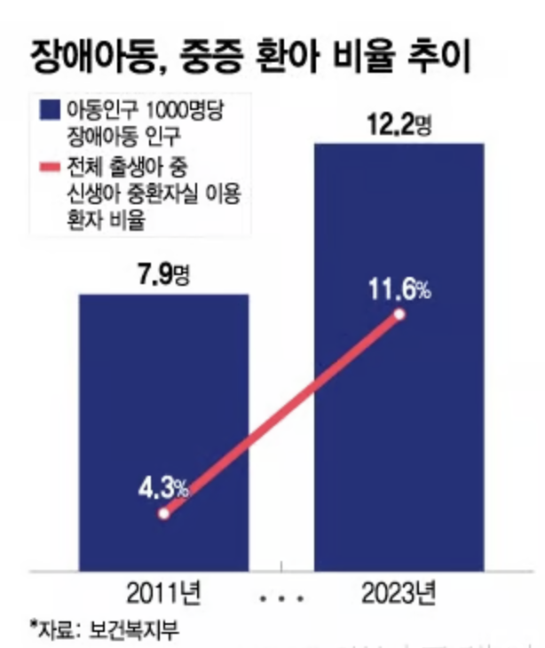
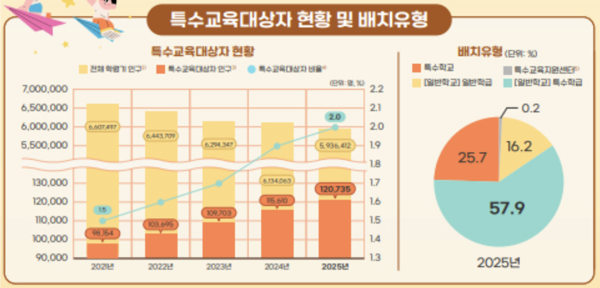
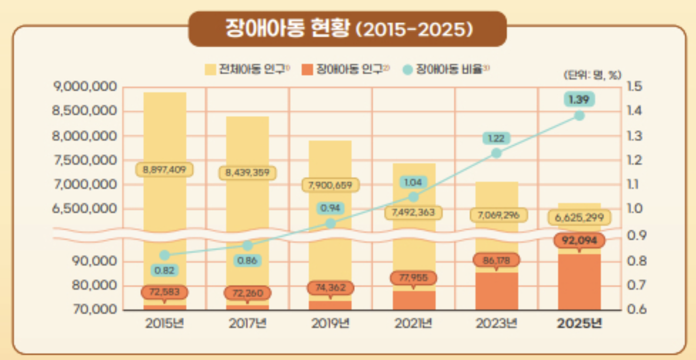
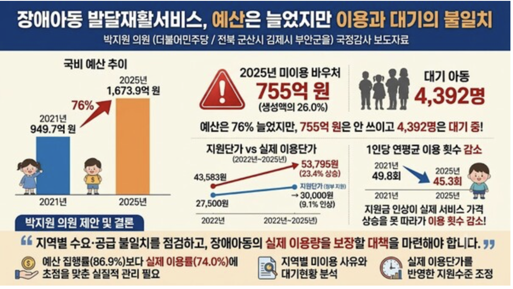

# 장애아동 IRP 자료조사

> 장애아동 가정 IRP(Individual Resource Planning) 에이전트의 문제 정의를 뒷받침하는 근거 자료 모음
> 최종 정리: 2026-10-24 (자료 8건 통합)

## 강조 표시 기준

| 표시 | 의미 |
|---|---|
| ⭐ | 발표 슬라이드에 반드시 넣을 핵심 수치 (표 안에서 **굵게** 표시) |
| `> [!IMPORTANT]` 박스 | 발표에서 그대로 말할 핵심 문장 |
| 🔥 | 메인 훅 (발표 첫 1분에 쓸 자료) |

---

## 🔥 발표 핵심 강조 포인트 (우선순위 순)

> [!IMPORTANT]
> **1. 돈은 남는데 아이는 기다린다 (자료 8)**
> 작년 발달재활 바우처 **755억 원(26.0%)이 쓰이지 않았는데**, 같은 해 **4,392명의 아이가 치료를 기다렸습니다.** → 제도와 예산이 부족한 게 아니라 **연결이 안 되는 문제**라는 것을 보여주는 가장 강력한 근거.

> [!IMPORTANT]
> **2. 정부의 개인별 지원계획은 100명 중 5명에게만 닿는다 (자료 7)**
> 9년간 개인별지원계획을 받은 발달장애인은 **전체의 4.8%**. 나머지 95%의 계획은 부모가 직접 세우고 있다.

> [!IMPORTANT]
> **3. 아이는 줄어도 장애아동은 늘고 있다 (자료 1, 6)**
> 13년간 아동 인구 **30.7% 감소**, 장애아동 **15.2% 증가**, 자폐성 장애아동 **약 3배**. 4년간 학령인구 67만 명 감소 속에 특수교육대상자는 **2만 명 증가(12만 명)**.

> [!IMPORTANT]
> **4. 그 모든 관리를 주돌봄자 한 명이 떠안는다 (자료 3)**
> 발달장애인 **51.6%가 하루 5시간 이상** 가족 돌봄, 주돌봄자 **63.4%는 자기 건강을 챙길 시간이 없다.**

> [!IMPORTANT]
> **5. 제도는 450여 종, 기준은 제각각 (자료 4, 5)**
> 소득 기준(수급자·120%·180%), 지원 형태(현금·바우처·시간), 신청 창구가 모두 다르다.

---

## 한눈에 보기

| # | 주장 | 핵심 수치 | 출처 |
|---|---|---|---|
| 1 | ⭐ 아이는 줄어드는데 장애아동은 늘고 있다 | **아동 인구 30.7% 감소, 장애아동 15.2% 증가 (2011→2024), 자폐성 장애아동 +210.5%** | 보건복지부, 머니투데이 (2025.05) |
| 2 | 어려운 아이일수록 공적 돌봄이 연결되지 않는다 | 활동지원 이용률 80.4%, 미연계 사유 중 도전행동 발달장애·사지마비 20.6% | 국회예산정책처 (2024.11) |
| 3 | ⭐ 돌봄은 결국 가족, 그중에서도 주돌봄자에게 몰린다 | **51.6%가 하루 5시간 이상 가족 돌봄, 주돌봄자 63.4%가 자기 건강 챙길 시간 없음** | 한국보건사회연구원 외, 매일신문 (2025.11) |
| 4 | 복지제도는 부처별 칸막이로 흩어져 있다 | 전 부처 복지사업 450여 종, 기관마다 따로 신청 | 서울신문 칼럼 (2022.09) |
| 5 | 장애아동 지원제도는 기준·형태가 제각각이다 | 소득 기준 수급자·120%·180%, 지원 형태 현금·바우처·시간 | 장애아동 지원제도 안내 (2026.10) |
| 6 | ⭐ 학령인구는 줄어도 특수교육대상자는 늘고 있다 | **학령인구 67만 명 감소, 특수교육대상자 2만 명 증가 (2021→2025, 12만 명)** | 한국장애인개발원, 한국교육신문 (2026.08) |
| 7 | ⭐ 정부의 개인별 지원계획은 대부분의 가정에 닿지 않는다 | **전체 발달장애인 대비 수립률 4.8%, 최중증 대비 23.3%** | 중앙장애아동·발달장애인지원센터, 세계일보 (2026.06) |
| 8 | 🔥⭐ 바우처는 남는데 아이는 대기한다 | **발달재활 바우처 755억 원(26.0%) 미사용, 대기아동 4,392명 (2025)** | 보건복지부 국감자료(박지원 의원실), 뉴스포털1 (2026.10) |

**발표 흐름**: 장애아동은 늘고 있고(1, 6) → 그 돌봄은 가족, 특히 주돌봄자 한 명에게 몰리며(3) → 공적 돌봄은 어려운 아이일수록 연결되지 않고(2) → **바우처 755억 원이 남는 동안 4,392명이 기다리는 연결 실패가 일어나고(8)** → 정부의 개인별 지원계획은 100명 중 5명에게만 닿으며(7) → 지원제도는 부처·기준·형태가 제각각이라 부모가 직접 맞춰야 한다(4, 5) → **그래서 흩어진 정보·자원·시간을 묶어 관리하는 장애아동 가정용 IRP 에이전트가 필요하다**

> 💡 **오프닝 추천**: 발표 첫 장은 자료 8(755억 미사용 vs 4,392명 대기)로 시작하고, 자료 7(100명 중 5명)로 "그래서 부모가 직접 한다"를 연결하면 문제 정의가 30초 안에 끝납니다.

---

## 1. 장애아동·중증 신생아 비율 증가 — 아이는 줄어드는데 장애아동은 늘고 있다 ⭐

- **링크**: https://www.mt.co.kr/thebio/2025/05/29/2025052914070071324
- **출처**: 보건복지부 자료, 머니투데이 「[단독]장애 아동·중증 신생아 환자 비율 늘었다」 (2025-05-29)

*이미지 출처: 머니투데이*

### 기사 내용
저출생으로 18세 미만 아동 인구는 13년 사이 30% 넘게 줄었지만, 같은 기간 등록 장애아동은 오히려 늘었다. 아동 1,000명당 장애아동 수는 1.7배가 됐고, 증가의 대부분은 자폐성 장애 등 발달장애 아동이 차지한다. 신생아 중 중환자실을 이용하는 비율도 12년 사이 약 2.7배로 늘었다. 복지부는 장애아동 증가 요인이 아직 명확히 규명되지 않았다고 밝혔다.

### 핵심 수치

| 항목 | 2011년 | 2024년 | 변화 |
|---|---|---|---|
| ⭐ 18세 미만 아동 인구 | 992만 1,012명 | 687만 6,330명 | **-304만 4,682명 (-30.7%)** |
| ⭐ 18세 미만 장애아동 | 7만 8,186명 | 9만 70명 | **+1만 1,884명 (+15.2%)** |
| 아동 1,000명당 장애아동 | 7.9명 | 13.1명 | 약 1.7배 |
| ⭐ 자폐성 장애아동 | 9,089명 | 2만 8,220명 | **+1만 9,131명 (+210.5%)** |
| 지적장애 아동 | 3만 6,099명 | 3만 9,221명 | +3,122명 (+8.6%) |

| 항목 | 2011년 | 2023년 | 변화 |
|---|---|---|---|
| 중환자실 이용 신생아 비율 | 4.3% | 11.6% | 약 2.7배 |

### 우리 주장과의 연결
- **시장 규모**: 타깃 가정(18세 미만 장애아동 가정)은 약 9만 가구로, 저출생 속에서도 줄지 않고 늘어나는 시장이다.
- **발달장애 중심 설계**: 증가분의 대부분이 자폐성 장애다 → 의사소통이 어렵고 돌봄 방법이 아이마다 달라서, 아이별 정보를 돌보는 사람에게 전달하는 인수인계 기능이 핵심이 된다.

### 발표 활용 문장
> [!IMPORTANT]
> "지난 13년간 아이는 30% 줄었는데, 장애아동은 15% 늘었습니다. 자폐성 장애아동은 3배가 됐습니다."

---

## 2. 장애인 돌봄 사업 평가 — 돌봄 인력과 제도에 공백이 있다

- **링크**: https://www.nabo.go.kr/ko/notice/releasesView.do?idx=8554
- **출처**: 국회예산정책처 「장애인 돌봄 사업 평가」 (2024-11-15)

<!-- 이미지 자리: 활동지원 이용률 또는 보고서 표지 (이미지 추가 시 아래 줄의 주석을 풀고 파일명을 맞춰주세요) -->
<!--  -->

### 자료 내용
국회예산정책처가 장애인 돌봄 사업 전반을 평가한 보고서다. 활동지원 서비스는 수급 자격을 받고도 실제로 이용하지 못하는 사람이 약 5명 중 1명이며, 연결되지 않는 사유 중 상당수가 도전행동이 있는 발달장애나 사지마비처럼 돌봄 난도가 높은 경우였다. 2024년 시작된 최중증 발달장애인 통합돌봄은 실태조사와 시범사업 없이 본사업으로 시작됐고, 1:1 지원 인력도 목표의 절반 수준만 확보됐다. 장애아동 수당 같은 경제적 지원과 장애아동 돌봄 휴직 같은 시간적 지원도 영국·독일·스웨덴 등에 비해 부족하다고 평가했다.

### 핵심 수치

| 항목 | 수치 |
|---|---|
| ⭐ 활동지원 수급자 / 실제 이용자 (2023년) | 15만 명 / 12만 명 → **이용률 80.4% (5명 중 1명 미이용)** |
| 미연계 사유 중 도전행동 발달장애·사지마비 (2022년 조사) | 20.6% |
| 최중증 발달장애인 24시간 1:1 지원 인력 (2024년 8월) | 목표 340명 중 176명 확보 (51.8%) |
| 장애아동 지원 수준 | 영국·독일·스웨덴 등 대비 경제적·시간적 지원 부족 *(수치 없음)* |

### 우리 주장과의 연결
- **인수인계 기능**: 돌봄이 어려운 아이일수록 지원 인력과 연결되지 않는다 → 아이의 특성, 진정 방법, 의사소통 방식을 미리 정리해 전달하면 새로 오는 돌봄 인력의 부담을 줄일 수 있다. *(우리 가설, 직접 검증된 자료는 아님)*
- **보호자 쉼 확보**: 공적 돌봄의 빈자리는 결국 가족이 채운다 → 가족 안에서 돌봄 시간을 나누고 공적 서비스 신청까지 연결하는 기능이 필요하다.
- **자료 8과 연결**: 활동지원(이용률 80.4%)과 발달재활 바우처(이용률 74.0%) 모두 "자격은 있는데 쓰지 못하는" 같은 패턴을 보인다.

### 발표 활용 문장
> "국회예산정책처에 따르면, 활동지원을 받을 자격이 있어도 5명 중 1명은 이용하지 못합니다. 돌봄이 어려운 아이일수록 연결이 끊깁니다."

---

## 3. 발달장애 돌봄의 굴레 — 돌봄은 가족, 그중에서도 주돌봄자에게 몰린다 ⭐

- **링크**: https://www.imaeil.com/page/view/2025102918010415737
- **출처**: 매일신문 「[벼랑 끝 가족들: 발달장애 돌봄의 굴레] <1> 잃을 수도, 벗어날 수도 없는 사랑, 발달장애 가족의 현실 기록」 (2025-11-09)

<!-- 이미지 자리: 발달장애 가족 돌봄 시간 그래픽 (이미지 추가 시 아래 줄의 주석을 풀고 파일명을 맞춰주세요) -->
<!--  -->

### 기사 내용
발달장애 가족의 돌봄 현실을 다룬 연재 기획의 첫 회다. 발달장애인의 절반 이상이 매일 5시간 넘게 가족의 돌봄을 받고 있으며, 주돌봄자 상당수는 자기 건강을 돌볼 시간조차 없다. 학령기보다 성인기에 돌봄 시간이 오히려 늘었다는 부모도 많아, 돌봄 부담이 시간이 지나도 줄지 않는 구조임을 보여준다. 보호자의 우울·불안과 극단적 선택 고민도 함께 다뤘다.

### 핵심 수치

| 항목 | 수치 | 조사 |
|---|---|---|
| ⭐ 하루 5시간 이상 가족 돌봄을 받는 발달장애인 | **51.6%** (2,649명 중 1,368명) | 한국보건사회연구원 전수조사 (2024) |
| ⭐ 주돌봄자 중 자기 건강을 챙길 시간이 없는 비율 | **63.4%** (104명 대상) | 대구시행복진흥사회서비스원 |
| 학령기보다 성인기에 돌봄 시간이 늘었다는 부모 | 41.6% (393명 대상) | 대구시행복진흥사회서비스원 |
| 주 1~2회 이상 도전행동을 보인다는 응답 | 77.7% | 기사에 "한 조사"로만 표기 |
| 심리상담을 고려한 보호자 중 우울·불안 약물 복용 | 35.2% (489명 중) | 한국보건사회연구원 |
| 극단적 선택을 고민한 적 있는 보호자 | 268명 | 한국보건사회연구원 |

*참고: 아동만이 아니라 성인을 포함한 발달장애인 전체 대상 수치다. 주돌봄자 63.4%는 104명 대상 지역 조사라 표본이 작으므로, 발표에서는 조사 기관을 함께 말한다.*

### 우리 주장과의 연결
- **보호자 가동률 기능**: 하루 5시간 이상, 자기 건강을 챙길 시간 없음 → 주돌봄자의 돌봄 시간을 기록으로 보여주고, 가족 간 교대와 공적 돌봄 신청을 제안하는 기능의 근거다.
- **장기적인 문제**: 성인기에 돌봄이 오히려 늘어난다 → 아동기부터 아이 정보와 돌봄 기록을 쌓아두는 것이 이후 돌봄 인력 교체나 기관 이동 때도 계속 쓰이는 자산이 된다.

### 발표 활용 문장
> [!IMPORTANT]
> "발달장애인의 절반 이상이 하루 5시간 넘게 가족의 돌봄을 받습니다. 그리고 그 주돌봄자의 63%는 자기 건강을 챙길 시간조차 없습니다."

---

## 4. 부처 칸막이 갇힌 공급자 중심 복지서비스 — 복지제도가 흩어져 있다

- **링크**: https://m.seoul.co.kr/news/2022/09/02/20220902023011
- **출처**: 서울신문 칼럼 「[전경하의 실패학] 부처 칸막이 갇힌 공급자 중심 복지서비스… '비극' 예방 어려워」, 전경하 논설위원 (2022-09-02)

<!-- 이미지 자리: 필요 시 추가 (이미지 추가 시 아래 줄의 주석을 풀고 파일명을 맞춰주세요) -->
<!--  -->

### 자료 내용
우리나라 복지서비스가 부처별 칸막이 안에서 공급자 중심으로 운영돼, 도움이 필요한 사람이 스스로 제도를 찾아 기관마다 따로 신청해야 하는 구조를 비판한 칼럼이다. 장애인 가정도 요금 감면, 직업훈련, 창업, 재활 지원을 각각 다른 기관에 신청해야 하고, 사는 지역에 따라 장애인 가족 지원센터도 달라진다. 미국 일부 주처럼 기관이 가족의 상황을 먼저 파악해 맞춤형으로 지원하는 원스톱 구조가 필요하다고 주장한다.

### 핵심 수치

| 항목 | 수치 |
|---|---|
| ⭐ 모든 부처의 복지사업 | **450여 종** |
| 복지부 통합 안내서 | 415쪽, 17만 부를 8,000여 개 기관에 배포 |
| 장애인 가정의 신청 창구 예시 | 전기료 → 한국전력, 가스요금 → 지역 도시가스사, 직업훈련 → 장애인고용공단, 창업 → 장애인기업종합지원센터, 재활 → 장애별 협회 |

*참고: 칼럼(의견 기사)이며, 장애아동이 아니라 장애인 복지 전반을 다룬다. 2022년 자료라 연도를 함께 표기한다.*

### 우리 주장과의 연결
- **문제의 구조**: 제도가 부족한 게 아니라 흩어져 있어서, 그것을 찾고 맞추는 일이 고스란히 가족 몫이 된다.
- **에이전트의 역할**: 가족의 상황(소득, 아이 상태, 이용 중인 서비스)을 알고 있는 쪽이 먼저 필요한 제도와 일정을 챙겨주는 구조, 칼럼이 말한 "원스톱"을 가정 단위에서 구현하는 것이 우리 서비스다.

### 발표 활용 문장
> "정부 복지사업은 450종이 넘습니다. 그런데 그걸 찾아서 신청하고 맞추는 일은 전부 가족의 몫입니다."

---

## 5. 장애아동 지원제도 비교 — 바우처마다 기준과 형태가 제각각이다

- **링크**: https://www.yugacrew.com/crewletter/disabled-child-support-guide
- **출처**: 유가크루 「장애아동 지원제도 가이드」 (2026-10-15 작성, 10-16 수정)

<!-- 이미지 자리: 제도별 기준 비교 표 (이미지 추가 시 아래 줄의 주석을 풀고 파일명을 맞춰주세요) -->
<!--  -->

### 자료 내용
장애아동 가정이 받을 수 있는 주요 지원제도를 정리한 안내 글이다. 같은 장애아동을 대상으로 하는 제도인데도 소득 기준, 지원 형태(현금·바우처·돌봄 시간), 신청 창구가 제도마다 다르다. 일부 제도는 연도별 기준이 바뀌어 안내처마다 수치가 다르게 표기되기도 한다.

### 핵심 수치

| 제도 | 소관 | 소득 기준 | 지원 형태·금액 |
|---|---|---|---|
| ⭐ 발달재활서비스 | 보건복지부 (시·군·구 지정 기관에서 이용) | 기초수급·차상위·기준 중위소득 180% 이하 (소득별 차등) | 바우처 월 26만 원(수급자, 본인부담 없음) ~ 18만 원(180% 이하, 본인부담 8만 원) |
| 장애아동수당 | 보건복지부 | 기초수급·차상위 | 현금 — 중증 월 22만·17만·9만 원 / 경증 월 11만·11만·3만 원 (수급 종류별) |
| 장애아가족 양육지원 | 보건복지부 | 중위소득 120% 이하 무료, 초과 시 이용료 40% 본인부담 | 돌봄 시간 — 2026년 연 1,200시간, 월 160시간 이내 *(정부24에는 2025년 기준 연 1,080시간으로 표기)* |
| 특수교육대상자 선정 | 「장애인 등에 대한 특수교육법」 (특수교육지원센터·교육청) | 해당 없음 | 진단·평가 30일 이내, 선정 결과 통지 2주 이내 |

*참고: 언론 기사가 아닌 민간 안내 글이다. 금액과 기준은 매년 바뀌므로 발표 전 복지로(bokjiro.go.kr) 또는 보건복지상담센터(129)에서 최신 기준을 확인한다.*

### 우리 주장과의 연결
- **치료·바우처 배분 기능**: 소득 기준(수급자·120%·180%), 지원 형태(현금·바우처·시간), 담당 기관이 모두 다르다 → 가정 하나가 여러 제도의 잔액·사용 시간·자격 기준을 동시에 관리해야 한다.
- **자격 변동 관리**: 소득이 조금만 바뀌어도 제도별로 자격이 달라진다 → 에이전트가 제도별 기준을 기억하고 갱신 시점과 변동을 알려줄 필요가 있다.
- **자료 8과 연결**: 여기서 정리한 발달재활서비스 바우처가 바로 작년 755억 원이 쓰이지 않은 그 바우처다.

### 발표 활용 문장
> "같은 아이를 위한 제도인데, 소득 기준은 120%, 180%, 수급자로, 지원은 현금, 바우처, 돌봄 시간으로 제각각입니다. 지금은 이걸 엄마 혼자 맞춰서 관리합니다."

---

## 6. 학령인구 줄어도 특수교육대상자 2만명 늘어 — 아이는 줄어도 특수교육이 필요한 아이는 늘고 있다 ⭐

- **링크**: https://hangyo.com/mobile/article.html?no=108832
- **출처**: 한국장애인개발원 KODDI 통계 뉴스레터 「통계로 보는 장애아동」, 한국교육신문 보도 (2026-08-12)

*이미지 출처: 한국장애인개발원, 한국교육신문*

### 기사 내용
한국장애인개발원이 장래인구추계, 특수교육통계, 장애인 현황, 장애인실태조사를 종합해 장애아동 통계를 정리했다. 저출생으로 학령인구는 4년 사이 67만 명 넘게 줄었지만, 특수교육대상자는 같은 기간 2만 명 넘게 늘어 학령인구 중 비율이 1.5%에서 2.0%로 올랐다. 장애아동 수와 전체 아동 중 비율도 10년 사이 꾸준히 늘었고, 장애청소년은 지적장애와 자폐성장애가 약 80%를 차지한다. 장애아동 4명 중 1명 이상은 학교생활에 잘 적응하지 못하는 것으로 나타났다.

### 핵심 수치

**학령인구와 특수교육대상자 (2021 → 2025)**

| 연도 | 특수교육대상자 |
|---|---|
| 2021 | 98,154명 |
| 2022 | 103,695명 |
| 2023 | 109,703명 |
| 2024 | 115,610명 |
| 2025 | **120,735명** |

| 항목 | 2021년 | 2025년 | 변화 |
|---|---|---|---|
| ⭐ 학령인구 (만 3~17세) | 6,607,497명 | 5,936,412명 | **-671,085명** |
| ⭐ 특수교육대상자 | 98,154명 | 120,735명 | **+22,581명** |
| 학령인구 중 특수교육대상자 비율 | 1.5% | 2.0% | +0.5%p |

**장애아동·장애청소년 (2015 → 2025)**

| 항목 | 2015년 | 2025년 | 변화 |
|---|---|---|---|
| 장애아동 수 | 72,583명 | 92,094명 | +19,511명 |
| 전체 아동 중 장애아동 비율 | 0.82% | 1.39% | +0.57%p |
| 장애청소년 수 (만 6~17세) | 64,461명 | 85,337명 | +20,876명 |
| 전체 청소년 중 장애청소년 비율 | 1.05% | 1.67% | +0.62%p |

| 장애청소년 장애유형 (2025년) | 비율 |
|---|---|
| ⭐ 지적장애 | **44.9%** |
| ⭐ 자폐성장애 | **34.6%** |
| 뇌병변장애 | 7.2% |

**학교생활**

| 항목 | 수치 |
|---|---|
| 학교생활에 적응하지 못하거나 잘 적응하지 못하는 편 | 27.5% |
| 주요 어려움: 수업 이해·진도 따라가기 | 32.6% |
| 주요 어려움: 친구들의 이해 부족·놀림 | 13.1% |
| 주요 어려움: 특수교사 부족 | 11.6% |
| 주요 어려움: 지원인력 미배치 | 10.0% |

### 우리 주장과의 연결
- **시장 규모**: 아이 수는 줄어드는데 특수교육대상자는 매년 5천~6천 명씩 늘고 있다 → 저출생 속에서도 커지는 시장이다.
- **IEP와 직접 연결**: 특수교육대상자 12만 명은 모두 학교에서 개별화교육계획(IEP)을 협의하는 가정이다 → 학기마다 IEP를 준비하는 부모에게 'IEP 준비 한 장'이 필요한 근거다.
- **발달장애 중심 설계**: 장애청소년의 약 80%가 지적·자폐성장애다 → 치료 기관이 여러 곳이고 기록이 쌓이는 가정이 핵심 사용자다.

### 발표 활용 문장
> [!IMPORTANT]
> "4년 사이 학령인구는 67만 명 줄었는데, 특수교육대상자는 2만 명 늘었습니다. 지금 12만 가정이 학기마다 IEP를 준비합니다."

---

## 7. 중증 발달장애인 23%만 '개인별지원 서비스' — 정부의 개인별 지원계획은 대부분의 가정에 닿지 않는다 ⭐

- **링크**: https://www.segye.com/newsView/20260629514888
- **출처**: 중앙장애아동·발달장애인지원센터 자료, 세계일보 「[단독] 중증 발달장애인 23%만 '개인별지원 서비스' [심층기획-죽어야 끝나는 돌봄]」 (2026-06-29)

<!-- 이미지 자리: 개인별지원계획 수립률 (이미지 추가 시 아래 줄의 주석을 풀고 파일명을 맞춰주세요) -->
<!--  -->

### 기사 내용
발달장애인법에 따라 발달장애인지원센터가 2017년부터 개인별지원계획을 세워 왔지만, 9년 동안 쌓인 계획은 약 1만 4천 건으로 최중증 발달장애인의 23% 수준에 그쳤다. 신청한 사람에게만 계획을 세우는 신청주의 구조라 신청 대비 수립률은 99%가 넘지만, 전체 발달장애인 기준으로는 5%도 안 된다. 지역 발달장애인지원센터는 광역지자체당 1곳, 전담 인력은 3명 안팎이라 계획을 세운 뒤에도 실제 점검은 6개월에 한 번 정도에 머문다.

### 핵심 수치

| 항목 | 수치 |
|---|---|
| 개인별지원계획 누적 수립 건수 (2017년~2025년) | 13,949건 |
| 연평균 수립 건수 | 약 1,550건 |
| 신청 대비 수립률 | 99.61% *(신청한 사람 기준)* |
| ⭐ 최중증 발달장애인 대비 수립률 | **23.3%** (복지부 추산 대상자 약 6만 명) |
| ⭐ **전체 발달장애인 대비 수립률** | **4.8%** (전체 288,324명 기준) |
| 지역 발달장애인지원센터 | 광역지자체당 1곳, 센터당 인력 10여 명 |
| 계획 수립 후 점검 주기 | 월 1회 필요하지만, 전담 직원 약 3명이라 실제로는 6개월에 1회 수준 *(현장 센터장 발언)* |

*참고: 아동만이 아닌 전 연령 발달장애인 대상 수치다. 발표에서는 "발달장애인 전체 기준"이라고 함께 말한다.*

### 우리 주장과의 연결
- **훅의 직접 근거**: "정부엔 개인별 지원계획이 있지만 부모 손엔 아무것도 없다" → 실제로 계획을 받은 사람은 발달장애인 100명 중 5명이다.
- **신청주의의 한계**: 신청한 사람만 계획을 받는다 → 제도를 알고 신청하는 일 자체가 부모 몫이며, 마감 레이더와 서류 체크리스트가 필요한 이유다.
- **공공 인력의 한계**: 센터 전담 인력 3명으로는 월 1회 점검도 어렵다 → 부모가 스스로 관리하고, 센터는 정리된 자료를 받는 구조(비즈니스 모델 1순위: 지자체·발달장애인지원센터)의 근거다.

### 발표 활용 문장
> [!IMPORTANT]
> "정부에는 개인별 지원계획이 있습니다. 하지만 9년 동안 그 계획을 받은 발달장애인은 100명 중 5명입니다. 나머지 95명의 계획은, 지금 부모가 손으로 쓰고 있습니다."

---

## 8. 장애아동 언어·행동 재활지원, 바우처 755억원 미사용 … 4,392명은 대기 — 돈은 남는데 아이는 기다린다 🔥⭐

- **링크**: https://www.civilreporter.co.kr/news/articleView.html?idxno=544923
- **출처**: 보건복지부 국정감사 제출자료, 박지원 의원(더불어민주당, 전북 군산·김제·부안을) 국정감사 보도자료, 한국시민기자협회 뉴스포털1 보도 (2026-10-07)

*이미지 출처: 뉴스포털1*

### 기사 내용
장애아동과 장애가 예견되는 영유아에게 언어·행동·감각·운동 재활을 지원하는 발달재활서비스의 국비 예산은 5년 사이 약 76% 늘었다. 그런데 작년(2025년) 만들어진 바우처 중 약 4분의 1이 실제 서비스 이용으로 이어지지 않았고, 같은 해 수천 명의 아이는 서비스를 기다렸다. 정부가 지원하는 1회 단가는 소폭 올랐지만 제공기관의 실제 이용 가격은 훨씬 크게 올라, 아이 한 명이 1년에 받은 치료 횟수는 오히려 줄었다. 박 의원은 예산을 얼마나 집행했는지보다 아이가 실제로 얼마나 서비스를 받았는지를 봐야 하며, 지역별 수요와 공급의 불일치를 점검해야 한다고 지적했다.

### 핵심 수치

**예산과 실제 이용 (2025년)**

| 항목 | 수치 |
|---|---|
| 국비 예산 | 2021년 949.7억 원 → 2025년 1,673.9억 원 (**약 76% 증가**) |
| 국비 예산 실집행률 | 86.9% |
| 바우처 생성액 (국비·지방비·본인부담 포함) | 2,908.1억 원 |
| ⭐ 바우처 생성액 대비 실제 이용률 | **74.0%** |
| ⭐ **미사용 바우처** | **755.1억 원 (26.0%)** |

**대기아동**

| 연도 | 대기아동 |
|---|---|
| 2024 | 5,451명 |
| 2025 | ⭐ **4,392명** |

**단가와 이용횟수**

| 항목 | 이전 | 2025년 | 변화 |
|---|---|---|---|
| 정부 지원단가 (1회) | 2022년 27,500원 | 30,000원 | +9.1% |
| ⭐ 제공기관 실제 평균 이용단가 (1회) | 2022년 43,583원 | 53,795원 | **+23.4%** |
| ⭐ 이용자 1인당 연평균 이용횟수 | 2021년 49.8회 | 45.3회 | **약 -9%** |
| 지원단가와 실제 단가의 차이 (1회) | 2022년 16,083원 | 23,795원 | 약 1.5배 *(우리 계산)* |

*참고: 국회의원 보도자료를 시민기자 매체가 전재한 기사다. 발표에서는 "보건복지부 국정감사 자료(박지원 의원실)"로 출처를 말하는 것이 공신력이 높다. 기사의 "지난해"는 2025년이다. 국비 실집행률(86.9%)과 바우처 이용률(74.0%)은 산정 기준이 다른 지표이므로 섞어 쓰지 않는다.*

### 우리 주장과의 연결
- **🔥 메인 훅: 연결 실패의 증거**: 바우처 755억 원이 남는 동안 4,392명이 대기했다 → 예산이나 제도가 부족한 게 아니라, **가정과 서비스가 제때 연결되지 않는 문제**다. IRP 에이전트가 풀려는 문제를 숫자로 가장 선명하게 보여준다.
- **바우처 잔액·소진 관리 기능**: 생성된 바우처의 26%가 쓰이지 않는다 → 월별 잔액, 소멸 시점, 이용 가능한 기관을 미리 알려주면 미사용을 줄일 수 있다. *(우리 가설: 기사는 미사용 원인을 분석하지 않았으므로, 미사용의 일부가 정보·일정 관리 문제라는 점은 검증되지 않음)*
- **치료비 계획 기능**: 지원단가는 9.1% 올랐는데 실제 가격은 23.4% 올라 1회당 약 2.4만 원을 가정이 더 부담하거나 횟수를 줄여야 한다 → 바우처와 본인부담을 합쳐 월 치료 계획을 짜주는 기능의 근거다.
- **B2G 근거**: 의원이 "지역별 미이용액·대기자·제공기관 현황을 함께 분석하라"고 요구했다 → 가정 단위의 이용·대기 기록이 쌓이면 지자체가 수요·공급 불일치를 파악하는 데이터가 될 수 있다(비즈니스 모델 1순위와 연결).
- **자료 2와 같은 패턴**: 활동지원(이용률 80.4%)에 이어 발달재활 바우처(이용률 74.0%)도 "자격은 있는데 못 쓰는" 구조가 반복된다.

### 발표 활용 문장
> [!IMPORTANT]
> "작년 장애아동 재활 바우처 755억 원이 쓰이지 않았습니다. 같은 해, 4,392명의 아이는 치료를 기다렸습니다. 돈이 없는 게 아니라, 연결이 안 되는 겁니다."

---

## 이미지 관련

- 현재 자료 1·6·8번에 이미지가 들어가 있다(6번은 `06-1`, `06-2` 두 장). 원본은 `문제_images.zip`에도 보관되어 있다.
- 자료 2·3·4·5·7번은 이미지가 비어 있다. 추가 시 `images/` 폴더에 각 섹션 주석에 적힌 파일명으로 저장하고 해당 줄의 주석을 해제한다.
- 기사 그래픽·사진의 저작권은 해당 언론사에 있으므로 이미지 아래에 출처를 표기한다.
- 저장소를 공개(public)로 전환하거나 발표 자료에 그대로 쓸 때는 수치를 바탕으로 직접 만든 그래프로 바꾸는 것을 권장한다.
- **그래프 추천 (강조 자료 우선)**: 자료 8은 "바우처 생성액 2,908억 중 미사용 755억" 도넛 차트 + 대기아동 4,392명 아이콘, 자료 1·6은 "아동 인구 감소 vs 장애아동·특수교육대상자 증가" 이중 축 선 그래프, 자료 7은 "100명 중 5명" 아이콘 배열이 한눈에 들어온다.

## 수치 표기 원칙

- 기사 문장을 그대로 옮기지 않고 수치와 사실 위주로 요약했다.
- 아동이 아닌 전체 연령 대상 수치, 칼럼, 민간 안내 글, 보도자료 전재 기사는 각 섹션 *참고*에 따로 표시했다.
- 우리 주장 중 자료로 직접 검증되지 않은 부분은 *(우리 가설)*로, 원자료 수치로 직접 계산한 값은 *(우리 계산)*으로 표시했다.
- 발표에서는 출처 기관명과 발표 시점을 함께 말한다.
