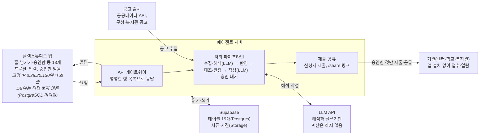

# 아이 한 장 — MVP 스펙

2026-10-24 · 임준현

해커톤 MVP는 지우네 세 장면을 실제 에이전트로 돌려, 문자와 사진을 넘기면 승인 몇 번으로 관리가 끝나고, 받을 수 있는 지원은 AI가 먼저 찾아 신청까지 가져가는 것을 보여 줍니다. 기능은 한 장 장부, 맞춤 지원 레이더, 아이 이력서 세 가지입니다.

테이블 설계는 아래 [데이터](#데이터) 절, 처리 순서·트리거·API는 [에이전트](#에이전트) 절에 있습니다.

## 목표와 범위

MVP가 증명할 것은 둘입니다. 부모가 문자 12개와 사진·파일 3개를 넘기면 승인 네 번으로 관리가 끝난다는 것, 그리고 부모가 찾지 않은 지원을 AI가 먼저 찾아 신청까지 가져간다는 것입니다.

| 구분 | 내용 |
| --- | --- |
| 실제로 구현 | 프로필 기반 대상 판정, 문자 붙여넣기와 사진 업로드, LLM 분류·추출과 문서 작성, 코드로 하는 장부 반영·대조·잔액·마감 계산, 시범 지역 한 곳의 공고 수집, 신청서 초안과 서류 체크, 승인함, 생성 문서 미리보기 |
| 목업으로 보여 줌 | 기관에 보내는 문자 발송, 신청서 제출(테스트 메일함), 기관이 여는 공유 페이지, 정부24 발급 단계(안내 화면만), 결정통지서 사진으로 프로필 채우기 |
| 이번에 하지 않음 | 로그인과 여러 가정, 센터 앱·마이데이터 실제 연동, 본인 인증 대행, 음성 입력, 실제 아동 데이터 |

데이터는 모두 가상이고, 시연은 시연 제어 화면에서 장면을 넘기며 진행합니다. 장면마다 '손으로 하던 일 → 승인' 카운터를 띄웁니다.

## 장면별 요구사항

세 장면은 기능 하나씩을 주인공으로 삼고, 모두 '넘기기(또는 자동 수집) → 에이전트 처리 → 승인' 순서로 돕니다. 시작 전에 지우네 기본 데이터와 프로필을 미리 넣어 둡니다.

**미리 넣어 둘 데이터:** 지우(7세, 초등 1학년 특수학급, 가명) 프로필, 기관 4곳(언어치료·감각통합·놀이치료 센터, 학교), 주간 치료 일정, 이번 달 바우처 한도와 이용 내역, 지난 학기 치료 피드백, 서류함, 시범 지역 공고 5건(그중 지우 해당 1건).

| 장면 | 기능 | 넘기는 것 | 에이전트 처리 | 화면 결과 | 승인 |
| --- | --- | --- | --- | --- | --- |
| 1. 월말 밤 | 한 장 장부 | 센터 문자 12개, 이용 내역 캐처 1장 | 문자를 일정·결석·보강·공지·치료 피드백으로 분류하고, 캐처에서 이용 내역을 추출해 시간표와 장부에 반영. 결석일에 이용 내역이 있는 1건을 찾고, 바우처 잔액 3만 원 월말 소멸 예정을 계산 | 확인 카드 2건(확인 요청·신고 상담 안내 선택지, 보강 제안), 카운터 6단계 → 승인 2번 | 확인 요청 문자, 보강 요청 문자 |
| 2. 오후 | 맞춤 지원 레이더 | 없음(공고 자동 수집), 엄마가 발급한 서류 파일 1개 | 공고 5건을 프로필과 맞춰 1건을 대상으로 판정하고 이유를 설명. 신청서 초안을 쓰고 서류함과 대조해 빠진 서류 1건의 발급을 안내. 승인 후 제출하고 결과 발표일을 등록 | 지원 카드, 신청서 미리보기, 서류 체크리스트, 신청 상태, 카운터 6단계 → 승인 1번·직접 1번 | 신청서 제출 |
| 3. 새 학기 | 아이 이력서 | IEP 협의 안내문 사진 1장 | 날짜를 뽑아 일정과 마감에 넣고, 지난 학기 세 기관 기록과 가정 관찰로 'IEP 준비 한 장' 작성. 같은 기록으로 인계서도 전환 | 문서 미리보기, 한 줄 수정 칸, 카운터 4단계 → 승인 1번 | 특수교사에게 공유 |

마무리 화면은 지우의 '한 장' 전체, '처음 해낸 날' 모음, 합계 '손 작업 16단계 → 승인 4번'입니다. 카드마다 근거가 된 원문 문자, 사진, 공고 링크를 함께 보여 줍니다.

## 시스템 구성

플렉스튜디오는 화면과 입력만 맡고, 공고 수집·해석·계산·문서와 신청서 작성은 에이전트 서버가, 상태 저장은 Supabase가 맡습니다.

**플렉스튜디오는 화면만, 판단과 저장은 에이전트 서버가 맡습니다**



플렉스튜디오는 Supabase에 직접 붙지 않고 서버 API만 부릅니다. 공고는 공공데이터 API를 먼저 쓰고 공개 게시판 수집은 보조로 쓰며, 기관에는 부모가 승인한 신청서와 문서만 나갑니다.

## 화면 명세

화면은 13개이고, 부모가 매일 여는 화면은 홈·넘기기·승인함 세 개입니다. 목록은 컨트롤이 아니라 컨렉션 반복 영역(행 하나 = 섹터 하나)으로 만듭니다.

| 화면 | 기능 | 목적 | 주요 요소 | 컨트롤 |
| --- | --- | --- | --- | --- |
| 1. 프로필 | 공통 | 처음 한 번 등록 | 나이·학년, 장애 유형, 사는 곳, 바우처 소득 구간, 다니는 기관, 결정통지서 사진으로 채우기(목업) | InputText, ComboBox, FileUpload |
| 2. 홈 | 공통 | 오늘 확인할 것 | 확인 카드(근거 원문 펼치기), 손 작업 카운터, 이번 주 일정 요약 | Text, Button, 컨렉션 반복 |
| 3. 넘기기 | 공통 | 문자·사진·파일 넘기기 | 여러 문자를 한 번에 붙여넣는 칸, 사진·파일 올리기, 부모 한마디 칸 | InputText, FileUpload, Button |
| 4. 승인함 | 공통 | 바깥으로 나갈 것 확인 | 대기 목록, 원문과 초안 나란히, 승인·고쳐서 승인·보류 | InputText, Button, 컨렉션 반복 |
| 5. 시간표 | 한 장 장부 | 기관별 주간 치료 일정 | 결석·보강 표시, 기관별 색 | TimeTable |
| 6. 바우처 장부 | 한 장 장부 | 이번 달 돈 | 한도·사용·잔액·소멸 예정, 이용 내역과 출석 대조, 교육청 카드와의 영역 중복 경고 | Text, 컨렉션 반복 |
| 7. 지원 레이더 | 맞춤 지원 레이더 | 받을 수 있는 것과 해야 할 것 | 해당 지원 목록(이유·마감·원문 링크), 마감 달력(서류 유효기간, IEP 기한, 신청 마감) | CalendarSchedule, 컨렉션 반복 |
| 8. 신청 진행 | 맞춤 지원 레이더 | 신청을 끝까지 | 신청서 미리보기, 서류 체크리스트, 발급 안내, 상태(준비·승인 대기·제출·접수·결과) | Embed(서버가 만든 HTML), Button, 컨렉션 반복 |
| 9. 서류함 | 맞춤 지원 레이더 | 가진 서류와 유효기간 | 서류 목록, 발급일·유효기간, 서류 사진 | Image, 컨렉션 반복 |
| 10. 아이 이력서 | 아이 이력서 | 기관별 목표와 진척 | 기관 탭, 기간별 기록, 처음 해낸 날, 용도별 문서 만들기 버튼 | Tab, Button, 컨렉션 반복 |
| 11. 문서 미리보기 | 아이 이력서 | 생성 문서 확인·공유 | 문서 본문, 한 줄 수정 칸, 공유 버튼 | Embed(서버가 만든 HTML), InputText, Button |
| 12. 기관용 공유 페이지 | 공통 | 기관이 받는 화면 | 읽기 전용 문서, 앱 설치 없음 | 에이전트 서버의 웹 페이지(목업) |
| 13. 시연 제어 | 공통 | 발표 중 장면 진행 | 장면 1\~3 입력 넣기, 공고 수집 실행, 초기화 | Button |

말투는 제안서의 경험 원칙을 따릅니다. '불일치' 대신 "확인이 필요한 이용 내역이 1건 있어요"처럼 쓰고, 지원 카드에는 "왜 해당하는지"와 원문 공고 링크를 붙입니다.

## 플렉스튜디오 제약과 대응

플렉스튜디오는 화면과 입력만 맡고, 판단과 저장은 모두 에이전트 서버로 보냅니다. 아래 제약은 [플렉스튜디오 문서](https://docs.flextudio.com/flextudio)에서 확인한 것입니다.

| 제약 | 설계 결정 |
| --- | --- |
| 외부 DB 연결은 MySQL·MSSQL·Oracle만 되고 PostgreSQL은 안 됨 | 플렉스튜디오는 에이전트 서버 API만 부르고, Supabase 읽기·쓰기는 서버가 맡음 |
| API 연동은 ParamBlocks로 보내고 Result를 2차원 배열로 받음 | 서버 응답을 화면별 평평한 행 목록으로 설계하고 중첩 JSON은 쓰지 않음 |
| 자동 새로고침과 타이머가 없음 | 넘기기·승인 응답에 갱신된 홈 데이터를 함께 돌려줌 |
| API 응답 시간 제한이 문서에 없음 | LLM 처리가 길면 run id를 먼저 돌려주고 '결과 보기' 버튼으로 조회. 시연 전에 응답 시간을 재봄 |
| 호출은 고정 IP(3.38.20.130)에서 옴 | 서버 방화벽에 이 IP를 허용하고, 키는 Secret Key로 보관 |
| [FileUpload](https://docs.flextudio.com/flextudio/scenario/component/control/fileupload.md)는 플렉스튜디오 파일 시스템에 저장하고 FileKey를 줌. 외부 API로 넘기는 방법은 문서에 없음 | 파일을 서버로 넘길 수 있는지 먼저 시험. 안 되면 서버에 미리 올린 서류 이미지를 고르는 방식으로 대체 |
| 마이크 API가 없고, Embed에는 script를 넣을 수 없음 | 부모 한마디는 글자 입력, 문서 미리보기는 script 없는 HTML |
| Approval 컨트롤은 결재선 UI | 승인함은 컨렉션 반복과 버튼으로 직접 구성 |
| '라이브에 적용'은 바로 반영됨 | 시연용 앱을 따로 두고, 발표 당일에는 변경하지 않음 |
| 에뮬레이터에 iOS·Android 환경이 없음 | 실제 휴대폰으로 리허설 |

## 일정과 역할 분담

작업은 네 단계로 나누고, 5명이 세 갈래(서버, 화면, 시나리오·발표)로 시작해 단계마다 필요한 곳으로 옮깁니다. 마감일이 정해지면 단계별 날짜를 붙입니다.

| 갈래 | 시작 인원 | 맡는 일 |
| --- | --- | --- |
| 에이전트 서버 | 2명 | API, 계산 모듈(대조·잔액·마감·대상 판정), 공고 수집기, LLM 분류·문서 작성, Supabase |
| 플렉스튜디오 화면 | 2명 | 화면 13개, API 연동(ParamBlocks·Result), 시연 제어 |
| 시나리오·발표 | 1명 | 가상 데이터와 장면 입력, 시범 지역 공고 5건 정리, 문서 예시, 발표 자료, 리허설 진행 |

1. **뼈대 확정:** 장면 입력과 가상 데이터, 테이블과 API 형식을 정합니다. 시범 지역 한 곳을 고르고 공고를 어떤 경로로 가져올지, FileUpload로 서버에 파일을 넘길 수 있는지도 이 단계에서 시험합니다.
2. **병렬 구현:** 서버는 계산 모듈과 API를, 화면은 홈·넘기기·승인함·지원 레이더부터 만듭니다. 처음에는 고정 응답으로 화면을 연결합니다.
3. **에이전트 연결:** LLM 분류·추출, 대상 판정, 신청서와 문서 작성을 붙이고, 장면 1\~3을 처음부터 끝까지 돌립니다.
4. **리허설:** 실제 휴대폰으로 장면을 반복하고, 응답 시간과 문구를 다듬고, 발표 자료를 맞춥니다.

## 확인할 것

구현을 막을 수 있는 것은 앞의 세 개이고, 나머지는 시연 문구와 발표 근거의 정확도에 관한 것입니다.

- [ ] FileUpload로 올린 파일을 에이전트 서버가 받을 수 있는지(FileKey로 내려받기 등)
- [ ] 플렉스튜디오 API 호출이 응답을 얼마나 기다리는지 실측
- [ ] 시범 지역 공고를 공공데이터 API로 받을 수 있는 범위와, 구청·복지관 게시판의 이용 조건
- [ ] 바우처 이용 내역을 부모가 어느 화면에서 보는지, 결제 때 문자가 오는지(장면 1 입력 형식)
- [ ] 지원사업·프로그램의 접수 방식(이메일·온라인·방문) 비율. 대신 낼 수 있는 범위가 여기서 정해집니다
- [ ] 교육청 치료지원 중복 규정의 다른 시·도 기준(서울은 같은 영역 중복 불가)
- [ ] 한 가정이 실제로 다니는 기관 수(부모 커뮤니티 글로 확인, 발표 근거)

---

# 데이터

Supabase 테이블은 19개이고, 데이터는 원문 → 해석 → 장부 → 결과 순서로 흐릅니다. 공고는 수집기가 따로 넣고, 금액·날짜 계산과 대상 판정의 비교는 서버 코드가 합니다.

## 테이블

| 테이블 | 단계 | 담는 것 | 주요 컬럼 |
| --- | --- | --- | --- |
| child | 기본 | 아이 프로필 | id, name(가명), birth\_date, grade, school\_class, disability\_type, region, income\_bracket |
| caregiver | 기본 | 보호자 | id, child\_id, name, role(주양육자·배우자·조부모), email |
| organization | 기본 | 기관 | id, child\_id, name, kind(발달센터·병원·학교·교육청·주민센터·복지관), contact |
| service | 기본 | 정기 치료 | id, organization\_id, therapy, therapist, weekday, start\_time, minutes, unit\_price, funding(바우처·교육청·자부담) |
| inbox\_item | 원문 | 부모가 넘긴 것 | id, child\_id, kind(text·photo·file·note), raw\_text, file\_ref, received\_at, processed |
| program | 원문 | 수집한 지원사업·프로그램 공고 | id, source(api·board), source\_url, title, org\_name, target\_rule(json), deadline, apply\_channel(email·online·visit·gov24), required\_docs(json), fetched\_at |
| event | 해석 | 원문을 해석한 사건 | id, inbox\_item\_id, type, organization\_id, service\_id, occurs\_on, amount, quote, confidence |
| session | 장부 | 회기 하나하나 | id, service\_id, date, status(예정·출석·결석·취소·보강), source\_event\_id |
| voucher\_month | 장부 | 월별 바우처 | id, child\_id, program\_name, month, limit\_amount, self\_pay |
| usage | 장부 | 바우처 이용 내역 | id, organization\_id, session\_id, used\_at, amount, source\_event\_id, match(일치·확인 필요·미확인) |
| document | 장부 | 서류함 | id, child\_id, doc\_type, issued\_on, valid\_until, file\_ref, fields(json) |
| deadline | 장부 | 마감 | id, child\_id, title, due\_on, kind(서류·IEP·신청), ref\_id, status |
| goal | 장부 | 기관별 목표 | id, organization\_id, area, description, started\_on, status |
| note | 장부 | 치료 피드백과 부모 관찰 | id, child\_id, organization\_id, noted\_on, author(치료사·부모), text, goal\_id, is\_first |
| program\_match | 결과 | 공고별 대상 판정 | id, program\_id, child\_id, eligible(해당·해당 가능·비해당), reasons(json), status(새 알림·관심·신청·숨김) |
| application | 결과 | 신청 진행 | id, program\_id, child\_id, form\_draft(json), checklist(json), status(준비·승인 대기·제출·접수·보완 요청·선정·미선정), submitted\_at, result\_on |
| approval | 결과 | 승인함 | id, child\_id, kind(확인 요청·보강 요청·신청 제출·문서 공유), title, draft\_text, refs(json), status(대기·승인·고쳐서 승인·보류·보냄), decided\_at |
| output\_doc | 결과 | 생성 문서 | id, child\_id, kind(IEP 준비·인계서·진료 요약·신청서용 아이 소개), body\_html, refs(json), share\_token |
| agent\_run | 결과 | 에이전트 실행 기록 | id, trigger, input\_ids, steps(json), manual\_steps, approvals, status, started\_at, finished\_at |

event.type은 일정 변경, 결석, 이용 내역, 보강, 공지, 치료 피드백, 서류, 담당자 변경 여덟 가지입니다. checklist는 신청에 필요한 서류마다 '있음·없음·만료'와 서류함 id를 담습니다. refs는 근거가 된 inbox\_item·note·session·program id 목록이고, 화면에서 근거 원문을 펼칠 때 씁니다.

## 가상 데이터

기관 이름은 실제 기관과 겹치지 않게 A·B·C로 부릅니다. 금액과 공고는 모두 시연용 가상 값입니다.

- **아이와 보호자:** 지우(7세, 초등 1학년 특수학급, 발달장애, 시범 지역 거주), 엄마(주양육자), 아빠
- **기관:** A 언어센터(주 1회), B 감각통합센터(주 1회), C 놀이치료실(주 1회), 학교 특수학급
- **바우처:** 이번 달 한도와 이용 내역을 장면 1에서 '잔액 3만 원 월말 소멸 예정'이 나오도록 맞춤
- **지난 기록:** 지난 학기 세 기관 피드백, B 센터 2년 치 월별 피드백(인계서 전환용), 부모 한마디(그중 '처음 해낸 날' 3건)
- **서류함:** 복지카드 사본, 진단서. 장면 2 공고가 요구하는 서류 1건은 일부러 비워 둠
- **공고 5건:** 시범 지역 구청·복지관 공고 형식을 본뜨 가상 공고. 지우 해당 1건(초등 저학년 발달장애 아동 주말 사회성 프로그램, 이메일 접수), 나이·지역·장애 유형이 맞지 않는 4건
- **장면 1 입력:** 문자 12개(일정 변경 3, 결석 처리 1, 보강 안내 2, 공지 2, 치료 피드백 4)와 이용 내역 캐처 1장(이용 6건, 그중 1건은 결석한 날)
- **장면 2·3 입력:** 엄마가 발급한 서류 파일 1개, IEP 협의 안내문 사진 1장

---

# 에이전트

에이전트는 정해진 처리 순서 위에서 돌고, LLM은 해석·추출과 글쓰기에만 씁니다. 계산, 대상 판정의 비교, 규칙 판단은 코드가 하고, 바깥으로 나가는 것은 모두 승인함을 거칩니다.

## 처리 순서

1. **받기:** POST /inbox가 부모가 넘긴 원문을 inbox\_item에 저장합니다. 공고는 수집기가 정해진 출처에서 가져와 program에 저장합니다(실서비스는 하루 한 번, 시연은 시연 제어 버튼).
2. **해석(LLM):** 문자는 event로, 사진·캐처는 document 필드나 이용 내역으로, 공고는 대상 조건(target\_rule)과 접수 방법으로 바꿉니다. 결과마다 근거 문장(quote)을 남깁니다.
3. **반영(코드):** session, usage, document, note, deadline을 갱신합니다.
4. **대조·계산·판정(코드):** 이용 내역과 출석을 대조하고, 바우처 잔액과 소멸 예정액, 서류 유효기간을 계산합니다. 공고의 대상 조건을 프로필과 비교해 해당·해당 가능·비해당을 정합니다.
5. **판단(코드):** 아래 트리거 표에 맞으면 카드, 신청 진행, 승인 항목을 만듭니다.
6. **작성(LLM과 툴):** 필요한 기록을 툴로 골라 읽고, 요청 문자, 신청서 초안, 문서를 씁니다.
7. **제출·추적(코드):** 승인된 것만 보냅니다. 신청은 접수 확인, 보완 요청, 결과 발표일을 deadline에 올려 추적합니다.
8. **기록:** agent\_run에 단계, 근거, 카운터(손 작업 단계 수와 승인 수)를 남깁니다.

## 트리거

| 트리거 | 조건(코드) | 만드는 것 | 승인 |
| --- | --- | --- | --- |
| T1 결석일 이용 내역 | 결석으로 처리된 회기에 이용 내역이 있음 | 확인 요청 문자 초안, 신고 상담 안내 | 문자를 보낼 때 |
| T2 바우처 소멸 예정 | 월말까지 남은 예정 회기를 다 써도 잔액이 남음 | 보강 요청 문자 초안 | 필요 |
| T3 일정 변경 | 일정 변경·보강 event | 시간표 갱신 카드 | 없음 |
| T4 영역 중복 | 같은 치료 영역에 바우처와 교육청 지원이 함께 잡힘 | 중복 경고 카드 | 없음 |
| T5 새 지원 대상 | program\_match가 해당 또는 해당 가능 | 지원 카드(이유·마감), 신청서 초안, 서류 체크리스트, 빠진 서류 발급 안내 | 제출할 때 |
| T6 신청 상태 변화 | 접수·보완 요청·결과를 알리는 메일이나 문자 | 상태 갱신, 보완 서류 안내, 선정 시 일정 반영 | 보완 제출할 때 |
| T7 IEP 협의 안내 | 안내문에서 IEP 협의 일정이 추출됨 | 일정·마감 등록, IEP 준비 한 장 | 공유할 때 |
| T8 담당자 변경 | 담당자 변경 event | 새 선생님용 인계서 | 공유할 때 |
| T9 서류 만료 | 서류 유효기간이 30일 안에 끝나거나 지남 | 마감 카드 | 없음 |
| T10 처음 해낸 날 | 부모 한마디에 '처음' 표현이 있음 | note에 처음 표시 | 없음 |

## API

플렉스튜디오가 부르는 API이고, 응답은 모두 평평한 행 목록(Result 2차원 배열)입니다.

| 메서드·경로 | 하는 일 | 돌려주는 것 |
| --- | --- | --- |
| POST /profile | 아이 프로필 등록·수정 | 프로필 1행 |
| POST /inbox | 문자·사진·파일·한마디 넘기기 | run\_id, 갱신된 홈 카드 행 |
| GET /home | 홈 카드와 카운터 | 카드 행 |
| GET /schedule?week= | 주간 회기 | 회기 행 |
| GET /voucher?month= | 바우처 장부 | 요약 1행, 이용 내역 행 |
| GET /radar | 지원 카드와 마감 | 지원 행, 마감 행 |
| GET /applications/{id} | 신청 진행 | 상태 1행, 서류 체크 행, 신청서 문서 id |
| GET /documents | 서류함 | 서류 행 |
| GET /approvals | 승인 대기 목록 | 승인 행 |
| POST /approvals/{id} | 승인·고쳐서 승인·보류(신청 제출 포함) | 갱신된 홈 카드 행 |
| GET /outputs/{id} | 생성 문서와 신청서 | script 없는 HTML(Embed용) |
| GET /share/{token} | 기관용 읽기 전용 페이지 | HTML |
| GET /runs/{id} | 오래 걸린 실행의 결과 | 상태와 단계 |
| POST /demo/scene/{n}, POST /demo/collect, POST /demo/reset | 시연 장면 넣기, 공고 수집 실행, 초기화 | 갱신된 홈 카드 행 |

## 해석 결과 형식

문자 하나와 공고 하나를 해석한 결과의 예시입니다. 문구, 금액, 공고는 가상입니다.

```json
{"type": "이용 내역", "organization": "A 언어센터", "date": "2026-10-20", "amount": 40000, "quote": "A언어센터 40,000원 이용", "confidence": 0.93}
```

```json
{"title": "주말 사회성 프로그램 참여자 모집", "target_rule": {"grade_min": 1, "grade_max": 3, "disability": ["발달장애"], "region": "시범 지역"}, "deadline": "2026-11-06", "apply_channel": "email", "required_docs": ["참가 신청서", "장애인증명서"], "quote": "관내 거주 초등 1~3학년 발달장애 아동"}
```

## 작성 단계의 툴

- get\_profile(child): 아이 프로필
- get\_notes(organization, from, to): 기간별 치료 피드백과 부모 관찰
- get\_goals(organization): 기관별 목표
- get\_sessions(month): 회기와 출석
- get\_document(id): 서류 필드
- get\_program(id): 공고 원문과 해석 결과
- check\_documents(program): 필요한 서류를 서류함과 대조(코드)
- save\_draft(kind, text, refs): 초안 저장. 보내는 툴은 없고, 제출과 발송은 승인 뒤에 서버가 합니다.

## 지켜야 할 규칙

- 진단, 치료 방향, 기관과 치료사에 대한 평가, 부정수급 여부 판정은 쓰지 않습니다.
- 모든 문장에 근거(refs)를 답니다. 근거가 없는 내용은 쓰지 않습니다.
- 숫자와 대상 판정은 코드의 값만 씁니다. LLM은 계산하거나 자격을 단정하지 않고, 조건이 애매하면 '해당 가능'으로 두고 문의처를 안내합니다.
- 신청서에는 공고가 요구하는 항목만 채웁니다. 프로필에 없는 정보는 지어내지 않고 빈칸으로 두어 부모에게 물습니다.
- 가족의 언어로 씁니다. '불일치' 대신 '확인이 필요한'처럼 씁니다.
- 기관에 보내는 문자는 존댓말 세 문장 이내로, 날짜·회기·금액을 정확히 적습니다.
