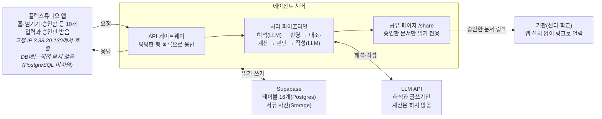

# 아이 한 장 — MVP 스펙

2026-10-24 · 임준현

해커톤 MVP는 지우네 세 장면을 실제 에이전트로 돌려, 문자와 사진을 넘기면 승인 몇 번으로 한 달 관리가 끝나는 것을 보여 줍니다.

테이블 설계는 [데이터](#데이터) 절, 처리 순서·트리거·API는 [에이전트](#에이전트) 절에 있습니다.

## 목표와 범위

MVP가 증명할 것은 하나입니다. 부모가 문자 15개와 사진 1장을 넘기면, 승인 네 번으로 한 달 치 관리가 끝난다는 것입니다.

| 구분 | 내용 |
| --- | --- |
| 실제로 구현 | 문자 붙여넣기와 사진 업로드, LLM 분류와 문서 작성, 코드로 하는 장부 반영·대조·잔액·마감 계산, 승인함, 생성 문서 미리보기 |
| 목업으로 보여 줌 | 기관에 보내는 문자 발송, 기관이 여는 공유 페이지, 문자 자동 수집과 카드 내역 연동 |
| 이번에 하지 않음 | 로그인과 여러 가정, 센터 앱·마이데이터 실제 연동, 음성 입력, 실제 아동 데이터 |

데이터는 모두 가상이고, 시연은 시연 제어 화면에서 장면을 넘기며 진행합니다. 장면마다 '손으로 하던 일 → 승인' 카운터를 띄웁니다.

## 장면별 요구사항

세 장면은 모두 '넘기기 → 에이전트 처리 → 승인' 순서로 돌고, 장면마다 승인 지점이 정해져 있습니다. 시작 전에 지우네 기본 데이터를 미리 넣어 둡니다.

**미리 넣어 둘 데이터:** 지우(6세, 가명) 프로필, 기관 4곳(언어치료·감각통합·놀이치료 센터, 유치원 특수학급), 주간 치료 일정, 이번 달 바우처 한도와 결제 내역, 지난 학기와 지난 2년 치 치료 피드백, 서류함의 진단서.

| 장면 | 넘기는 것 | 에이전트 처리 | 화면 결과 | 승인 |
| --- | --- | --- | --- | --- |
| 1. 월말 밤 | 센터 문자 14개 | 문자를 일정·결석·결제·보강·공지로 분류해 시간표와 장부에 반영. 결제와 출석을 대조해 결석일 결제 1건을 찾고, 바우처 잔액 3만 원 소멸 예정을 계산 | 홈에 확인 카드 2건, 시간표·장부 갱신, 카운터 6단계 → 승인 2번 | 정정 요청 문자, 보강 요청 문자 |
| 2. 새 학기 | IEP 협의 안내문 사진 1장 | 날짜·장소를 뽑아 일정에 넣고, 지난 학기 세 기관 기록과 가정 관찰을 엮어 'IEP 준비 한 장' 초안 작성 | 문서 미리보기, 한 줄 수정 칸, 카운터 4단계 → 승인 1번 | 특수교사에게 공유 |
| 3. 선생님 변경 | 감각통합 선생님 퇴사 공지 문자 1개 | 해당 기관 2년 치 기록으로 새 선생님용 인계서 작성. 서류함을 살펴 진단서 유효기간 만료를 함께 알림 | 인계서 미리보기, 마감 카드, 카운터 4단계 → 승인 1번 | 새 선생님에게 공유 |

마무리 화면은 지우의 '한 장' 전체, '처음 해낸 날' 모음, 한 달 합계 '손 작업 14단계 → 승인 4번'입니다. 카드마다 근거가 된 원문 문자나 사진을 함께 보여 줍니다.

## 시스템 구성

플렉스튜디오는 화면과 입력만 맡고, 해석·계산·문서 작성은 에이전트 서버가, 상태 저장은 Supabase가 맡습니다.

**플렉스튜디오는 화면만, 판단과 저장은 에이전트 서버가 맡습니다**



플렉스튜디오는 Supabase에 직접 붙지 않고 서버 API만 부릅니다. 기관에는 부모가 승인한 문서만 공유 링크로 나갑니다.

## 화면 명세

화면은 10개이고, 부모가 매일 여는 화면은 홈·넘기기·승인함 세 개입니다. 목록은 컨트롤이 아니라 컬렉션 반복 영역(행 하나 = 섹터 하나)으로 만듭니다.

| 화면 | 목적 | 주요 요소 | 컨트롤 |
| --- | --- | --- | --- |
| 1. 홈 | 오늘 확인할 것 | 확인 카드(근거 원문 펼치기), 손 작업 카운터, 이번 주 일정 요약 | Text, Button, 컬렉션 반복 |
| 2. 넘기기 | 문자·사진 넘기기 | 여러 문자를 한 번에 붙여넣는 칸, 사진 올리기, 부모 한마디 칸, 넘기기 버튼 | InputText, FileUpload, Button |
| 3. 승인함 | 바깥으로 나갈 것 확인 | 대기 목록, 원문과 초안 나란히, 승인·고쳐서 승인·보류 | InputText, Button, 컬렉션 반복 |
| 4. 시간표 | 기관별 주간 치료 일정 | 결석·보강 표시, 기관별 색 | TimeTable |
| 5. 바우처 장부 | 이번 달 돈 | 한도·사용·잔액·소멸 예정, 결제 내역과 출석 대조 표시 | Text, 컬렉션 반복 |
| 6. 서류함·마감 | 서류와 기한 | 서류 목록과 유효기간, 마감 달력, 서류 사진 | CalendarSchedule, Image |
| 7. 아이 이력서 | 기관별 목표와 진척 | 기관 탭, 기간별 기록, 처음 해낸 날 | Tab, 컬렉션 반복 |
| 8. 문서 미리보기 | 생성 문서 확인·공유 | 문서 본문, 한 줄 수정 칸, 공유 버튼 | Embed(서버가 만든 HTML), InputText, Button |
| 9. 기관용 공유 페이지 | 기관이 받는 화면 | 읽기 전용 문서, 앱 설치 없음 | 에이전트 서버의 웹 페이지(목업) |
| 10. 시연 제어 | 발표 중 장면 진행 | 장면 1~3 입력 넣기, 초기화 | Button |

말투는 제안서의 경험 원칙을 따릅니다. '불일치' 대신 "확인이 필요한 결제가 1건 있어요"처럼 쓰고, 카드마다 근거 원문을 붙입니다.

## 플렉스튜디오 제약과 대응

플렉스튜디오는 화면과 입력만 맡고, 판단과 저장은 모두 에이전트 서버로 보냅니다. 아래 제약은 [플렉스튜디오 문서](https://docs.flextudio.com/flextudio)에서 확인한 것입니다.

| 제약 | 설계 결정 |
| --- | --- |
| 외부 DB 연결은 MySQL·MSSQL·Oracle만 되고 PostgreSQL은 안 됨 | 플렉스튜디오는 에이전트 서버 API만 부르고, Supabase 읽기·쓰기는 서버가 맡음 |
| API 연동은 ParamBlocks로 보내고 Result를 2차원 배열로 받음 | 서버 응답을 화면별 평평한 행 목록으로 설계하고 중첩 JSON은 쓰지 않음 |
| 자동 새로고침과 타이머가 없음 | 넘기기·승인 응답에 갱신된 홈 데이터를 함께 돌려줌 |
| API 응답 시간 제한이 문서에 없음 | LLM 처리가 길면 run id를 먼저 돌려주고 '결과 보기' 버튼으로 조회. 시연 전에 응답 시간을 재봄 |
| 호출은 고정 IP(3.38.20.130)에서 옴 | 서버 방화벽에 이 IP를 허용하고, 키는 Secret Key로 보관 |
| [FileUpload](https://docs.flextudio.com/flextudio/scenario/component/control/fileupload.md)는 플렉스튜디오 파일 시스템에 저장하고 FileKey를 줌. 외부 API로 넘기는 방법은 문서에 없음 | 파일을 서버로 넘길 수 있는지 먼저 시험. 안 되면 서버에 미리 올린 서류 이미지를 고르는 방식으로 대체 |
| 마이크 API가 없고, Embed에는 script를 넣을 수 없음 | 부모 한마디는 글자 입력, 문서 미리보기는 script 없는 HTML |
| Approval 컨트롤은 결재선 UI | 승인함은 컬렉션 반복과 버튼으로 직접 구성 |
| '라이브에 적용'은 바로 반영됨 | 시연용 앱을 따로 두고, 발표 당일에는 변경하지 않음 |
| 에뮬레이터에 iOS·Android 환경이 없음 | 실제 휴대폰으로 리허설 |

## 일정과 역할 분담

작업은 네 단계로 나누고, 5명이 세 갈래(서버, 화면, 시나리오·발표)로 시작해 단계마다 필요한 곳으로 옮깁니다. 마감일이 정해지면 단계별 날짜를 붙입니다.

| 갈래 | 시작 인원 | 맡는 일 |
| --- | --- | --- |
| 에이전트 서버 | 2명 | API, 계산 모듈(대조·잔액·마감), LLM 분류·문서 작성, Supabase |
| 플렉스튜디오 화면 | 2명 | 화면 10개, API 연동(ParamBlocks·Result), 시연 제어 |
| 시나리오·발표 | 1명 | 가상 데이터와 장면 입력, 문서 예시, 발표 자료, 리허설 진행 |

1. **뼈대 확정:** 장면 입력(문자 15개, 안내문 사진)과 가상 데이터, 테이블과 API 형식을 정합니다. FileUpload로 서버에 파일을 넘길 수 있는지도 이 단계에서 시험합니다.
2. **병렬 구현:** 서버는 계산 모듈과 API를, 화면은 홈·넘기기·승인함부터 만듭니다. 처음에는 고정 응답으로 화면을 연결합니다.
3. **에이전트 연결:** LLM 분류와 문서 작성을 붙이고, 장면 1~3을 처음부터 끝까지 돌립니다.
4. **리허설:** 실제 휴대폰으로 장면을 반복하고, 응답 시간과 문구를 다듬고, 발표 자료를 맞춥니다.

## 확인할 것

구현을 막을 수 있는 것은 앞의 두 개이고, 나머지는 시연 문구와 발표 근거의 정확도에 관한 것입니다.

- [ ] FileUpload로 올린 파일을 에이전트 서버가 받을 수 있는지(FileKey로 내려받기 등)
- [ ] 플렉스튜디오 API 호출이 응답을 얼마나 기다리는지 실측
- [ ] 미사용 바우처 소멸 여부와 바우처 결제 문자의 실제 형식(장면 1 문자 문구에 반영)
- [ ] 제도별 진단서 유효기간 규칙(장면 3 마감 알림의 기준)
- [ ] 한 가정이 실제로 다니는 기관 수(부모 커뮤니티 글로 확인, 발표 근거)

---

# 데이터

Supabase 테이블은 16개이고, 데이터는 원문 → 해석 → 장부 → 결과 순서로 흐릅니다. 금액과 날짜 계산은 이 테이블을 읽는 서버 코드가 합니다.

## 테이블

| 테이블 | 단계 | 담는 것 | 주요 컬럼 |
| --- | --- | --- | --- |
| child | 기본 | 아이 프로필 | id, name(가명), birth_date, school_class |
| caregiver | 기본 | 보호자 | id, child_id, name, role(주양육자·배우자·조부모) |
| organization | 기본 | 기관 | id, child_id, name, kind(발달센터·병원·유치원·교육청·주민센터), contact |
| service | 기본 | 정기 치료 | id, organization_id, therapy(언어·감각통합·놀이), therapist, weekday, start_time, minutes, unit_price, funding(바우처·교육청·자부담) |
| inbox_item | 원문 | 부모가 넘긴 것 | id, child_id, kind(text·photo·note), raw_text, file_ref, received_at, processed |
| event | 해석 | 원문을 해석한 사건 | id, inbox_item_id, type, organization_id, service_id, occurs_on, amount, quote, confidence |
| session | 장부 | 회기 하나하나 | id, service_id, date, status(예정·출석·결석·취소·보강), source_event_id |
| voucher_month | 장부 | 월별 바우처 | id, child_id, program, month, limit_amount, self_pay |
| payment | 장부 | 결제 | id, organization_id, session_id, paid_at, amount, source_event_id, match(일치·확인 필요·미확인) |
| document | 장부 | 서류함 | id, child_id, doc_type(진단서·결정통지서·안내문·검사지), issued_on, valid_until, file_ref, fields(json) |
| deadline | 장부 | 마감 | id, child_id, title, due_on, document_id, status |
| goal | 장부 | 기관별 목표 | id, organization_id, area, description, started_on, status |
| note | 장부 | 치료 피드백과 부모 관찰 | id, child_id, organization_id, noted_on, author(치료사·부모), text, goal_id, is_first |
| approval | 결과 | 승인함 | id, child_id, kind(정정 요청·보강 요청·문서 공유), title, draft_text, refs(json), status(대기·승인·고쳐서 승인·보류·보냄), decided_at |
| output_doc | 결과 | 생성 문서 | id, child_id, kind(IEP 준비·인계서·진료 요약·재신청 근거), body_html, refs(json), share_token |
| agent_run | 결과 | 에이전트 실행 기록 | id, trigger, input_ids, steps(json), manual_steps, approvals, status, started_at, finished_at |

event.type은 일정 변경, 결석, 결제, 보강, 공지, 치료 피드백, 서류, 담당자 변경 여덟 가지입니다. refs는 근거가 된 inbox_item·note·session id 목록이고, 화면에서 근거 원문을 펼칠 때 씁니다.

## 가상 데이터

기관 이름은 실제 기관과 겹치지 않게 A·B·C로 부릅니다. 금액은 모두 시연용 가상 값입니다.

- **아이와 보호자:** 지우(6세), 엄마(주양육자), 아빠
- **기관:** A 언어센터(주 1회), B 감각통합센터(주 1회), C 놀이치료실(주 1회), 유치원 특수학급
- **바우처:** 이번 달 한도와 결제를 장면 1에서 '잔액 3만 원 소멸 예정'이 나오도록 맞춤
- **지난 기록:** B 센터 2년 치 월별 피드백, 지난 학기 세 기관 피드백, 부모 한마디(그중 '처음 해낸 날' 3건)
- **서류:** 장면 3 시점에 유효기간이 지나는 진단서 1장
- **장면 1 문자 14개:** 일정 변경 3, 결석 처리 1, 결제 알림 6(그중 1건은 결석한 날), 보강 안내 2, 공지 2
- **장면 2·3 입력:** IEP 협의 안내문 사진 1장, B 센터 담당 선생님 퇴사 공지 문자 1개

---

# 에이전트

에이전트는 정해진 처리 순서 위에서 돌고, LLM은 해석과 글쓰기에만 씁니다. 계산과 규칙 판단은 코드가 하고, 바깥으로 나가는 것은 모두 승인함을 거칩니다.

## 처리 순서

1. **받기:** POST /inbox가 원문을 inbox_item에 저장합니다.
2. **해석(LLM):** 문자는 event로, 사진은 document 필드로 바꿉니다. 결과마다 근거 문장(quote)을 남깁니다.
3. **반영(코드):** session, payment, document, note를 갱신합니다.
4. **대조·계산(코드):** 결제와 출석을 대조하고, 바우처 잔액과 소멸 예정액, 서류 유효기간을 계산합니다.
5. **판단(코드):** 아래 트리거 표에 맞으면 카드나 승인 항목을 만듭니다.
6. **작성(LLM과 툴):** 필요한 기록을 툴로 골라 읽고, 요청 문자 초안과 문서를 씁니다.
7. **기록:** agent_run에 단계, 근거, 카운터(손 작업 단계 수와 승인 수)를 남깁니다.

## 트리거

| 트리거 | 조건(코드) | 만드는 것 | 승인 |
| --- | --- | --- | --- |
| T1 결석일 결제 | 같은 회기에 결석 event와 결제가 함께 있음 | 정정 요청 문자 초안 | 필요 |
| T2 바우처 소멸 예정 | 월말까지 남은 예정 회기를 다 써도 잔액이 남음 | 보강 요청 문자 초안 | 필요 |
| T3 일정 변경 | 일정 변경·보강 event | 시간표 갱신 카드 | 없음 |
| T4 IEP 협의 안내 | 안내문 사진에서 IEP 협의 일정이 추출됨 | 일정 등록, IEP 준비 한 장 | 공유할 때 |
| T5 담당자 변경 | 담당자 변경 event | 새 선생님용 인계서 | 공유할 때 |
| T6 서류 만료 | 서류 유효기간이 30일 안에 끝나거나 지남 | 마감 카드 | 없음 |
| T7 처음 해낸 날 | 부모 한마디에 '처음' 표현이 있음 | note에 처음 표시 | 없음 |

## API

플렉스튜디오가 부르는 API이고, 응답은 모두 평평한 행 목록(Result 2차원 배열)입니다.

| 메서드·경로 | 하는 일 | 돌려주는 것 |
| --- | --- | --- |
| POST /inbox | 문자·사진·한마디 넘기기 | run_id, 갱신된 홈 카드 행 |
| GET /home | 홈 카드와 카운터 | 카드 행 |
| GET /schedule?week= | 주간 회기 | 회기 행 |
| GET /voucher?month= | 바우처 장부 | 요약 1행, 결제 행 |
| GET /documents | 서류함과 마감 | 서류 행, 마감 행 |
| GET /approvals | 승인 대기 목록 | 승인 행 |
| POST /approvals/{id} | 승인·고쳐서 승인·보류 | 갱신된 홈 카드 행 |
| GET /outputs/{id} | 생성 문서 | script 없는 HTML(Embed용) |
| GET /share/{token} | 기관용 읽기 전용 페이지 | HTML |
| GET /runs/{id} | 오래 걸린 실행의 결과 | 상태와 단계 |
| POST /demo/scene/{n}, POST /demo/reset | 시연 장면 넣기와 초기화 | 갱신된 홈 카드 행 |

## 해석 결과 형식

문자 하나를 해석한 결과의 예시입니다. 문구와 금액은 가상입니다.

```json
{"type": "결제", "organization": "A 언어센터", "date": "2026-10-20", "amount": 40000, "quote": "A언어센터 40,000원 결제 승인", "confidence": 0.93}
```

## 작성 단계의 툴

- get_notes(organization, from, to): 기간별 치료 피드백과 부모 관찰
- get_goals(organization): 기관별 목표
- get_sessions(month): 회기와 출석
- get_document(id): 서류 필드
- save_draft(kind, text, refs): 초안 저장. 보내는 툴은 없고, 발송은 승인 뒤에 서버가 합니다.

## 지켜야 할 규칙

- 진단, 치료 방향, 기관과 치료사에 대한 평가는 쓰지 않습니다.
- 모든 문장에 근거(refs)를 답니다. 근거가 없는 내용은 쓰지 않습니다.
- 숫자는 계산 모듈의 값만 씁니다. LLM은 계산하지 않습니다.
- 가족의 언어로 씁니다. '불일치' 대신 '확인이 필요한'처럼 씁니다.
- 기관에 보내는 문자는 존댓말 세 문장 이내로, 날짜·회기·금액을 정확히 적습니다.
