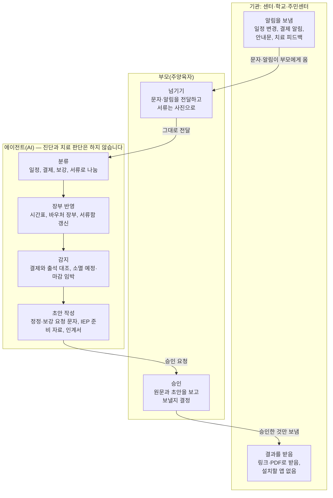

# 아이 한 장 — 장애아동 IRP 제안서

2026-10-24 · 임준현

## 개요

아이 한 장은 장애·발달지연 아동 부모가 여러 기관에 흩어진 일정, 바우처, 서류, 치료 기록을 손으로 엮는 일을 AI가 대신하는 개인 자원 계획(IRP) 서비스입니다. 플렉스튜디오 해커톤 자유공모 트랙 출품작입니다.

> 학교에는 개별화교육계획(IEP)이, 정부에는 개인별 지원계획이 있습니다. 그런데 그걸 전부 엮는 부모 손에는 아무것도 없습니다.

- **한 줄 피치:** 흩어진 기관의 문자와 서류를 넘기기만 하면, AI가 아이 한 명의 자원 계획표를 대신 씁니다.
- **핵심 논지:** 개인이 ERP를 못 쓴 이유는 입력할 담당자가 없어서입니다. AI가 그 담당자가 되면 아이 한 명 단위의 ERP가 가능해집니다.
- **이름:** ERP를 IRP(Individual Resource Planning)로 비틀었고, 학교의 IEP, 정부의 개인별 지원계획과 나란히 섭니다.

## 문제

장애·발달지연 아동 부모는 기관마다 흩어진 일정, 바우처, 서류, 치료 기록을 혼자 엮고 있습니다. 대상 아동은 빠르게 늘고, 제도는 담당 기관마다 따로 돌아갑니다.

발달지연 아동은 2019년 6만 8,748명에서 2024년 14만 4,169명으로 5년 새 두 배가 넘었습니다. 대구의 한 대학병원은 자폐 초진 대기가 약 4년입니다. 대구 실태조사(2023)에서 행정기관을 통해 복지 정보를 얻은 비율은 8.9%였습니다([매일신문](https://www.imaeil.com/page/view/2025111315133422886)).

### 제도는 담당 기관마다 따로 돌아갑니다

| 제도 | 담당 | 부모가 챙길 것 |
| --- | --- | --- |
| 발달재활서비스 바우처 | 시·군·구, 지정 제공기관 | 소득별 월 18만~26만 원, 본인부담 0~8만 원, 남은 금액 소멸 |
| 특수교육대상자 선정·지원 | 교육청, 특수교육지원센터 | 선정 절차, 학기마다 IEP 협의 |
| 장애아가족 양육지원 | 주민센터 신청 | 연 1,200시간, 월 160시간 이내 돌봄 시간 |
| 장애아동수당 | 정부24 안내 | 기초·차상위 가정 대상, 매달 지급 |
| 장애 등록 | 주민센터, 국민연금공단 심사 | 진단·심사 서류 |

금액과 시간은 정부24 기준(2026년 8월)이고 매년 바뀔 수 있습니다([육아크루](https://www.yugacrew.com/crewletter/disabled-child-support-guide)). 미사용 바우처가 소멸한다는 점은 블로그 기준이라 공식 확인이 필요합니다([크로노젠](https://blog.cronozen.com/post/1268)).

### 부모가 지금 손으로 하는 일

1. 언어치료, 감각통합, 놀이치료, 병원, 유치원 일정을 달력에 옮기고 결석과 보강을 맞춥니다.
2. 이번 달 바우처가 얼마 남았는지, 본인부담금이 얼마인지 계산합니다.
3. 결제 내역을 기억과 대조합니다. 결석했는데 결제되거나 본인부담금이 두 번 청구되는 분쟁은 보호자 쪽 기록이 없어서 생깁니다([크로노젠](https://blog.cronozen.com/post/1268)).
4. 제도마다 다른 신청 기한과 서류 유효기간을 챙깁니다.
5. 기관을 옮기거나 학기마다 IEP를 할 때, 지금까지의 치료 이력을 처음부터 다시 정리합니다. 보호자 기록은 기관 이동과 바우처 재신청의 근거가 됩니다([크로노젠](https://blog.cronozen.com/post/1271)).

## 해결: 아이 한 장

부모는 받은 문자와 서류를 넘기기만 하고, AI가 분류부터 문서 작성까지 맡고, 부모는 승인만 합니다. 회사의 ERP에는 입력 담당자가 있지만 가정에는 없었고, 그 빈자리를 AI가 채웁니다.

| 구분 | 하는 일 |
| --- | --- |
| AI가 알아서 | 문자·사진 분류, 일정·장부 반영, 결제와 출석 대조, 마감·유효기간 감지, 문서 초안 작성 |
| 부모 승인 후 | 기관에 보내는 모든 메시지, 문서 공유, 보강·정정 요청 |
| 하지 않음 | 진단, 치료 방향 판단, 기관 평가 |

입력은 세 가지뿐이고 입력 폼은 없습니다.

- 센터 알림 문자와 결제 알림을 그대로 전달
- 결정통지서, 진단서, 안내문, 검사지 사진
- 원할 때만 부모의 한마디("오늘 처음으로 '물'이라고 했어요")

## 사용자와 역할

앱을 쓰는 사람은 주양육자 한 명이고, 기관은 앱을 깔지 않고 결과물만 받습니다. 쓰는 사람이 늘수록 실패한다는 것이 육아 IRP에서 얻은 교훈입니다.

| 누구 | 역할 | 쓰는 방식 |
| --- | --- | --- |
| 주양육자 | 문자·서류 전달, 승인 | 앱 |
| 다른 보호자(배우자, 조부모) | 시간표와 기록 열람 | 공유 링크(선택) |
| 치료사, 특수교사 | 인계서·IEP 준비 자료 받기 | 링크·PDF, 설치 없음 |
| 지자체·지원센터 담당자 | 정리된 자료 받기 | 부모가 승인할 때만 공유 |

대상은 미취학부터 초등 저학년까지의 발달장애·발달지연 아동 가정입니다. 9세 미만은 장애 등록 없이 의뢰서와 검사 자료로 발달재활 바우처를 신청할 수 있어, 등록 전 단계 가정도 포함합니다([육아크루](https://www.yugacrew.com/crewletter/disabled-child-support-guide)).

## 핵심 기능

기능은 세 가지이고, 셋 다 부모가 넘긴 문자와 사진에서 출발합니다. 시연의 하이라이트는 흩어진 기록을 한 장으로 엮는 아이 이력서입니다.

| 기능 | 넣는 것 | AI가 하는 일 | 부모가 하는 일 |
| --- | --- | --- | --- |
| 통합 장부 | 센터 문자, 결제 알림 | 일정·결제·보강을 분류해 시간표와 바우처 장부에 반영하고, 결제와 출석을 대조해 이상한 건만 올림 | 정정 요청·보강 요청 승인 |
| 마감 레이더 | 결정통지서, 진단서, 안내문 사진 | 제도별 기한과 서류 유효기간을 뽑아 미리 알리고, 필요한 서류 체크리스트를 만듦 | 확인 |
| 아이 이력서 | 쌓인 치료 피드백, 검사지 사진, 부모 한마디 | 기관별 목표와 진척을 시간순으로 엮어 IEP 협의 준비 자료, 새 기관 인계서, 진료 전 요약, 바우처 재신청 근거를 한 장으로 만듦 | 확인 후 공유 |

**에이전트 흐름: 부모가 하는 일은 넘기기와 승인, 두 가지뿐입니다**

기관이 보낸 문자는 부모가 넘기기만 하면 에이전트가 분류, 반영, 감지, 초안까지 처리합니다. 부모가 승인한 것만 다시 기관으로 나갑니다.

## IRP 설계: ERP를 아이 한 명 단위로

IRP는 ERP의 통합 원장, 예산, 대사, 결재를 아이 한 명 단위로 옮긴 것입니다. ERP 회사 심사위원에게 가장 익숙한 언어로 서비스를 설명하는 장치이기도 합니다.

| ERP 개념 | 아이 한 장에서 |
| --- | --- |
| 통합 원장 | 기관마다 흩어진 기록을 하나로 모음 |
| 예산·집행 관리 | 바우처는 예산, 본인부담금은 비용, 소멸은 불용액 |
| 대사·감사 | 결제 내역과 출석을 대조 |
| 생산계획 | 주간 치료 시간표와 보강 배치 |
| 문서·계약 관리 | 결정통지서와 서류 유효기간 |
| 이력 추적 | 치료 이력, 목표 대비 진척 |
| 결재 | 바깥으로 나가는 모든 것은 부모 승인 |

관리하는 리소스는 셋이고, 셋 다 한도가 있어서 계획이 필요합니다.

| 리소스 | 한도 | 아이 한 장이 하는 일 |
| --- | --- | --- |
| 돈 | 발달재활 바우처 월 18만~26만 원, 남은 금액 소멸 | 소멸 전에 보강을 제안 |
| 시간 | 장애아가족 양육지원 연 1,200시간, 월 160시간 이내 | 남은 시간을 알리고 신청 초안을 준비 |
| 자리 | 치료 시간표, 기관 대기 | 보강과 기관 이동 일정을 배치 |

## 경험 설계 원칙

엔진은 ERP처럼 일하고, 화면은 가족의 언어로 말합니다. 지친 부모에게 또 하나의 관리 도구가 되지 않는 것이 첫 번째 기준입니다.

- **입력 폼이 없습니다.** 전달과 사진이 전부입니다. 화면에 '손으로 하던 일 n단계 → 승인 n번' 카운터를 띄워 줄어든 일을 보여 줍니다.
- **승인만 합니다.** 기관에 나가는 메시지와 문서는 모두 부모가 확인한 뒤에 나갑니다. 승인 전에는 AI가 읽은 원문을 옆에 함께 보여 줍니다.
- **기관은 아무것도 설치하지 않습니다.** 치료사와 교사는 링크나 PDF로 받습니다.
- **판단하지 않습니다.** 진단과 치료 방향은 치료사가, 결정은 부모가 합니다. AI는 기록, 정리, 마감, 대조만 합니다.
- **가족의 언어로 말합니다.** '불일치 1건' 대신 "확인이 필요한 결제가 1건 있어요"라고 말합니다. 진척은 성적표가 아니라 성장 기록으로 보여 줍니다.
- **작은 처음을 남깁니다.** 부모의 한마디 중 '처음 해낸 날'을 따로 모아 아이 이력서에 담습니다.
- **쉼도 리소스입니다.** 양육지원 시간이 남았으면 "이번 주 토요일 오후, 돌봄 지원을 신청해 둘까요?"라고 먼저 묻습니다.

## 비즈니스 모델과 확산

가정은 무료로 쓰고, 부모의 관리 부담이 줄어 이득을 보는 지자체와 기업이 비용을 냅니다. 아래 순위는 아직 검증 전인 가설입니다.

| 순위 | 고객 | 그들이 얻는 것 | 과금(가설) |
| --- | --- | --- | --- |
| 1 | 지자체·발달장애인지원센터 | 개인별 지원계획 공백을 부모 자가 관리로 메우고, 담당자는 정리된 자료를 받음 | 가구당 라이선스 |
| 2 | 기업 복지 | 장애 자녀를 둔 직원의 행정 부담과 이탈 위험 감소 | 복지몰 입점, 기업 계약 |
| 3 | 발달센터 | 보호자 문의와 정산 분쟁 감소 | 연동 수수료 |

1순위의 근거는 개인별 지원계획의 낮은 수립률입니다. 대구는 발달장애인 1만 3,571명 중 835건, 약 6.2%만 계획을 세웠습니다([매일신문](https://www.imaeil.com/page/view/2025111315133422886)). 2순위는 이미 있는 유통 채널을 씁니다. 현대이지웰이 운영한 복지포인트는 2024년 약 1.6조 원이었습니다([현대이지웰 IR](https://file.alphasquare.co.kr/media/pdfs/company-ir/20250228현대이지웰_주요_경영현황_설명.pdf)).

가정에 구독료를 받지 않는 이유는 치료비 부담이 이미 크기 때문입니다. 시장은 등록 전 단계인 발달지연 아동(2024년 14만 4,169명)까지 넓힐 수 있습니다.

### 확산 채널

- **처음 걱정하는 순간:** 영유아 건강검진에서 심화평가 권고를 받은 가정과 첫 발달센터 상담 때, "지금까지 기록 한 장 정리"를 무료로 제공
- **지원 기관:** 발달장애인지원센터와 장애인복지관의 부모 교육 프로그램
- **센터 제휴:** 대기실 안내와 첫 등록 안내문
- **부모 커뮤니티:** 실제로 쓰는 부모가 공유한 '한 장'이 다음 가정을 데려옴

## 리스크와 대응

가장 큰 리스크는 '센터 앱으로 충분하다'는 반론과 '부모가 또 입력해야 한다'는 의심입니다. 둘 다 시연에서 직접 보여 주는 방식으로 답합니다.

| 예상 질문·리스크 | 대응 |
| --- | --- |
| 센터 앱이 이미 있지 않나요? | [케어플센터](https://www.careplecenter.com/)와 [크로노젠](https://blog.cronozen.com/post/1271)은 센터 한 곳의 창입니다. 여러 기관과 학교, 주민센터를 엮는 건 부모 쪽 통합이고, 센터 앱 알림도 재료로 씁니다. |
| 부모가 또 입력해야 하지 않나요? | 전달과 사진뿐이고 입력 폼이 없습니다. 시연 카운터로 줄어든 일을 보여 줍니다. |
| 장애·건강 정보는 민감정보입니다 | 시연은 가상 데이터로 합니다. 실서비스는 가족 단위로 저장하고, 공유는 건별 승인, 원문 대신 요약본만 내보냅니다. |
| AI가 문자를 잘못 읽으면요? | 승인 전에 원문을 옆에 보여 줍니다. 기관에 나가는 것은 모두 부모 확인 뒤입니다. |
| 돈은 누가 내나요? | 가정은 무료이고, 지자체와 기업 복지가 냅니다(비즈니스 모델 절). |
| 당사자 검증은 했나요? | 부모 커뮤니티 글 분석과 치료사·특수교사 인터뷰로 발표 전에 확보합니다. |

### 확인할 가정

- [ ] 한 가정이 실제로 다니는 기관 수. 한 곳뿐이면 센터 앱으로 충분해 가치가 줄어듭니다.
- [ ] 미사용 바우처 소멸 여부를 사회서비스 전자바우처 공식 안내로 확인
- [ ] 바우처 결제와 센터 일정이 문자로 오는지, 어떤 형태로 오는지
- [ ] 발달재활 바우처와 교육청 치료지원을 함께 쓸 수 있는지

## 시연 시나리오와 발표

시연은 지우네의 한 달을 세 장면으로 보여 주고, 장면마다 '손 작업 → 승인' 카운터로 줄어든 일을 숫자로 보여 줍니다. 주인공 지우(6세, 가명)는 언어치료, 감각통합, 놀이치료를 세 기관에서 받고 유치원 특수학급에 다닙니다.

### 세 장면

1. **월말 밤, 쌓인 문자 14개.** 엄마가 한 번에 전달하면 시간표와 장부가 갱신되고 알림 두 건만 올라옵니다.
    - "화요일 언어치료는 결석했는데 결제됐어요." 정정 요청 문자 초안이 함께 뜹니다.
    - "이번 달 바우처 3만 원이 사라질 예정이에요. 감각통합 보강 1회를 넣을까요?"
    - 카운터: 손으로 하던 일 6단계 → 승인 2번
2. **새 학기 IEP 협의 안내문 사진.** 날짜가 일정에 들어가고, 지난 학기 세 기관 기록과 집에서의 관찰을 엮은 'IEP 준비 한 장'이 나옵니다. 엄마가 한 줄 고쳐 특수교사에게 보냅니다.
3. **"감각통합 선생님이 이번 달까지만 계세요."** 2년 치 기록이 새 선생님용 인계서 한 장으로 정리됩니다. 마감 레이더가 진단서 재발급도 함께 알립니다.

마지막은 지우의 '한 장' 전체 화면과 '처음 해낸 날' 모음으로 끝냅니다.

### 발표 흐름

1. 훅: "학교엔 IEP, 정부엔 개인별 지원계획이 있지만 부모 손엔 아무것도 없다"
2. 문제: 발달지연 아동 5년 새 2배, 담당 기관마다 따로 도는 제도 표
3. 시연: 지우네 세 장면
4. IRP 설계: ERP 매핑표와 돈·시간·자리
5. 비즈니스 모델: 가정 무료, 지자체·기업 복지
6. 마무리: 흩어진 기관의 기록을, 아이 한 장으로

### 구현 방식

화면은 플렉스튜디오로 만들고, 판단과 문서 생성은 에이전트 서버가, 상태 저장은 Supabase가 맡습니다. 플렉스튜디오의 외부 DB 연결은 PostgreSQL을 지원하지 않아, 플렉스튜디오는 에이전트 서버 API만 호출하고 서버가 Supabase를 읽고 씁니다. 입력은 문자 붙여넣기와 사진 업로드로 시연하고, 데이터는 모두 가상입니다.

## 선택 근거

육아 IRP는 없던 관리를 새로 만들었지만, 아이 한 장은 부모가 이미 하고 있는 일을 덜어 줍니다. 부모 쪽에서 여러 기관을 묶는 국내 서비스는 찾지 못했습니다.

| 기준 | 육아 IRP | 아이 한 장 |
| --- | --- | --- |
| 없애는 손 작업 | 거의 없음, 새 관리 거리를 만듦 | 일정 맞추기, 바우처 계산, 결제 대조, 마감 챙기기, 이력 정리 |
| 자원의 한도 | 느슨함 | 바우처, 돌봄 시간, 치료 자리 모두 한도가 있음 |
| 진짜 경쟁자 | 전화 한 통과 카톡 | 센터 한 곳 단위 앱 |
| 사회적 가치 | 보통 | 발달지연 아동 5년 새 2배 |

### 국내 유사 서비스

| 서비스 | 대상 | 하는 일 | 비어 있는 곳 |
| --- | --- | --- | --- |
| [케어플센터](https://www.careplecenter.com/) | 발달센터 | 일정, 바우처 수납, 치료 일지, 보호자 알림 앱 | 센터 한 곳 단위 |
| [센터다이어리](https://www.centerdiary.com/) | 센터 운영자, 치료사 | 일정, 바우처별 매출과 급여, 자동 문자 | 부모 기능 없음 |
| [크로노젠](https://blog.cronozen.com/post/1271) | 재활 기관, 보호자 | 회기 기록을 보호자 앱으로 전달(2026) | 기관 단위, 일정·바우처 관리 없음 |
| [아이보리(IVORY)](https://kormedi.com/1549893/) | 보호자(병원 연구팀) | 검사 결과지 OCR 정리(2022) | 일정·바우처·제도 관리 없음 |
| [사이이음](https://apps.apple.com/kr/app/%EC%82%AC%EC%9D%B4%EC%9D%B4%EC%9D%8C-%EB%82%B4-%EC%95%84%EC%9D%B4-%EB%B0%9C%EB%8B%AC%EA%B3%BC-%EA%B4%80%EB%A0%A8%ED%95%9C-%EB%AA%A8%EB%93%A0-%EA%B6%81%EA%B8%88%EC%A6%9D-%ED%95%B4%EA%B2%B0/id6471832303) | 부모 | 센터 찾기, 커뮤니티 | 기록·관리 없음 |

### 해커톤 수상 패턴과 맞닿는 점

- 영림원·한국컴퓨터정보학회 해커톤의 심사위원은 학회 교수진과 산업계였고, 기준은 독창성, 사회적 영향력, 사업성, 실현 가능성, 발표력이었습니다([벤처스퀘어](https://www.venturesquare.net/993542)).
- 2026 K-해커톤 대상은 식자재 재고 앱, 우수상은 ERP 개념을 현장 작업에 적용한 앱이었습니다. ERP를 작은 단위에 옮긴 작품이 상을 받았습니다([디지털타임스](https://www.dt.co.kr/article/12072035)).
- 국내 수상작은 AI가 이미 있는 문서를 읽어 취약한 사용자의 일을 덜어 주는 구조가 많았습니다. 시니어용 문서 요약 디누리([대학저널](https://www.dhnews.co.kr/news/view/1065574149568220))와 전세사기 위험 탐지 ASGI([뉴스서울](https://newsseoul.co.kr/news/view/1065601804287587))가 대상을 받았습니다.

### 출처

- [육아크루: 장애아동 지원 제도 정리(2026.10)](https://www.yugacrew.com/crewletter/disabled-child-support-guide)
- [크로노젠: 2026 발달재활바우처 가이드](https://blog.cronozen.com/post/1268)
- [크로노젠: 보호자 재활일지 가이드(2026.4)](https://blog.cronozen.com/post/1271)
- [매일신문: 발달장애 진단·치료 대기(2025.11)](https://www.imaeil.com/page/view/2025111315133422886)
- [현대이지웰 주요 경영현황 IR(2025.2)](https://file.alphasquare.co.kr/media/pdfs/company-ir/20250228현대이지웰_주요_경영현황_설명.pdf)
- [케어플센터](https://www.careplecenter.com/), [센터다이어리](https://www.centerdiary.com/), [코메디닷컴: 아이보리(2022.12)](https://kormedi.com/1549893/)
- [벤처스퀘어: 2025 KSCI-해커톤](https://www.venturesquare.net/993542), [디지털타임스: 2026 K-해커톤](https://www.dt.co.kr/article/12072035)
- [대학저널: 2025 캡스톤디자인 및 AI 해커톤](https://www.dhnews.co.kr/news/view/1065574149568220), [뉴스서울: AI 노코드 해커톤 2025](https://newsseoul.co.kr/news/view/1065601804287587)
