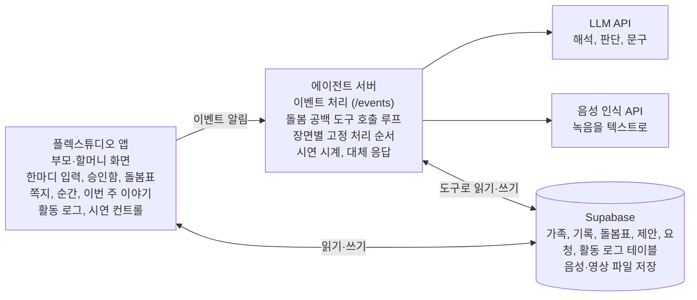

# 육아 IRP 해커톤 MVP 스펙

작성일 2026-10-24

시연 4장면을 해커톤 기간 안에 만들기 위한 팀 내부 스펙입니다. 컨셉 시연이 목표이므로 에이전트의 판단은 실제로 돌리고, 나머지는 목업으로 둡니다. 기획 배경과 시연 이야기는 제안서(`육아-IRP-제안서.md`)를 따릅니다.

이 문서는 세 부분으로 되어 있습니다.

1. 본문: 목표와 범위, 장면별 요구사항, 시스템 구성, 화면 명세, 일정
2. 데이터·API 계약: Supabase 테이블, 에이전트 서버 API, 시연 시드 데이터
3. 에이전트 명세: 트리거별 동작, 도구, 말투와 가드레일, 실패 시 대체 동작

## 목표와 범위

완성 기준은 시연 4장면이 3분 안에 끊김 없이 돌아가는 것입니다. 에이전트가 판단하는 부분은 실제로 구현하고, 그 주변은 목업으로 둡니다. 계산은 코드로, 판단과 문구는 LLM으로 나눠 시연 중 결과가 흔들리지 않게 합니다.

| 요소 | 방식 | 비고 |
| --- | --- | --- |
| 한마디 → 구조화된 돌봄 기록 | 실제 (LLM) | 음성은 미리 녹음한 파일로 인식해도 됨 |
| 재고 소진 예측 | 실제 (코드 계산 + LLM 문구) | 소모 속도는 최근 기록으로 계산 |
| 빈 시간 감지와 대타 후보 선정 | 실제 (코드 계산 + 에이전트 판단) | 핵심 장면 |
| 대타 요청 문구, 오늘의 쪽지, 이번 주 이야기 | 실제 (LLM) | |
| 에이전트 활동 로그 | 실제 | 에이전트가 단계마다 기록 |
| 아빠 일정 | 목업 | 고정된 일정 데이터 |
| 주문과 결제 | 목업 | 주문 완료 화면만 |
| 할머니에게 가는 문자 | 목업 | 앱 안의 문자 미리보기 화면 |
| 첫걸음 영상 | 목업 | 미리 준비한 영상 |
| 시간 흐름 | 목업 | "다음 장면으로" 버튼이 시연 시계를 옮기고 트리거를 실행 |
| 지원금 정보 | 목업 | 고정 데이터 1건 |

MVP에서 빼는 것: 실제 결제, 실제 지원금 조회, 통신사 연동, 처음 앨범, 자율성 설정의 실제 동작(화면만 둠), 여러 가족 지원.

## 장면별 요구사항

각 장면은 사람의 행동 하나에서 시작하고, 에이전트의 반응이 화면에 보이면 끝납니다.

| 장면 | 사람의 행동 | 시스템 반응 | 완료 조건 |
| --- | --- | --- | --- |
| 1. 새벽 3시, 밤 당번과 MRP | 아빠가 "3시, 기저귀 갈고 다시 재움"을 녹음해 올림 | 홈에 오늘 밤 당번(아빠) 표시. 기록 저장, 기저귀 재고 차감, 소진 예측이 3일 이하라서 장바구니 제안 생성. 아침으로 넘기면 엄마 승인함에 제안 표시 | 녹음 업로드부터 제안 생성까지 사람 개입 없이 진행. 승인하면 주문 완료 목업 화면으로 이동 |
| 2. 목요일 오후 4시, 돌봄 공백 | 엄마가 "오늘 저녁 회의 생겼어"를 입력 | 예외 일정 저장, 18\~21시 공백 감지, 후보 비교 후 엄마에게 "할머니께 도움을 요청할까요?" 확인, 엄마가 확인하면 할머니에게 요청 생성과 문자 미리보기 표시. 할머니가 수락하면 돌봄표 갱신, 부모 알림, 할머니에게 오늘의 쪽지 | 입력부터 발송 확인 요청까지 자동, 확인 한 번으로 발송. 수락 후 돌봄표와 쪽지가 바로 보이고, 활동 로그에 판단 근거가 단계별로 남음 |
| 3. 목요일 저녁 7시, 첫걸음 | 할머니가 영상과 "처음으로 두 걸음 걸었어요"를 올림 | 오늘의 순간으로 저장하고 엄마 화면에 순간 카드 표시 | 엄마 화면에 영상 카드가 뜸 |
| 4. 일요일 밤, 이번 주 이야기 | 발표자가 "일요일 밤으로"를 누름 | 밤 당번 횟수 집계, 이번 주의 순간·고마운 사람·다음 주 챙길 일을 담은 이야기 생성. "고마워요 보내기"를 누르면 할머니 화면에 감사 카드 | 이야기에 네 요소가 모두 담기고, 감사 카드가 할머니 화면에 보임 |

## 시스템 구성

화면은 플렉스튜디오, 판단은 에이전트 서버, 상태는 Supabase 한곳에 둡니다. 두 쪽이 같은 Supabase를 읽고 쓰므로, 테이블 계약만 맞으면 화면과 서버를 따로 만들 수 있습니다. 세부 약속은 아래 '데이터·API 계약'과 '에이전트 명세'에 있습니다.

플렉스튜디오와 에이전트 서버는 서로 데이터를 주고받지 않고 같은 Supabase에서만 만납니다. 플렉스튜디오가 서버에 보내는 것은 "무슨 일이 생겼다"는 이벤트 알림뿐입니다.

이벤트 흐름은 다섯 단계입니다.

1. 플렉스튜디오 화면이 Supabase에 기록이나 예외 일정을 저장합니다.
2. 저장 직후 플렉스튜디오가 에이전트 서버의 `/events`를 호출합니다. 대안으로 Supabase 데이터베이스 웹훅이 같은 호출을 대신할 수 있습니다.
3. 에이전트 서버가 LLM과 도구로 일을 처리하고, 결과와 활동 로그를 Supabase에 씁니다.
4. 플렉스튜디오 화면이 Supabase를 다시 읽어 결과를 보여줍니다. 자동 갱신이 안 되면 몇 초 간격 새로고침이나 화면 전환으로 갱신합니다.
5. 시간이 필요한 트리거(아침 승인함, 일요일 이야기)는 시연 시계로 처리합니다. "다음 장면으로" 버튼이 `/demo/advance`를 호출하면 서버가 시계를 옮기고 그 시각의 트리거를 실행합니다.

LLM과 음성 인식 API 키는 에이전트 서버의 환경변수에만 두고, 플렉스튜디오에는 넣지 않습니다.

## 화면 명세

화면은 13개이고, 그중 활동 로그와 시연 컨트롤은 발표용입니다. 할머니가 쓰는 화면은 별도의 고령자 모드로 설정하고, 큰 글씨와 버튼 두세 개, 읽어주기를 기본으로 합니다.

| 화면 | 쓰는 사람 | 보여주는 것 | 주요 동작 | 장면 |
| --- | --- | --- | --- | --- |
| 부모 홈 | 부모 | 오늘의 돌봄표(시간대별 담당), 오늘 밤 당번, 승인함 배지, 최근 쪽지와 순간 | 한마디 입력 열기, 승인함 열기 | 1, 2, 3 |
| 한마디 입력 | 모든 돌봄 담당자 | 녹음 버튼과 텍스트 입력 | 녹음하거나 써서 올리기 | 1, 2, 3 |
| 승인함 | 부모 | 장바구니 제안(품목, 수량, 도착 예정, 이유), 대타 요청 발송 확인 | 승인, 수량 수정, 거절 | 1, 2 |
| 주문 완료 (목업) | 부모 | 주문 완료 안내 | 홈으로 | 1 |
| 돌봄표 | 부모 | 주간 기본표, 예외 일정, 비어 있는 시간 강조 | 기본표 편집 | 2 |
| 문자 미리보기 (목업) | 할머니 | 에이전트가 보낸 요청 문자 | 수락, 어려워요 | 2 |
| 오늘의 쪽지 | 할머니, 다음 담당자 | 큰 글씨 쪽지, 읽어주기 버튼(목업 가능) | 확인 | 2 |
| 순간 카드 | 부모 | 사진이나 영상과 한 줄 | 보기 | 3 |
| 이번 주 이야기 | 가족 모두 | 이번 주의 순간, 고마운 사람, 밤 당번 횟수, 다음 주 챙길 일 | 고마워요 보내기 | 4 |
| 감사 카드 | 할머니 | 아이 사진과 감사 인사 | 보기 | 4 |
| 에이전트 활동 로그 (발표용) | 발표자 | 실행별 단계, 쓴 도구, 판단 이유 한 줄 | 실행 펼치기 | 1, 2, 4 |
| 시연 컨트롤 (발표용) | 발표자 | 현재 시연 시각 | 다음 장면으로, 데이터 초기화 | 전체 |
| 자율성 설정 | 부모 | 알림까지, 장바구니 담기까지, 주문까지 | 선택 (MVP는 표시만) | 없음 |

## 일정과 역할 분담

팀은 5명이고 역할은 유동적으로 나눕니다. 아래 표는 3일 기준으로 일차별 작업 묶음을 정리한 것이고, 담당은 그때그때 정합니다. 핵심 장면인 돌봄 공백을 2일차 안에 끝내는 것이 가장 중요합니다.

| 일차 | 화면 (플렉스튜디오) | 에이전트·데이터 (서버, Supabase) | 기획·발표 |
| --- | --- | --- | --- |
| 1일차 | 부모 홈, 한마디 입력, 승인함, 시연 컨트롤 | Supabase 테이블과 시드 데이터, `/events` 뼈대, 장면 1(기록 구조화, 소진 예측) | 시연 대본 확정, 시드 데이터 문구 |
| 2일차 | 돌봄표, 문자 미리보기, 오늘의 쪽지, 순간 카드, 활동 로그 | 장면 2 돌봄 공백 루프, 오늘의 쪽지, 장면 4 이번 주 이야기 | 대체 응답 준비, 발표 자료 초안 |
| 3일차 | 화면 다듬기, 이번 주 이야기와 감사 카드 | 버그 수정, 응답 시간 점검 | 리허설 5회, 녹화 백업, 발표 |

## 열린 질문

- [x] 팀은 몇 명이고, 역할을 어떻게 나누나요? → 5명, 역할은 유동적
- [x] 해커톤 기간은 며칠이고, 사전 개발이 허용되나요?
- [x] 플렉스튜디오 화면이 Supabase 변경을 자동으로 반영하나요, 아니면 새로고침이 필요한가요?
- [x] 플렉스튜디오 앱에서 녹음과 영상 업로드가 되나요? 안 되면 파일 업로드나 목업으로 대체합니다.
- [x] LLM과 음성 인식은 어떤 서비스를 쓰고, API 비용은 누가 부담하나요?
- [x] 할머니 화면은 어떻게 보여줄까요? → 고령자용 UI를 별도 설정으로 둠

---

# 데이터·API 계약

Supabase 테이블과 에이전트 서버 API의 약속입니다. 플렉스튜디오 화면과 에이전트 서버는 이 계약만 맞추면 따로 작업할 수 있습니다.

## Supabase 테이블

테이블은 21개입니다. 플렉스튜디오는 사람이 입력한 것(한마디, 승인, 수락, 감사)만 쓰고, 해석과 판단 결과는 에이전트 서버가 씁니다.

| 테이블 | 용도 | 주요 컬럼 | 쓰는 쪽 |
| --- | --- | --- | --- |
| `families` | 가족 | id, name | 시드 |
| `members` | 가족 구성원과 역할 | id, family_id, name, role(parent, grandparent, sitter), phone(가상), can_view_finance, senior_mode(고령자용 UI) | 시드 |
| `children` | 아이 | id, family_id, name, birth_month | 시드 |
| `inputs` | 한마디 원본 | id, family_id, author_id, text, audio_url, media_url, created_at, processed | 화면 |
| `care_logs` | 돌봄 기록 | id, child_id, author_id, logged_at, type(feed, diaper, sleep, meal, note), amount, note, input_id | 서버 |
| `inventory_items` | 육아용품 재고 | id, family_id, item(diaper, wipes), size, stock_count, avg_daily_use, next_size_month | 시드, 서버 |
| `cart_proposals` | 장바구니 제안 | id, item_id, quantity, reason, eta_text, status(pending, approved, rejected, ordered), decided_by, decided_at | 서버 생성, 화면에서 승인·거절 |
| `base_schedule` | 기본 돌봄표 | id, family_id, weekday, start_time, end_time, caregiver_id | 시드, 화면에서 편집 |
| `availability` | 기본표 밖에서 도울 수 있는 시간 | id, member_id, weekday, start_time, end_time | 시드 |
| `schedule_exceptions` | 예외 일정 | id, member_id, date, start_time, end_time, kind(unavailable, available), input_id | 서버 |
| `coverage` | 날짜별 확정 돌봄표 | id, family_id, date, start_time, end_time, caregiver_id, origin(base, exception, request) | 서버 |
| `coverage_requests` | 대타 요청 | id, family_id, date, start_time, end_time, candidate_id, message, status(draft, sent, accepted, declined, expired), responded_at | 서버 생성, 화면에서 발송 확인과 수락·거절 |
| `night_duty` | 밤 당번 | id, family_id, date, member_id, done | 시드, 서버 |
| `handover_notes` | 오늘의 쪽지 | id, family_id, to_member_id, for_date, body, source_log_ids | 서버 |
| `moments` | 오늘의 순간 | id, child_id, author_id, caption, media_url, created_at, input_id | 서버 |
| `deadlines` | 챙길 일 | id, family_id, title, due_date, kind(subsidy, vaccination), source_url, status | 시드 |
| `weekly_stories` | 이번 주 이야기 | id, family_id, week_start, body(json: moment, thanks_to, night_duty_counts, next_week) | 서버 |
| `thanks` | 감사 카드 | id, from_member_id, to_member_id, story_id, message, media_url | 화면 |
| `notifications` | 앱 안 알림 카드 | id, member_id, kind, title, body, link_table, link_id, read | 서버 |
| `agent_actions` | 활동 로그 | id, family_id, run_id, step_no, action, tool, summary, reason, used_fallback, created_at | 서버 |
| `demo_clock` | 시연 시계 | id(1), now | 서버 |

MVP에서는 Supabase 행 수준 보안(RLS) 대신 플렉스튜디오의 역할별 화면 권한으로 볼 수 있는 정보를 나누고, 에이전트 서버는 서비스 키로 접근합니다. 실서비스로 갈 때는 RLS를 적용합니다.

## 에이전트 서버 API

플렉스튜디오는 사람이 입력한 것을 Supabase에 쓴 뒤, 에이전트 서버에 "무슨 일이 생겼다"는 이벤트 하나만 알립니다. 서버는 처리 결과를 Supabase에 쓰고, 응답으로는 실행 번호와 상태만 돌려줍니다.

| 엔드포인트 | 호출하는 쪽 | 요청 | 하는 일 |
| --- | --- | --- | --- |
| `POST /events` | 플렉스튜디오 (또는 Supabase 웹훅) | `{type, family_id, ref_id}` | 이벤트 종류별 처리 (아래 표) |
| `POST /demo/advance` | 시연 컨트롤 | `{to}` (시연 시각) | 시연 시계를 옮기고 그 시각의 트리거 실행 |
| `POST /demo/reset` | 시연 컨트롤 | 없음 | 시드 데이터로 되돌림 |
| `GET /runs/{run_id}` | 활동 로그 화면 (선택) | 없음 | 실행 상태와 단계 조회 |

이벤트 종류는 다섯 가지입니다.

| type | ref_id가 가리키는 것 | 서버가 하는 일 |
| --- | --- | --- |
| `input_created` | `inputs`의 행 | 한마디를 돌봄 기록, 예외 일정, 순간으로 나눠 저장하고 후속 처리 |
| `coverage_confirmed` | `coverage_requests`의 행 (부모가 발송 확인) | 요청을 `sent`로 바꾸고 문자 미리보기 생성 |
| `coverage_responded` | `coverage_requests`의 행 | 수락이면 돌봄표 확정과 쪽지 작성, 거절이면 다음 후보에게 요청 |
| `cart_decided` | `cart_proposals`의 행 | 승인이면 주문 완료(목업) 처리와 재고 반영 |
| `thanks_sent` | `thanks`의 행 | 받는 사람에게 알림 카드 생성 |

응답 예: `{"run_id": "r_0142", "status": "done"}`. 시연 중에 결과를 바로 보여줄 수 있도록 처리는 동기로 하고, LLM 호출이 8초를 넘기면 대체 응답을 쓴 뒤 `status`를 `fallback`으로 돌려줍니다.

## 시연 시드 데이터

시드는 하린이네 가족의 지난 일주일입니다. 목요일 저녁에 할머니만 가능하도록 짜여 있어, 에이전트가 할머니를 고르는 이유가 데이터로 설명됩니다. "데이터 초기화"를 누르면 이 상태로 돌아갑니다.

| 항목 | 내용 |
| --- | --- |
| 가족 | 엄마(부모), 아빠(부모), 할머니(조부모, 근처 거주), 시터(평일 낮 담당), 하린(12개월) |
| 기본 돌봄표 | 평일 9\~18시 시터, 18\~21시 엄마, 주말은 부모 |
| 도울 수 있는 시간 | 할머니는 화요일을 뺀 평일 저녁, 시터는 18시 이후 불가 |
| 이번 주 일정 | 아빠는 목요일 지방 출장(금요일 아침 복귀) |
| 재고 | 기저귀 4단계 36장, 하루 평균 12장 사용(약 3일치), 다음 사이즈는 다음 달 |
| 지난 일주일 기록 | 하루 15\~20건의 수유, 식사, 기저귀, 낮잠 기록 |
| 밤 당번 | 지난 일주일 엄마 3회, 아빠 4회가 되도록 구성 |
| 챙길 일 | 다음 주 예방접종 1건, 시연 일요일 기준 마감 5일 전인 지원금 신청 1건 |
| 시연 시각 순서 | 수요일 03:00 → 수요일 08:00 → 목요일 16:00 → 목요일 19:00 → 일요일 21:00 |

---

# 에이전트 명세

에이전트는 이벤트를 받아 정해진 일을 하고, 모든 단계를 활동 로그에 남깁니다. 핵심 장면인 돌봄 공백만 도구 호출 루프로 돌리고, 나머지는 고정된 처리 순서 안에서 LLM을 부릅니다.

## 트리거별 동작

트리거는 일곱 가지입니다. 돌봄 공백만 에이전트가 도구를 골라 쓰는 루프로 돌고, 나머지는 정해진 순서로 처리합니다. 어느 쪽이든 단계마다 `agent_actions`에 한 줄씩 남습니다.

| 트리거 | 처리 방식 | 하는 일 | 결과 | 사람의 확인 |
| --- | --- | --- | --- | --- |
| 한마디 입력 (`input_created`) | 고정 순서 | 한마디를 돌봄 기록, 예외 일정, 순간으로 나눔. 기저귀 기록이면 재고를 줄이고 소진 시점을 계산해, 3일 이하면 장바구니 제안. 예외 일정이면 돌봄 공백 처리로 넘김 | 기록, 제안, 알림 | 장바구니는 부모 승인 |
| 돌봄 공백 (예외 일정 저장 직후) | 도구 호출 루프 (최대 8단계) | 확정 돌봄표에서 빈 시간 찾기 → 후보별 가능 여부와 이유 비교 → 한 명을 골라 요청 문구 작성 → 요청을 `draft`로 저장하고 부모에게 "할머니께 도움을 요청할까요?" 확인 요청 | 발송 확인 요청 | 부모가 발송 확인 |
| 발송 확인 (`coverage_confirmed`) | 고정 순서 | 요청을 `sent`로 바꾸고 문자 미리보기 생성 | 대타 요청 문자 | 상대가 수락 |
| 대타 응답 (`coverage_responded`) | 고정 순서 | 수락이면 돌봄표 확정, 맡을 사람에게 오늘의 쪽지, 부모에게 확정 알림. 거절이면 남은 후보로 돌봄 공백 처리를 다시 실행하고, 후보가 없으면 부모에게 직접 확인 요청 | 돌봄표, 쪽지, 알림 | 없음 |
| 아침 (시연 시각 08:00) | 고정 순서 | 승인 대기 항목을 부모 홈에 올림. 한 사람이 밤 당번을 사흘 연속 맡았으면 교대 제안 | 알림 | 교대 제안은 부모가 선택 |
| 일요일 밤 (시연 시각 일요일 21:00) | 고정 순서 | 한 주 집계(밤 당번 횟수, 돌봄 시간, 대타 기록) → 순간 하나와 고마운 사람 선정 → 다음 주 챙길 일 정리 → 이야기 작성 | 이번 주 이야기 | 없음 |
| 감사 전송 (`thanks_sent`) | 고정 순서 | 받는 사람에게 감사 카드 알림 | 알림 | 없음 |

## 도구 목록

계산은 코드로, 해석과 문구는 LLM으로 나눕니다. 숫자가 맞는지는 코드가 책임지고, LLM은 그 숫자를 가족의 언어로 옮깁니다.

| 도구 | 하는 일 | 구현 |
| --- | --- | --- |
| `parse_input` | 한마디를 돌봄 기록, 예외 일정, 순간으로 분해 | LLM (JSON 스키마 출력) |
| `update_inventory` | 기저귀·물티슈 기록으로 재고 차감 | 코드 |
| `forecast_depletion` | 최근 7일 평균 사용량으로 남은 일수 계산 | 코드 |
| `get_coverage` | 날짜의 확정 돌봄표 조회 | 코드 |
| `find_gaps` | 기본 돌봄표와 예외 일정을 합쳐 아이 곁에 아무도 없는 구간 계산 | 코드 |
| `list_candidates` | 빈 구간에 가능한 사람과 근거(가능 시간, 이번 주 돌봄 횟수) 목록 | 코드 |
| `draft_message` | 요청 문자와 알림 문구 작성 | LLM |
| `create_cart_proposal` | 장바구니 제안 저장 | 코드 |
| `create_coverage_request` | 대타 요청을 draft로 저장 (발송은 부모 확인 후) | 코드 |
| `confirm_coverage` | 수락된 요청을 확정 돌봄표에 반영 | 코드 |
| `write_handover_note` | 최근 기록과 저녁 루틴으로 오늘의 쪽지 작성 | LLM |
| `aggregate_week` | 밤 당번 횟수, 돌봄 시간, 대타 기록 집계 | 코드 |
| `write_weekly_story` | 집계 결과로 이번 주 이야기 작성 | LLM (JSON 스키마 출력) |
| `notify` | 알림 카드 생성 | 코드 |
| `log_action` | 활동 로그에 단계, 도구, 이유 한 줄 기록 | 코드 |

돌봄 공백 루프에서 에이전트가 고를 수 있는 도구는 `get_coverage`, `find_gaps`, `list_candidates`, `draft_message`, `create_coverage_request`, `notify` 여섯 개입니다. `log_action`은 서버가 매 단계 자동으로 호출합니다.

## 말투와 가드레일

모든 문구는 제안서의 원칙을 따릅니다. 엔진은 ERP처럼 일하고, 화면은 가족의 언어로 말합니다.

### 말투

- 아이 이름으로 말합니다("하린이 기저귀가 사흘쯤 남았어요").
- 할머니와 시터에게는 존댓말을 쓰고, 요청은 부탁하는 말투로 씁니다.
- 숫자는 남은 일수, 도착일, 시간처럼 꼭 필요한 것만 씁니다.

### 금지

- 다른 아이와의 비교, 발달 평가
- 의학적 판단이나 조언(증상 해석, 약 권유)
- 누군가를 탓하거나 분담을 점수처럼 매기는 표현
- 기록에 없는 사실을 쪽지나 이야기에 덧붙이는 것

### 자율성 단계

부모는 항목별로 에이전트에게 맡길 범위를 고릅니다. 시연 설정은 두 항목 모두 2단계입니다. 주문은 돈이 나가는 일이고 대타 요청은 부모 이름으로 가족에게 보내는 메시지라, 둘 다 보내기 전에 부모가 한 번 확인합니다. MVP에서 단계는 이 설정으로 고정하고, 설정 화면은 보여주기만 합니다.

| 단계 | 장바구니 | 대타 요청 |
| --- | --- | --- |
| 1. 알림까지 | 소진 예정만 알림 | 빈 시간과 추천 후보만 알림 |
| 2. 준비까지 | 장바구니에 담고 부모 승인 대기 | 요청 문자를 만들고 부모 확인 후 발송 |
| 3. 실행까지 | 정기 품목은 자동 주문 | 바로 요청하고, 수락되면 돌봄표 확정 |

## 실패 시 대체 동작

시연 중 어느 단계가 실패해도 다음 장면으로 넘어갈 수 있어야 합니다. 대체 동작을 쓴 단계는 활동 로그에 `used_fallback`으로 표시합니다.

| 상황 | 대체 동작 |
| --- | --- |
| LLM 호출이 8초를 넘기거나 오류 | 장면별로 준비한 문구 사용 |
| `parse_input`이 해석에 실패 | 원문을 그대로 메모(note) 기록으로 저장 |
| JSON 출력이 스키마와 다름 | 한 번 다시 요청하고, 또 실패하면 준비한 문구 사용 |
| 돌봄 공백 루프가 8단계 안에 끝나지 않음 | 루프를 멈추고 코드 계산 결과(빈 시간, 첫 번째 후보)로 요청 생성 |
| 가능한 후보가 없음 | 부모에게 "직접 확인이 필요해요" 알림 |
| 음성 인식 실패 | 미리 준비한 텍스트로 대체 |
