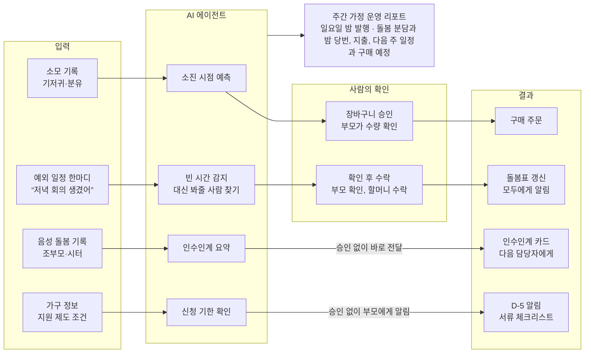

# 육아 IRP: 아이 키우는 집을 위한 Individual Resource Planning

작성일 2026-10-23

육아 IRP는 아이 키우는 집의 돌봄 인력, 육아용품, 일정, 예산을 ERP처럼 운영하고, 반복되는 판단은 AI 에이전트가 맡는 서비스입니다. 플렉스튜디오 해커톤 자유 공모 트랙 후보이며, 수익은 기업 복지로 먼저 검증하고 통신사 구독 플랫폼·결합 상품으로 확장합니다.

## 문제: 가정에는 운영 시스템이 없다

아이 키우는 집은 매일 인력 배치, 재고, 일정, 예산을 동시에 관리하지만, 이 일을 묶어 주는 시스템 없이 기억과 메신저로 처리합니다. 그 결과 다섯 군데에서 빈틈이 생깁니다.

- **재고**: 기저귀나 분유가 떨어진 뒤에야 급하게 주문합니다.
- **돌봄 공백**: 부모에게 갑자기 일정이 생기면 대신 봐줄 사람을 메신저로 일일이 찾아야 합니다.
- **교대**: 돌봄 담당이 바뀔 때 마지막 수유와 낮잠 정보가 말로만 전달되어 끊깁니다.
- **일정·행정**: 지원금 신청 기한, 영유아 검진과 예방접종 일정을 각자 따로 챙겨야 합니다.
- **분담**: 누가 얼마나 돌봤는지, 밤에 누가 일어났는지 근거 없이 체감으로만 이야기하게 됩니다.

## 해결: 가정용 ERP

ERP의 다섯 모듈을 육아 업무에 하나씩 대응시켜, 흩어진 운영을 한 시스템으로 묶습니다.

| ERP 모듈 | 육아 IRP에서 하는 일 |
| --- | --- |
| 자재·구매(MRP) | 기저귀, 분유, 물티슈 소모 속도로 재고를 예측하고 구매 시점을 추천 |
| 인사·인력 배치 | 기본 돌봄표(가정용 근무표), 빈 시간 감지와 대신 봐줄 사람 조율, 밤 당번, 인수인계 |
| 생산계획 | 수유, 수면, 이유식 일정 |
| 회계 | 육아 지출과 정부 지원금 수령 관리 |
| 경영분석 | 주간 가정 운영 리포트(돌봄 분담, 지출, 재고) |

## 사용자와 역할

부모가 최종 결정권을 갖고, 조부모·시터는 돌봄 정보에만, 에이전트는 준비 작업에만 접근합니다. 역할마다 화면과 권한이 달라 플렉스튜디오의 권한별 화면 기능을 그대로 살릴 수 있습니다. 주 타깃은 맞벌이이면서 조부모나 시터의 도움을 받는 가정으로, 기업 복지 판매 경로의 대상과 겹칩니다.

| 역할 | 하는 일 | 볼 수 있는 정보 |
| --- | --- | --- |
| 부모 (2명) | 예외 일정 입력, 구매 승인, 지원금 신청, 주간 리포트 확인 | 전체 |
| 조부모·베이비시터 | 음성으로 돌봄 기록, 인수인계 카드 확인, 대신 봐달라는 요청 수락(문자 속 버튼 하나) | 돌봄 기록과 일정 (지출·지원금 제외) |
| AI 에이전트 | 재고 예측, 빈 시간 감지와 대타 조율, 인수인계 요약, 기한 확인, 리포트 작성 | 기록 데이터 (구매는 부모 승인 후, 대타 요청은 부모 확인 후 발송하고 상대의 수락 후 확정) |

## 핵심 기능

에이전트가 예측, 조율, 요약을 맡고, 사람은 구매 승인과 대타 수락처럼 꼭 필요한 순간에만 나섭니다. 기록을 쌓는 데서 끝나지 않고 다음 행동까지 준비한다는 점이 기록 앱과의 차이입니다.

| 기능 | 에이전트가 하는 일 | 사람이 하는 일 |
| --- | --- | --- |
| 육아 자재 MRP | 소모 기록으로 소진 시점 예측("기저귀 3일 후 소진, 지금 주문하면 이틀 뒤 도착"), 기저귀 사이즈와 분유 단계가 바뀔 시점 알림 | 부모가 장바구니 승인 |
| 돌봄 커버리지 관리 | 기본 돌봄표와 예외 한마디("목요일 저녁 회의 생겼어")로 아이 곁에 아무도 없는 시간을 감지. 가능한 사람을 찾아 부모 확인을 거쳐 요청하고, 수락을 받으면 돌봄표를 고쳐 모두에게 알림. 밤 당번 순서와 횟수도 관리 | 부모가 요청 발송을 한 번 확인하고, 대신 봐줄 사람이 수락 |
| 돌봄 교대 인수인계 | 음성 메모("2시에 분유 160ml, 낮잠 40분, 조금 보챔")를 정리해 다음 담당자에게 인수인계 카드 전달: 마지막 수유, 다음 일정, 특이사항 | 다음 담당자가 카드 확인 |
| 지원금·행정 일정 | 가구 정보로 받을 수 있는 정부 육아 지원 제도와 신청 기한, 검진·접종 일정 관리. 공식 안내 페이지를 근거로 제시 | 부모가 서류 확인 후 신청 |
| 주간 운영 리포트 | 일요일 밤 돌봄 분담(밤 당번 포함), 지출, 다음 주 일정과 구매 예정을 정리해 발행 | 돌봐준 가족에게 고마움을 전하고 다음 주 계획을 함께 봄 |

돌봄 커버리지 관리는 일정을 보여주는 캘린더가 아니라, "지금 누가 아이 곁에 있는가"를 관리하는 가정용 근무표입니다. 기본 돌봄표는 한 번만 만들고, 이후에는 예외만 한마디로 입력합니다. 새벽에 아기가 깨는 순간은 실시간으로 조율하지 않고 미리 정한 밤 당번으로 대응합니다.

모든 기능에 세 가지 공통 장치를 둡니다.

- **에이전트 활동 로그**: 에이전트가 무엇을 왜 했는지 시간순으로 보여줍니다.
- **승인함**: 부모가 처리해야 할 건만 모아둡니다.
- **자율성 설정**: 알림까지, 장바구니 담기까지, 주문까지처럼 에이전트에게 맡길 범위를 고릅니다.

**에이전트 작동 흐름: 에이전트가 준비하고, 사람은 승인과 수락만 합니다**

구매와 대타 요청처럼 사람이 결정해야 하는 일만 확인을 거치고, 인수인계와 기한 알림은 바로 전달되며, 모든 기록은 주간 리포트로 모입니다.

## 따뜻한 경험 설계

엔진은 ERP처럼 일하지만, 화면은 관리 용어 대신 가족의 언어로 말하고 분담을 평가가 아닌 고마움으로 보여줍니다. ERP 비유는 심사위원을 설득하는 틀이고, 사용자가 만나는 경험은 가족 사이를 잇는 데 둡니다.

| 엔진에서 하는 일 | 화면에서 보이는 말 |
| --- | --- |
| 재고 소진 예측 | "하린이 기저귀가 사흘쯤 남았어요. 지난번처럼 담아둘까요?" |
| 빈 시간 감지와 대타 요청 | 엄마에게 "할머니께 도움을 요청할까요?", 할머니에게 "목요일 저녁, 하린이를 봐주실 수 있을까요?" |
| 밤 당번 | "오늘 밤은 아빠 차례예요. 엄마는 푹 주무세요" |
| 인수인계 카드 | 다음 돌봄 담당자에게 전하는 "오늘의 쪽지" |
| 돌봄 분담 집계 | "이번 주 할머니가 화·목 오후를 맡아주셨어요" |
| 지원금·접종 기한 관리 | "다음 주에 챙길 일" |
| 주간 가정 운영 리포트 | "우리 가족 이번 주 이야기" |

여기에 따뜻한 기능 네 가지를 더합니다.

- **고마워요 보내기**: 주간 이야기에서 돌봄을 맡아준 가족에게 아이 사진과 인사를 보냅니다. 분담을 점수가 아니라 고마움으로 보여줍니다.
- **쉼 지키기**: 한 사람이 새벽 돌봄을 며칠 연속 맡으면, 에이전트가 다른 가족에게 교대를 제안합니다. 꺼내기 어려운 "오늘은 네가 해줄래?"를 앱이 대신 열어줍니다.
- **오늘의 순간**: 돌봄 메모에서 웃음, 옹알이 같은 순간 한 줄을 골라 오늘의 쪽지와 주간 이야기에 담습니다. 사진은 부모가 고른 것만 씁니다.
- **처음 앨범**: 첫 웃음, 첫 이유식처럼 기록 속 "처음"을 모아 성장 앨범으로 엮습니다.

다른 아이와 비교하거나 발달을 평가하는 말은 하지 않습니다.

## 비즈니스 모델

수익은 기업 복지로 먼저 검증하고, 통신사 구독 플랫폼과 결합 상품으로 규모를 키웁니다. 부모는 아이 물건에는 돈을 쓰지만 앱 구독에는 지갑을 잘 열지 않으므로, 기업 구매나 통신비 합산처럼 결제 장벽이 낮은 경로로 판매합니다.

| 단계 | 판매 경로 | 결제 방식 | 구매 논리 |
| --- | --- | --- | --- |
| 초기 검증 | 기업 복지 (B2B2C) | 기업이 구매 | 육아휴직 복귀 직원의 부담을 줄여 이탈을 막음. 결정권자가 명확하고 영림원의 기업 세계와도 연결됨 |
| 규모 확장 | 통신사 구독 플랫폼·결합 상품 | 가입자가 통신비와 함께 결제, 통신사와 수익 배분 | 통신사는 가족 고객 확보와 가족 단위 해지 방지를 얻음. 가족결합 회선이 곧 돌봄 인력 명단 |
| 보조 수익 | 커머스 제휴 | 판매처 수수료 | 재고 예측이 구매로 이어지는 흐름에서 수수료 |
| 공공 확산 | 지자체 (B2G) | 사업 계약 | 저출생 대응 사업의 일환으로 지역 주민에게 제공 |

통신 3사는 이미 외부 서비스를 묶어 파는 구독 플랫폼을 운영하고 있어 입점할 자리가 있습니다([T우주](https://www.sidae.com/article/2025040208360094292), [유독](https://sports.khan.co.kr/article/202607191017003), [KT 구독](https://dealsite.co.kr/articles/160157)). 발표에서는 "끼워팔기" 대신 "결합 상품", "구독 플랫폼 입점"이라고 표현합니다. 끼워팔기는 공정거래법상 불공정 행위를 가리키는 말이고, T우주 패스도 대리점 끼워팔기 논란을 겪었습니다([이데일리](https://v.daum.net/v/20220714150654148)).

## 홍보 전략

부모가 새 도구를 받아들이는 시점마다 무료 이용권을 건네고, 조부모·시터 초대가 확산을 만들게 합니다. 무료 기간 비용은 제휴처가 부담하거나 나눠 부담하고, 제휴처는 재구매와 고객 접점을 얻습니다.

| 시점 | 접점 | 제안 | 연결되는 판매 경로 |
| --- | --- | --- | --- |
| 출산 준비 | 유모차·카시트·기저귀 구매 | 구매 시 3개월 무료 이용권. 기저귀 정기배송과 묶으면 재고 예측이 바로 재구매로 이어짐 | 커머스 제휴 |
| 출산 준비 | 베이비페어 | 현장에서 "기저귀 MRP"를 체험하고, 가입하면 무료 기간 제공 | 커머스 제휴 |
| 출산 직후 | 지인 선물 | 출산 축하 선물용 이용권(모바일 상품권) | 직접 판매 |
| 조리원 퇴소 | 산후조리원 | 조리원에서 쌓은 수유·수면 기록을 집으로 넘기는 "첫 인수인계" 카드 | 커머스 제휴, 기업 복지 |
| 출생신고 | 지자체 | 지원금 안내문에 앱 안내와 이용권 동봉 | 지자체 |
| 가입 직후 | 가족 초대 | 조부모·시터를 초대할 때마다 무료 기간 연장 | 전 경로 |
| 복직 | 회사 인사팀 | 육아휴직 복귀 지원 패키지에 포함 | 기업 복지 |
| 상시 | 통신사 | 가족결합·키즈 상품 가입 고객에게 무료 체험 제공 | 통신사 결합 상품 |
| 상시 | 육아 커뮤니티·SNS | "우리 집 ERP 진단" 테스트와 주간 리포트 공유 카드 | 전 경로 |

가장 강한 장치는 두 가지입니다.

- **조리원 "첫 인수인계"**: 서비스의 핵심 기능인 인수인계를 조리원에서 집으로 넘어가는 첫 순간에 보여줍니다. 체험이 곧 제품 설명이 됩니다.
- **가족 초대**: 이 서비스는 원래 여러 돌봄 담당자가 함께 써야 제대로 돌아가므로, 가입한 부모가 조부모·시터를 데려오는 확산이 제품 구조에 들어 있습니다.

공유 카드는 집계된 수치만 담고, 공유 여부는 부모가 직접 고릅니다.

## 리스크와 대응

가장 큰 위험은 기존 육아 기록 앱처럼 보이는 것이며, 운영과 의사결정 기능을 전면에 두는 것으로 대응합니다.

| 리스크 | 대응 |
| --- | --- |
| 수유·수면 기록 앱이 이미 많음 | 기록이 아니라 예측, 조율, 인수인계, 승인 같은 운영 기능을 전면에 둠 |
| 가족 공유 캘린더 앱과 겹침 | 일정 표시가 아니라 "누가 아이 곁에 있는가"를 관리하고, 빈 시간 감지와 대타 조율은 에이전트가 맡음 |
| 일정 입력이 번거로움 | 기본 돌봄표는 한 번만 만들고, 이후에는 예외만 한마디로 입력 |
| 조부모가 앱을 쓰지 않을 수 있음 | 대타 요청은 문자 속 버튼 하나로 수락 |
| 돌봄 공백이 실제로 자주 생기는지 확인되지 않음 | 맞벌이 부모 10\~20명에게 지난달 갑작스러운 돌봄 공백 횟수와 해결 방법을 물어 근거 확보 |
| B2C 지불 의사가 낮음 | 기업 구매와 통신비 합산 결제처럼 결제 장벽이 낮은 경로로 판매 |
| 통신사는 혜택 비용을 줄이는 추세이고([뉴스토마토](https://newstomato.com/ReadNews.aspx?no=1223368)) 협상이 길며 수익 배분이 큼 | 기업 복지로 먼저 검증하고, 통신사는 확장 단계 채널로 둠 |
| 통신사가 육아 서비스를 직접 운영함([LG유플러스 부모나라](https://www.lg.co.kr/media/release/26783)) | 정보·콘텐츠가 아닌 가정 운영과 에이전트라는 보완재로 포지셔닝해 제휴를 제안 |
| 아이 건강·발달 정보가 민감함 | 역할별 권한 분리, 필요한 정보만 수집, 에이전트는 의학적 판단을 하지 않음. 통신사 등 판매 제휴처와 돌봄 데이터는 공유하지 않음 |
| 지원 제도가 자주 바뀜 | 공식 안내 페이지를 근거로 제시하고 최종 확인은 부모가 함 |

## 시연 시나리오와 발표

시연은 맞벌이 부부와 할머니가 함께 키우는 12개월 하린이네의 한 주를 약 3분 동안 따라갑니다. 기능은 독립 장면이 아니라 하나의 이야기 속에 녹입니다.

1. **새벽 3시, 밤 당번과 MRP (40초)**: 하린이가 깨서 웁니다. 오늘 밤 당번은 아빠라 엄마는 계속 잡니다. 아빠가 기저귀를 갈며 "3시, 기저귀 갈고 다시 재움"이라고 한마디 남기면, 에이전트가 소모 속도를 갱신해 "기저귀가 사흘쯤 남았어요. 지난번처럼 담아둘까요?"를 띄웁니다. 아침에 엄마가 한 번 눌러 승인합니다.
2. **목요일 오후 4시, 돌봄 공백 (1분 30초, 핵심 장면)**: 엄마가 "오늘 저녁 회의 생겼어"라고 한마디 남깁니다. 아빠는 출장 중입니다. 에이전트가 기본 돌봄표에서 저녁 6\~9시 공백을 찾아 할머니에게 문자로 요청합니다. 보내기 직전에는 엄마에게 "할머니께 도움을 요청할까요?"라고 한 번 묻고, 엄마가 확인을 누르면 문자가 갑니다. "목요일 저녁, 하린이를 봐주실 수 있을까요?" 할머니가 버튼 하나로 수락하면 돌봄표가 바뀌고, 할머니에게 저녁밥 위치와 목욕 순서가 담긴 오늘의 쪽지가 갑니다. 화면 옆 활동 로그에는 에이전트가 무엇을 확인하고 왜 할머니에게 요청했는지가 남습니다.
3. **목요일 저녁 7시, 감정의 정점 (20초)**: 회의 중인 엄마에게 쪽지가 옵니다. "하린이가 처음으로 두 걸음 걸었어요." 급히 와준 할머니가 찍은 짧은 영상과 함께입니다.
4. **일요일 밤, 이번 주 이야기 (30초)**: 이번 주 밤 당번은 엄마 세 번, 아빠 네 번입니다. 이번 주의 순간(첫걸음), 고마운 사람(급히 와준 할머니), 다음 주에 챙길 일(예방접종, 지원금 신청 마감 5일 전)이 담깁니다. 엄마가 "고마워요 보내기"를 누르며 끝납니다.

공백이 생겼기 때문에 할머니가 왔고, 할머니가 왔기 때문에 엄마가 첫걸음을 전해 받습니다. 시간은 "다음 날로" 버튼으로 건너뛰고, 아빠 일정, 주문, 문자는 목업으로 보여줍니다.

발표는 ERP 비유로 열고, 가족의 장면으로 닫습니다.

> 여는 말: "아이를 키우는 집은 매일 인력 배치, 재고 관리, 일정 관리, 예산 집행을 동시에 합니다. 그런데 이 회사에는 ERP가 없습니다."

> 닫는 말: "갑자기 빈 시간은 육아 IRP가 메우고, 가족은 아이의 첫걸음을 함께 봅니다."

## 선택 근거: 1인 사업자 IRP와 비교

육아 IRP는 ERP 비유, 공감, 협업 구조에서 앞서고, 약한 BM은 기업 복지와 통신사 결합 상품으로 보완합니다. 저출생이라는 사회 문제와 직결되어 사회적 효과 점수를 얻기 좋고, 여러 역할이 쓰는 구조라 플렉스튜디오의 강점도 살아납니다.

| 기준 | 1인 사업자 IRP | 육아 IRP |
| --- | --- | --- |
| ERP 비유의 자연스러움 | 높음 | **매우 높음** |
| 공감·사회적 효과 | 보통 | **매우 높음** |
| 협업 구조 (플렉스튜디오 적합성) | 보통 | **높음** |
| BM 확실성 | **높음** | 보통 (기업 복지·통신사 결합으로 보완) |
| 경쟁 강도 | 보통 | 높음 (기록 앱과 차별화 필수) |
