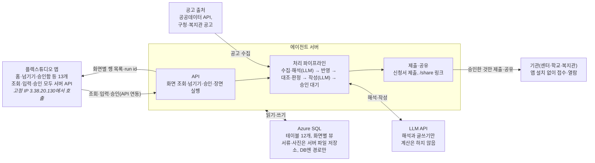

# 이음 — MVP 스펙

2026-10-24 · 파이브 가이즈(임준현)

해커톤 MVP는 지우네 장면을 실제 에이전트로 돌려, 문자와 서류를 넘기면 AI가 아이 한 명 기준으로 묶고 정리해 승인 몇 번으로 관리가 끝나고, 받을 수 있는 지원은 AI가 먼저 찾아 신청까지 가져가는 것을 보여 줍니다. 기능은 한 장 장부, 맞춤 지원 레이더, 아이 이력서 세 가지이고, 발표 시연은 앞의 두 가지(장면 1·2)입니다.

테이블 설계는 아래 [데이터](#데이터) 절, 처리 순서·트리거·API는 [에이전트](#에이전트) 절에 있습니다.

## 목표와 범위

MVP가 증명할 것은 둘입니다. 바우처 이용 내역이 연동되면 사라질 뻔한 바우처와 확인할 결제를 승인 두 번으로 정리한다는 것(장면 1), 그리고 부모가 찾지 않은 지원을 AI가 먼저 찾아 등본 한 장과 승인 한 번으로 신청까지 가져간다는 것(장면 2)입니다. 장면 3(아이 이력서)은 발표 시연에서 빼고, 장면 1·2가 끝난 뒤 후순위로 구현해 질의응답용으로 둡니다.

| 구분 | 내용 |
| --- | --- |
| 실제로 구현 | 프로필 기반 대상 판정, 이용 내역·문자 붙여넣기와 사진 업로드, LLM 분류·추출과 문서 작성, 코드로 하는 장부 반영·대조·잔액·마감 계산, 시범 지역 한 곳의 공고 수집, 신청서 초안과 서류 체크, 승인함, 생성 문서 미리보기 |
| 목업으로 보여 줌 | 바우처 이용 내역 연동(화면은 연동으로 보이고, 실제로는 미리 넣은 가상 이용 내역을 불러옴), 기관에 보내는 문자 발송, 신청서 제출(테스트 메일함), 기관이 여는 공유 페이지, 정부24 발급 단계(안내 화면만), 결정통지서 사진으로 프로필 채우기 |
| 이번에 하지 않음 | 로그인과 여러 가정, 센터 앱·마이데이터·바우처 이용 내역 실제 연동, 본인 인증 대행, 음성 입력, 실제 아동 데이터 |
| 후순위 | 장면 3(아이 이력서) 에이전트 연결. 화면은 탭으로 두고, 장면 1·2가 안정된 뒤 붙임 |

데이터는 모두 가상이고, 시연은 시연 제어 화면에서 장면을 넘기며 진행합니다. 장면마다 '손으로 하던 일 → 승인' 카운터를 띄웁니다.

## 장면별 요구사항

장면은 기능 하나씩을 주인공으로 삼고, 모두 '넘기기(또는 자동 수집) → 에이전트 처리 → 승인' 순서로 돕니다. 시작 전에 지우네 기본 데이터와 프로필, 이미 넘겨 둔 센터 문자를 미리 넣어 둡니다. 시연 날짜는 2026년 10월 24일(월말 일주일 전)로 고정합니다.

**미리 넣어 둘 데이터:** 지우(7세, 초등 1학년 특수학급, 가명) 프로필과 찾고 싶은 지원 유형, 기관 4곳(언어치료·감각통합·놀이치료 센터, 학교), 주간 치료 일정, 이번 달 바우처 한도와 이번 달 센터 문자(10월 20일 언어치료 결석 안내 포함), 지난 학기 치료 피드백, 서류함, 시범 지역 공고 5건(그중 지우 해당 1건).

| 장면 | 기능 | 넘기는 것 | 에이전트 처리 | 화면 결과 | 승인 |
| --- | --- | --- | --- | --- | --- |
| 1. 월말 일주일 전(시연) | 한 장 장부 | 이번 달 바우처 이용 내역 연동(목업: 가상 이용 내역 불러오기) | 이용 내역을 추출해 장부에 반영하고 잔액(한도 20만 원, 사용 17만 원, 잔액 3만 원)과 소멸까지 남은 날(7일)을 계산. 10월 20일 결석 안내 문자와 같은 날 3만 원 결제를 대조해 1건을 찾고, 지우 일정에 맞는 언어치료 보강 시간(10월 28일 수요일 16:00)을 찾음 | 한 장 장부 요약, '먼저 확인해 주세요' 카드 2건 → 이용 내역 확인(두 기록 비교, 확인 문자 초안), 남은 바우처 활용(보강 요청), 카운터 6단계 → 승인 2번 | 확인 문자, 보강 요청 |
| 2. 엄마가 찾지 않아도(시연) | 맞춤 지원 레이더 | 없음(공고 자동 수집), 엄마가 발급한 주민등록등본 1개 | 공고 5건을 프로필과 맞춰 1건을 대상으로 판정하고 이유(학년, 장애 유형, 거주 지역)를 설명. 마감 5일 전에 알림. 신청서를 프로필로 채우고 서류함과 대조해 장애인증명서는 찾고, 빠진 등본의 정부24 발급을 안내. 승인 후 복지관에 제출하고 결과 발표일을 일정에 등록 | 지원 카드, 신청 준비(신청서·필요한 서류), 신청 내용 확인(보낼 내용·받는 곳), 신청 진행, 카운터 6단계 → 승인 1번·직접 1번 | 신청 제출 |
| 3. 새 학기(후순위) | 아이 이력서 | IEP 협의 안내문 사진 1장 | 날짜를 뽑아 일정과 마감에 넣고, 지난 학기 세 기관 기록과 가정 관찰로 'IEP 준비 한 장' 작성. 같은 기록으로 인계서도 전환 | 문서 미리보기, 한 줄 수정 칸, 카운터 4단계 → 승인 1번 | 특수교사에게 공유 |

발표 시연 합계는 '손 작업 12단계 → 승인 3번, 직접 1번'입니다. 카드마다 근거가 된 원문 문자, 이용 내역, 공고 링크를 함께 보여 줍니다.

## 시스템 구성

플렉스튜디오는 화면과 입력만 맡고, 화면에 띄울 데이터는 에이전트 서버의 조회 API로 받습니다. 공고 수집·해석·계산·문서와 신청서 작성, 그리고 Azure SQL을 읽고 쓰는 일은 모두 에이전트 서버가 맡습니다.

**DB에는 에이전트 서버만 붙고, 플렉스튜디오는 서버 API만 부릅니다**



플렉스튜디오는 DB에 직접 붙지 않습니다. 외부 DB 연동과 FlexSQL은 Business 플랜 이상이라 쓸 수 없고, 화면 스크립트에 DB 접속 정보를 넣을 수도 없기 때문입니다. 화면 데이터는 서버가 화면별 뷰를 읽어 평평한 행 목록으로 돌려주고, 테이블에 쓰는 일도 모두 서버 API를 거칩니다. 계산과 판단, DB 접속을 서버 한 곳에 모읍니다. 공고는 공공데이터 API를 먼저 쓰고 공개 게시판 수집은 보조로 쓰며, 기관에는 부모가 승인한 신청서와 문서만 나갑니다.

## 화면 명세

화면은 13개이고, 부모가 매일 여는 화면은 홈·넘기기·승인함 세 개입니다. 하단 탭은 홈·한 장 장부·지원 레이더·아이 이력서 네 개입니다. 목록은 컨트롤이 아니라 컨렉션 반복 영역(행 하나 = 섹터 하나)으로 만듭니다.

| 화면 | 기능 | 목적 | 주요 요소 | 컨트롤 |
| --- | --- | --- | --- | --- |
| 1. 프로필 | 공통 | 처음 한 번 등록 | 나이·학년, 장애 유형, 사는 곳, 바우처 소득 구간, 다니는 기관, 결정통지서 사진으로 채우기(목업) | InputText, ComboBox, FileUpload |
| 2. 홈 | 공통 | 오늘 확인할 것 | 확인 카드(근거 원문 펼치기), 손 작업 카운터, 이번 주 일정 요약 | Text, Button, 컨렉션 반복 |
| 3. 넘기기 | 공통 | 문자·사진·파일 넘기기 | 여러 문자를 한 번에 붙여넣는 칸, 사진·파일 올리기, 부모 한마디 칸 | InputText, FileUpload, Button |
| 4. 승인함 | 공통 | 바깥으로 나갈 것 확인 | 대기 목록, 원문과 초안 나란히, 승인·고쳐서 승인·보류 | InputText, Button, 컨렉션 반복 |
| 5. 시간표 | 한 장 장부 | 기관별 주간 치료 일정 | 결석·보강 표시, 기관별 색 | TimeTable |
| 6. 바우처 장부 | 한 장 장부 | 이번 달 돈 | 남은 바우처와 소멸까지 남은 날, 한도·사용·확인할 내역 수, '먼저 확인해 주세요' 카드, 이용 내역 확인(같은 날 센터 문자와 결제 비교, 확인 문자 초안), 남은 바우처 활용(보강 시간과 요청 초안), 교육청 카드와의 영역 중복 경고 | Text, Button, 컨렉션 반복 |
| 7. 지원 레이더 | 맞춤 지원 레이더 | 받을 수 있는 것과 해야 할 것 | 해당 지원 목록(이유·마감·원문 링크), 마감 달력(서류 유효기간, IEP 기한, 신청 마감) | CalendarSchedule, 컨렉션 반복 |
| 8. 신청 진행 | 맞춤 지원 레이더 | 신청을 끝까지 | 신청 준비(미리 채운 신청서, 필요한 서류, 정부24 발급 안내), 신청 내용 확인(보낼 내용, 받는 곳, 결과 발표일), 진행 상태(준비·승인 대기·제출·접수·결과) | Embed(서버가 만든 HTML), Button, 컨렉션 반복 |
| 9. 서류함 | 맞춤 지원 레이더 | 가진 서류와 유효기간 | 서류 목록, 발급일·유효기간, 서류 사진 | Image, 컨렉션 반복 |
| 10. 아이 이력서 | 아이 이력서 | 기관별 목표와 진척 | 기관 탭, 기간별 기록, 처음 해낸 날, 용도별 문서 만들기 버튼 | Tab, Button, 컨렉션 반복 |
| 11. 문서 미리보기 | 아이 이력서 | 생성 문서 확인·공유 | 문서 본문, 한 줄 수정 칸, 공유 버튼 | Embed(서버가 만든 HTML), InputText, Button |
| 12. 기관용 공유 페이지 | 공통 | 기관이 받는 화면 | 읽기 전용 문서, 앱 설치 없음 | 에이전트 서버의 웹 페이지(목업) |
| 13. 시연 제어 | 공통 | 발표 중 장면 진행 | 장면 1·2(후순위 3) 입력 넣기, 공고 수집 실행, 초기화 | Button |

말투는 제안서의 경험 원칙을 따릅니다. '불일치' 대신 "확인이 필요한 이용 내역이 1건 있어요"처럼 쓰고, 지원 카드에는 "왜 해당하는지"와 원문 공고 링크를 붙입니다.

## 플렉스튜디오 제약과 대응

플렉스튜디오는 화면과 입력만 맡고, 조회·판단·쓰기는 모두 에이전트 서버 API로 보냅니다. 아래 제약은 [플렉스튜디오 문서](https://docs.flextudio.com/flextudio)에서 확인한 것입니다.

| 제약 | 설계 결정 |
| --- | --- |
| 외부 DB 연동과 FlexSQL은 Business 플랜 이상이라 지금 플랜에서는 쓸 수 없음 | Azure SQL에는 에이전트 서버만 접속. 화면 데이터는 [API 연동](https://docs.flextudio.com/flextudio/workspace/interface/data/api.md) 모듈로 서버의 조회 API(GET /views/{뷰})를 불러 받음 |
| API 연동은 ParamBlocks로 보내고 Result를 2차원 배열로 받음. 객체 배열 응답은 이중 배열로 자동 변환됨 | 화면마다 평평한 행을 돌려주는 뷰를 두고, 서버는 뷰의 행을 객체 배열 그대로 돌려줌. 컬럼 이름을 컬렉션 키와 맞추고, 중첩 JSON은 쓰지 않음. 어긋나면 Result Convert Script로 맞춤 |
| 자동 새로고침과 타이머가 없음 | 넘기기·승인·장면 실행 이벤트 뒤에 해당 화면의 조회 API를 이어서 부름 |
| API 응답 시간 제한이 문서에 없음 | LLM 처리가 길면 run id를 먼저 돌려주고 '결과 보기' 버튼으로 조회. LLM 호출마다 시간 제한을 두고 넘기면 미리 만든 대체 결과를 씀. 시연 전에 응답 시간을 재봄 |
| 호출은 고정 IP(3.38.20.130)에서 옴 | 에이전트 서버에서 이 IP를 허용하고, 서버 키는 Secret Key로 보관. Azure SQL 방화벽에는 에이전트 서버의 IP만 열어 둠 |
| 이벤트 스크립트는 Javascript지만, 스크립트 안에서 fetch로 외부 서버를 부를 수 있는지는 문서에 없음 | API 연동 모듈을 기본으로 씀. 모듈을 못 쓰게 되면 스크립트 fetch를 시험하고, 그때는 호출이 브라우저에서 나가므로 서버에 CORS를 허용 |
| [FileUpload](https://docs.flextudio.com/flextudio/scenario/component/control/fileupload.md)는 플렉스튜디오 파일 시스템에 저장하고 FileKey를 줌. 외부 API로 넘기는 방법은 문서에 없음 | 파일을 서버로 넘길 수 있는지 먼저 시험. 안 되면 서버에 미리 올린 서류 이미지를 고르는 방식으로 대체 |
| 마이크 API가 없고, Embed에는 script를 넣을 수 없음 | 부모 한마디는 글자 입력, 문서 미리보기는 script 없는 HTML |
| Approval 컨트롤은 결재선 UI | 승인함은 컨렉션 반복과 버튼으로 직접 구성 |
| '라이브에 적용'은 바로 반영됨 | 시연용 앱을 따로 두고, 발표 당일에는 변경하지 않음 |
| 에뮬레이터에 iOS·Android 환경이 없음 | 실제 휴대폰으로 리허설 |

## 일정과 역할 분담

작업은 네 단계로 나누고, 5명이 세 갈래(서버, 화면, 시나리오·발표)로 시작해 단계마다 필요한 곳으로 옮깁니다. 마감일이 정해지면 단계별 날짜를 붙입니다.

| 갈래 | 시작 인원 | 맡는 일 |
| --- | --- | --- |
| 에이전트 서버 | 2명 | API(넘기기·승인·장면 실행), 계산 모듈(대조·잔액·마감·대상 판정), 공고 수집기, LLM 분류·문서 작성, 조회 API, Azure SQL 테이블·뷰·시드 데이터 |
| 플렉스튜디오 화면 | 2명 | 화면 13개, API 연동(조회·넘기기·승인), 시연 제어 |
| 시나리오·발표 | 1명 | 가상 데이터와 장면 입력, 시범 지역 공고 5건 정리, 문서 예시, 발표 자료, 리허설 진행 |

1. **뼈대 확정:** 장면 입력과 가상 데이터, 테이블·뷰와 API 형식을 정합니다. 시범 지역 한 곳을 고르고 공고를 어떤 경로로 가져올지 정하고, API 연동 모듈로 서버의 조회 API를 불러 컬렉션에 넣을 수 있는지와 FileUpload로 서버에 파일을 넘길 수 있는지도 이 단계에서 시험합니다.
2. **병렬 구현:** 서버는 계산 모듈과 API를, 화면은 홈·넘기기·승인함·지원 레이더부터 만듭니다. 서버는 시드 데이터를 넣은 뷰와 조회 API를 먼저 열고, 화면은 그 API에 붙여 연결합니다.
3. **에이전트 연결:** LLM 분류·추출, 대상 판정, 신청서와 문서 작성을 붙이고, 장면 1·2를 처음부터 끝까지 돌립니다. 장면 3은 그 뒤에 붙입니다.
4. **리허설:** 실제 휴대폰으로 장면을 반복하며 LLM 대체 결과 파일을 만들고, 응답 시간과 문구를 다듬고, 발표 자료를 맞춥니다.

## 확인할 것

구현을 막을 수 있는 것은 앞의 네 개이고, 나머지는 시연 문구와 발표 근거의 정확도에 관한 것입니다.

- [ ] 지금 플랜에서 API 연동 모듈을 쓸 수 있는지, 응답 객체 배열이 컬렉션에 그대로 들어가는지(안 되면 이벤트 스크립트 fetch 시험)
- [ ] FileUpload로 올린 파일을 에이전트 서버가 받을 수 있는지(FileKey로 내려받기 등)
- [ ] 플렉스튜디오 API 호출이 응답을 얼마나 기다리는지 실측
- [ ] 시범 지역 공고를 공공데이터 API로 받을 수 있는 범위와, 구청·복지관 게시판의 이용 조건
- [ ] 바우처 이용 내역을 부모가 어느 화면에서 보는지, 결제 때 문자가 오는지(장면 1 입력 형식)
- [ ] 지원사업·프로그램의 접수 방식(이메일·온라인·방문) 비율. 대신 낼 수 있는 범위가 여기서 정해집니다
- [ ] 교육청 치료지원 중복 규정의 다른 시·도 기준(서울은 같은 영역 중복 불가)
- [ ] 한 가정이 실제로 다니는 기관 수(부모 커뮤니티 글로 확인, 발표 근거)

---

# 데이터

Azure SQL 테이블은 시연용 12개와 장면 3용 4개(후순위)이고, 데이터는 원문 → 해석 → 장부 → 결과 순서로 흐릅니다. 공고는 수집기가 따로 넣고, 금액·날짜 계산과 대상 판정의 비교는 서버 코드가 합니다.

Azure SQL Database를 기준으로 아래처럼 정합니다.

- **id:** int IDENTITY 기본 키. share\_token만 uniqueidentifier(NEWID())로 두어 추측할 수 없게 합니다.
- **글자:** 한글이 들어가므로 모두 nvarchar로 둡니다. raw\_text, quote, text, draft\_text, body\_html은 nvarchar(max)입니다.
- **json 컬럼:** target\_rule, required\_docs, reasons, form\_draft, checklist, refs, fields, steps는 nvarchar(max)에 ISJSON 체크 제약을 걸고, 조회는 서버 코드나 OPENJSON으로 합니다.
- **상태·종류 값:** 괄호 안의 값만 들어가도록 nvarchar 컬럼에 CHECK 제약을 겁니다.
- **금액·날짜·여부:** 금액은 원 단위 int, 날짜는 date, 시각은 datetime2, processed·is\_first는 bit입니다.
- **파일:** 서류·사진 원본은 에이전트 서버의 파일 저장소에 두고, file\_ref에는 그 경로만 넣습니다.

## 테이블

시연(장면 1·2)에 쓰는 테이블은 12개입니다. 보호자는 child에, 정기 치료는 session에, 원문 해석 결과는 inbox\_item에 합쳤습니다.

| 테이블 | 단계 | 담는 것 | 주요 컬럼 |
| --- | --- | --- | --- |
| child | 기본 | 아이 프로필과 주양육자 | id, name(가명), birth\_date, grade, school\_class, disability\_type, region, income\_bracket, guardian\_name, guardian\_phone, guardian\_email |
| organization | 기본 | 기관 | id, child\_id, name, kind(발달센터·병원·학교·교육청·주민센터·복지관), contact, color |
| inbox\_item | 원문·해석 | 부모가 넘긴 것과 그 해석 결과 | id, child\_id, kind(text·photo·file·note), raw\_text, file\_ref, received\_at, processed, event\_type, organization\_id, occurs\_on, amount, quote, confidence |
| program | 원문·해석 | 수집한 지원사업·프로그램 공고 | id, source(api·board), source\_url, title, org\_name, target\_rule(json), deadline, apply\_channel(email·online·visit·gov24), required\_docs(json), fetched\_at |
| session | 장부 | 회기 하나하나 | id, organization\_id, therapy, therapist, date, start\_time, minutes, unit\_price, funding(바우처·교육청·자부담), status(예정·출석·결석·취소·보강), inbox\_item\_id |
| voucher\_month | 장부 | 월별 바우처 | id, child\_id, program\_name, month, limit\_amount, self\_pay, used\_amount, balance, days\_left(뒤의 셋은 서버 계산) |
| usage | 장부 | 바우처 이용 내역 | id, organization\_id, session\_id, used\_at, amount, source(연동·캡처), inbox\_item\_id, match(일치·확인 필요·미확인) |
| document | 장부 | 서류함 | id, child\_id, doc\_type, issued\_on, valid\_until, file\_ref, fields(json) |
| program\_match | 결과 | 공고별 대상 판정 | id, program\_id, child\_id, eligible(해당·해당 가능·비해당), reasons(json), status(새 알림·관심·신청·숨김) |
| application | 결과 | 신청 진행 | id, program\_id, child\_id, form\_draft(json), checklist(json), status(준비·승인 대기·제출·접수·보완 요청·선정·미선정), submitted\_at, result\_on |
| approval | 결과 | 승인함 | id, child\_id, kind(확인 요청·보강 요청·신청 제출·문서 공유), title, draft\_text, refs(json), status(대기·승인·고쳐서 승인·보류·보냄), decided\_at |
| agent\_run | 결과 | 에이전트 실행 기록과 카운터 | id, trigger, input\_ids, steps(json), manual\_steps, approvals, status, started\_at, finished\_at |

inbox\_item.event\_type은 일정 변경, 결석, 이용 내역, 보강, 공지, 치료 피드백, 서류, 담당자 변경 여덟 가지이고, 문자 하나에 사건 하나로 봅니다. session은 시연 달의 회기를 미리 다 넣어 두고, 보강 시간은 비어 있는 시간대를 코드로 찾습니다. checklist는 신청에 필요한 서류마다 '있음·없음·만료'와 서류함 id를 담습니다. refs는 근거가 된 inbox\_item·session·usage·program id 목록이고, 화면에서 근거 원문을 펼칠 때 씁니다. agent\_run은 오래 걸린 실행의 상태 조회(GET /runs/{id})와 홈 카운터에 씁니다.

장면 3을 붙일 때 아래 네 개를 추가합니다.

| 테이블 | 담는 것 | 주요 컬럼 |
| --- | --- | --- |
| goal | 기관별 목표 | id, organization\_id, area, description, started\_on, status |
| note | 치료 피드백과 부모 관찰 | id, child\_id, organization\_id, noted\_on, author(치료사·부모), text, goal\_id, is\_first |
| output\_doc | 생성 문서 | id, child\_id, kind(IEP 준비·인계서·진료 요약·신청서용 아이 소개), body\_html, refs(json), share\_token |
| deadline | 다른 테이블에 없는 마감(IEP 협의 일정 등) | id, child\_id, title, due\_on, kind, ref\_id, status |

## 화면별 뷰

서버의 조회 API(GET /views/{뷰})는 아래 뷰만 읽어 돌려줍니다. 뷰는 조인·정렬과 json 컬럼 풀기(OPENJSON)만 하고, 잔액·남은 날·대조·판정 같은 값은 서버가 테이블에 넣은 것을 그대로 읽습니다. 뷰의 행 하나가 컨렉션 반복 영역의 섹터 하나입니다.

| 뷰 | 화면 | 행 하나에 담는 것 |
| --- | --- | --- |
| v\_home\_card | 홈 | 확인 카드(제목, 설명, 근거 원문, 연결 화면)와 카운터 |
| v\_schedule | 시간표 | 회기(기관, 치료, 날짜·시각, 상태, 기관 색) |
| v\_voucher\_summary | 바우처 장부 | 이번 달 한도·사용·잔액·소멸까지 남은 날·확인할 내역 수(1행) |
| v\_usage | 바우처 장부 | 이용 내역, 대조 결과, 같은 날 센터 문자 |
| v\_radar | 지원 레이더 | 지원 카드(판정, 이유, 마감, 원문 링크) |
| v\_deadline | 지원 레이더 | 마감 하나(서류 유효기간, 신청 마감, 결과 발표일). document·program·application의 날짜를 UNION으로 모음 |
| v\_application | 신청 진행 | 신청 상태, 결과 발표일, 신청서 미리보기 주소(1행) |
| v\_checklist | 신청 진행 | 필요한 서류 하나(있음·없음·만료, 서류함 id) |
| v\_document | 서류함 | 서류(종류, 발급일, 유효기간, 사진 경로) |
| v\_approval | 승인함 | 승인 대기 항목(원문과 초안) |
| v\_record | 아이 이력서 | 기관별 목표·기록·처음 해낸 날(후순위) |

## 가상 데이터

기관 이름은 실제 기관과 겹치지 않게 A·B·C로 부릅니다. 금액과 공고는 모두 시연용 가상 값입니다.

- **아이와 보호자:** 지우(7세, 초등 1학년 특수학급, 발달장애, 시범 지역 거주), 엄마(주양육자), 아빠
- **기관:** A 언어센터(주 1회), B 감각통합센터(주 1회), C 놀이치료실(주 1회), 학교 특수학급
- **바우처:** 이번 달 한도 20만 원, 사용 17만 원으로 장면 1에서 '잔액 3만 원, 7일 뒤 소멸'이 나오도록 맞춤. 보강 후보는 A 언어센터 10월 28일(수) 16:00
- **지난 기록:** 지난 학기 세 기관 피드백, B 센터 2년 치 월별 피드백(인계서 전환용), 부모 한마디(그중 '처음 해낸 날' 3건)
- **서류함:** 장애인증명서, 진단서. 장면 2 공고가 요구하는 주민등록등본은 일부러 비워 둠
- **공고 5건:** 시범 지역 구청·복지관 공고 형식을 본뜬 가상 공고. 지우 해당 1건(가족복지관 '주말 사회성 교실', 초등 저학년 발달장애 아동, 마감 10월 29일, 이메일 접수), 나이·지역·장애 유형이 맞지 않는 4건
- **미리 넘겨 둔 문자:** 이번 달 센터 문자 12개(일정 변경 3, 결석 처리 1, 보강 안내 2, 공지 2, 치료 피드백 4). 결석 처리 1건은 10월 20일 A 언어센터
- **장면 1 입력:** 연동으로 들어오는 가상 이용 내역 6건(그중 1건은 결석한 10월 20일 A 언어센터 3만 원). 같은 내용의 이용 내역 캡처 이미지 1장도 준비해, 연동 질문이 나오면 넘기기 화면에서 캡처 경로를 바로 보여 줌
- **장면 2·3 입력:** 엄마가 발급한 주민등록등본 파일 1개, IEP 협의 안내문 사진 1장(후순위)

---

# 에이전트

에이전트는 정해진 처리 순서 위에서 돌고, LLM은 해석·추출과 글쓰기에만 씁니다. 계산, 대상 판정의 비교, 규칙 판단은 코드가 하고, 바깥으로 나가는 것은 모두 승인함을 거칩니다.

## 처리 순서

1. **받기:** POST /inbox가 부모가 넘긴 원문을 inbox\_item에 저장합니다. 공고는 수집기가 정해진 출처에서 가져와 program에 저장합니다(실서비스는 하루 한 번, 시연은 시연 제어 버튼).
2. **해석(LLM):** 문자는 inbox\_item의 해석 컬럼(사건 종류·기관·날짜·금액)으로, 사진·캡처는 document 필드나 이용 내역으로, 공고는 대상 조건(target\_rule)과 접수 방법으로 바꿉니다. 결과마다 근거 문장(quote)을 남깁니다. 호출 방식은 [LLM 호출과 대체 결과](#llm-호출과-대체-결과)를 따릅니다.
3. **반영(코드):** session, usage, document, voucher\_month를 갱신합니다. 장면 3을 붙이면 note와 deadline도 갱신합니다.
4. **대조·계산·판정(코드):** 이용 내역과 출석을 대조하고, 바우처 잔액과 소멸 예정액, 서류 유효기간을 계산합니다. 공고의 대상 조건을 프로필과 비교해 해당·해당 가능·비해당을 정합니다.
5. **판단(코드):** 아래 트리거 표에 맞으면 카드, 신청 진행, 승인 항목을 만듭니다.
6. **작성(LLM):** 트리거마다 정해진 기록을 서버 코드가 모아 넣고, LLM을 한 번 불러 요청 문자, 신청서 초안, 문서를 받습니다([작성 단계의 입력](#작성-단계의-입력)).
7. **제출·추적(코드):** 승인된 것만 보냅니다. 신청은 접수 확인, 보완 요청, 결과 발표일을 application에 기록해 추적합니다.
8. **기록:** agent\_run에 단계, 근거, 카운터(손 작업 단계 수와 승인 수)를 남깁니다.

## 트리거

| 트리거 | 조건(코드) | 만드는 것 | 승인 |
| --- | --- | --- | --- |
| T1 결석일 이용 내역 | 결석으로 처리된 회기에 이용 내역이 있음 | 확인 요청 문자 초안, 신고 상담 안내 | 문자를 보낼 때 |
| T2 바우처 소멸 예정 | 월말까지 남은 예정 회기를 다 써도 잔액이 남음 | 일정에 맞는 보강 시간, 보강 요청 문자 초안 | 필요 |
| T3 일정 변경 | 일정 변경·보강으로 해석된 문자 | 시간표 갱신 카드 | 없음 |
| T4 영역 중복 | 같은 치료 영역에 바우처와 교육청 지원이 함께 잡힘 | 중복 경고 카드 | 없음 |
| T5 새 지원 대상 | program\_match가 해당 또는 해당 가능(알림은 마감 5일 전까지) | 지원 카드(이유·마감), 신청서 초안, 서류 체크리스트, 빠진 서류 발급 안내 | 제출할 때 |
| T6 신청 상태 변화 | 접수·보완 요청·결과를 알리는 메일이나 문자 | 상태 갱신, 보완 서류 안내, 선정 시 일정 반영 | 보완 제출할 때 |
| T7 IEP 협의 안내 | 안내문에서 IEP 협의 일정이 추출됨 | 일정·마감 등록, IEP 준비 한 장 | 공유할 때 |
| T8 담당자 변경 | 담당자 변경으로 해석된 문자 | 새 선생님용 인계서 | 공유할 때 |
| T9 서류 만료 | 서류 유효기간이 30일 안에 끝나거나 지남 | 마감 카드 | 없음 |
| T10 처음 해낸 날 | 부모 한마디에 '처음' 표현이 있음 | note에 처음 표시 | 없음 |

## API

플렉스튜디오가 API 연동 모듈로 부르는 서버 API입니다. 조회는 [화면별 뷰](#화면별-뷰)를 읽는 GET /views/{뷰} 하나로 모으고, 나머지는 쓰기와 서버가 만드는 HTML입니다. 응답은 모두 평평한 행 목록(객체 배열)이고, 플렉스튜디오는 쓰기 API 호출이 끝나면 같은 이벤트에서 해당 화면의 조회 API를 다시 부릅니다.

| 메서드·경로 | 하는 일 | 돌려주는 것 |
| --- | --- | --- |
| GET /views/{뷰} | 화면별 뷰 조회. 뷰 이름은 위 목록에 있는 것만 받고, child\_id·application\_id 같은 조건은 쿼리 파라미터로 받음 | 뷰의 행 목록 |
| POST /profile | 아이 프로필 등록·수정, 대상 판정 다시 실행 | 프로필 1행 |
| POST /inbox | 문자·사진·파일·한마디 넘기기 | run\_id |
| POST /approvals/{id} | 승인·고쳐서 승인·보류, 승인된 것 제출·발송 | 승인 1행(상태) |
| GET /outputs/{id} | 신청서(application.form\_draft로 그림)와 생성 문서(장면 3) | script 없는 HTML(Embed용) |
| GET /share/{token} | 기관용 읽기 전용 페이지(장면 3, output\_doc.share\_token) | HTML |
| GET /runs/{id} | 오래 걸린 실행의 결과 | 상태와 단계 |
| POST /demo/scene/{n}, POST /demo/collect, POST /demo/reset | 시연 장면 넣기, 공고 수집 실행, 초기화 | run\_id |

## 해석 결과 형식

문자 하나와 공고 하나를 해석한 결과의 예시입니다. 문구, 금액, 공고는 가상입니다.

```json
{"type": "이용 내역", "organization": "A 언어센터", "date": "2026-10-20", "amount": 30000, "quote": "A언어센터 30,000원 이용", "confidence": 0.93}
```

```json
{"title": "주말 사회성 교실 참여자 모집", "target_rule": {"grade_min": 1, "grade_max": 3, "disability": ["발달장애"], "region": "시범 지역"}, "deadline": "2026-10-29", "apply_channel": "email", "required_docs": ["참가 신청서", "장애인증명서", "주민등록등본"], "quote": "관내 거주 초등 1~3학년 발달장애 아동"}
```

## 작성 단계의 입력

작성은 툴 호출 루프 없이 LLM을 한 번만 부릅니다. 무엇이 필요한지는 트리거가 이미 알고 있으므로, 서버 코드가 아래 기록을 DB에서 모아 id와 함께 프롬프트에 넣고, LLM은 정해진 JSON 형식으로 초안만 돌려줍니다. 저장·제출·발송은 서버 코드가 하고, 바깥으로 보내는 것은 승인 뒤에만 합니다.

| 작성할 것 | 트리거 | 서버가 넣는 기록 | 출력 |
| --- | --- | --- | --- |
| 확인 요청 문자 | T1 | 기관 이름·연락처, 결석 회기(날짜·치료), 같은 날 이용 내역(금액), 결석 안내 문자 원문 | 문자 초안, refs |
| 보강 요청 문자 | T2 | 기관 이름·연락처, 잔액과 소멸까지 남은 날, 남은 예정 회기, 코드가 찾은 보강 후보 시간 | 문자 초안, refs |
| 지원 카드 이유 | T5 | 공고 원문과 target\_rule, 프로필, program\_match 판정과 맞은 조건 | 이유 문장(학년·장애 유형·거주 지역), refs |
| 신청서 초안 | T5 | 공고 원문과 신청 양식 항목, 프로필과 주양육자 정보, checklist(코드가 서류함과 대조한 결과) | form\_draft(항목별 값, 모르면 빈칸), refs |
| IEP 준비 한 장·인계서(장면 3) | T7·T8 | 기관별 목표, 기간 안의 치료 피드백과 부모 관찰 전체, 일정 | body\_html, refs |

서버는 받은 초안을 저장하기 전에 코드로 검사합니다. refs가 프롬프트에 넣은 id 안에 있는지, 초안에 들어간 날짜·금액이 넣은 값과 같은지 확인하고, 통과하지 못하면 아래 대체 결과를 씁니다.

## LLM 호출과 대체 결과

해석과 작성의 LLM 호출은 모두 한 번 호출이고, 시연이 LLM 응답 때문에 멈추지 않도록 대체 결과를 준비해 둡니다.

- **미리 만들기:** 시연 입력이 고정이므로, 리허설 때 호출마다 입력과 결과를 서버의 대체 결과 파일(작업 종류와 입력 해시로 찾음)에 저장해 둡니다.
- **시연 때:** 실제로 LLM을 부르고, 시간 제한(초기값 8초, 플렉스튜디오 응답 대기 실측 뒤 조정)을 넘기거나 오류가 나거나 형식·검사를 통과하지 못하면 같은 입력의 대체 결과를 씁니다.
- **기록:** 실제 호출 결과를 썼는지 대체 결과를 썼는지 agent\_run.steps에 남기고, 리허설 때 대체 비율을 확인합니다.
- **입력 고정:** 시연 중 문구를 바꾸면 입력 해시가 달라져 대체 결과가 없으므로, 시연 입력은 시연 제어 버튼으로만 넣습니다.

## 지켜야 할 규칙

- 진단, 치료 방향, 기관과 치료사에 대한 평가, 부정수급 여부 판정은 쓰지 않습니다.
- 모든 문장에 근거(refs)를 답니다. 근거가 없는 내용은 쓰지 않습니다.
- 숫자와 대상 판정은 코드의 값만 씁니다. LLM은 계산하거나 자격을 단정하지 않고, 조건이 애매하면 '해당 가능'으로 두고 문의처를 안내합니다.
- 신청서에는 공고가 요구하는 항목만 채웁니다. 프로필에 없는 정보는 지어내지 않고 빈칸으로 두어 부모에게 물습니다.
- 가족의 언어로 씁니다. '불일치' 대신 '확인이 필요한'처럼 씁니다.
- 기관에 보내는 문자는 존댓말 세 문장 이내로, 날짜·회기·금액을 정확히 적습니다.
