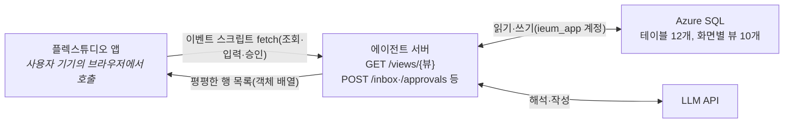

# 이음 — 연동 계획

2026-10-25 · 파이브 가이즈(임준현)

플렉스튜디오 화면, 에이전트 서버, Azure SQL을 어떻게 잇는지와 그렇게 정한 배경, 그리고 각자 해야 할 작업을 정리합니다. 테이블·뷰·API의 자세한 형식은 [MVP 스펙](이음-MVP-스펙.md)을 따릅니다.

## 한 줄 요약

Azure SQL에는 에이전트 서버만 접속합니다. 플렉스튜디오는 DB를 직접 보지 않고, 화면 조회와 넘기기·승인을 모두 이벤트 스크립트의 fetch로 서버 API에 보냅니다. 호출은 사용자 기기의 브라우저에서 나가므로, 서버는 IP가 아니라 CORS와 서버 키로 받습니다.



## 배경: 왜 이렇게 정했나

| 순서 | 검토한 안 | 결론 |
| --- | --- | --- |
| 1 | Supabase(Postgres) | 팀이 MSSQL 쪽을 원해 Azure SQL로 바꿈 |
| 2 | FlexDB(플렉스튜디오 내장 DB) + FlexSQL | FlexDB는 MySQL 기반이고, 바깥 서버가 직접 붙는 방법이 문서에 없음. 에이전트 서버와 같은 DB를 쓸 수 없어 제외 |
| 3 | Azure SQL을 FlexSQL 외부 DB로 연결해 화면이 뷰를 바로 조회 | 외부 DB 연동과 FlexSQL은 Business 플랜 이상인데, 우리 플랜은 Business가 아님. 쓸 수 없음 |
| 4 | 화면 스크립트에서 DB에 직접 fetch | DB는 HTTP가 아닌 TDS(1433)로만 받고, 화면 코드에 DB 접속 정보가 그대로 드러남. 불가 |
| 5 | API 연동 모듈로 에이전트 서버 API 호출 | 문서가 안내하는 방식이라 처음에 채택했으나 10/25 시험에서 막힘. 모듈은 만들고 배포할 수 있지만, 편집기의 TEST CALL이 손대지 않은 기본 샘플까지 500 오류를 내고, 이벤트의 API 액션에는 받는 카테고리 칸이 화면에 나오지 않음. 원인을 알 때까지 보류 |
| 6 | **이벤트 스크립트에서 fetch로 에이전트 서버 API 호출** | 10/25 시험에서 동작. 응답 객체 배열을 `f.Collection.addSector`로 카테고리에 넣으면 키 이름 그대로 들어감. 참고 시나리오(고객관리_CRM_Advanced)도 같은 방식으로 Supabase REST를 부름. **채택** |

### 10/25 시험 결과

시험용 시나리오 `ieum_api_test`에서 Step1의 로드 시(Loaded) 이벤트 `loadUsage`가 고정 JSON을 돌려주는 임시 주소를 fetch로 부르고, 응답을 `usage` 카테고리에 넣게 한 뒤 디버거로 실행했습니다.

| 확인한 것 | 결과 | 설계에 주는 영향 |
| --- | --- | --- |
| 컬렉션 반영 | 객체 배열 2행이 `usage_id`, `used_at`, `org_name`, `amount`, `match`, `quote`(null 포함) 키 이름 그대로 들어감. 변환 필요 없음 | 뷰의 컬럼 이름을 카테고리 키로 씀 |
| 호출 출처 | 출발 IP는 실행한 PC였고, 요청에 `Origin: https://scenario.flextudio.com`이 붙음. 플렉스튜디오 서버를 거치지 않음 | IP 허용은 쓸 수 없고 CORS가 필요함 |
| 사전 요청 | `X-Api-Key` 헤더 때문에 OPTIONS 사전 요청이 먼저 옴 | 서버가 OPTIONS에 키 검사 없이 응답해야 함 |
| 빈 섹터 | 카테고리 맨 앞에 값이 모두 null인 섹터가 하나 남음 | 반복 영역을 붙일 때 처리 방법을 정함 |
| 화면 목록 | 반복 영역을 붙이지 않아 시험하지 않음 | 다음 시험 |

API 연동 모듈은 호출이 플렉스튜디오 서버에서 나가 서버 키를 숨길 수 있다는 장점이 있습니다. 막힌 원인이 풀리면 다시 검토하되, 그때 화면 쪽만 바꾸면 되도록 서버 API 형식은 그대로 둡니다.

참고 문서: [스크립트 에디터](https://docs.flextudio.com/flextudio/scenario/dev-mode/event/script-editor.md), [컬렉션과 섹터](https://docs.flextudio.com/flextudio/concept/collection-sector.md), [API 연동](https://docs.flextudio.com/flextudio/workspace/interface/data/api.md), [외부 DB 연동](https://docs.flextudio.com/flextudio/reference/data-connection/db.md)

## 연동 방식

### 공통 스크립트

참고 시나리오처럼 Step1의 로드 이벤트에 공통 스크립트를 두고, 서버 주소·키와 호출 함수를 `_v`에 담아 모든 화면에서 씁니다. 아래는 형태 예시입니다.

```js
const API_BASE = 'https://<에이전트 서버 주소>';
const API_KEY = '<시연용 서버 키>';

// 조회: 뷰를 불러 카테고리를 덮어쓰고 그룹을 다시 그림
_v.loadView = (view, params, category, groupId) => {
  const query = new URLSearchParams(params).toString();
  return fetch(`${API_BASE}/views/${view}?${query}`, { headers: { 'X-Api-Key': API_KEY } })
    .then((res) => {
      if (!res.ok) throw new Error(`HTTP ${res.status}`);
      return res.json();
    })
    .then((rows) => {
      f.Collection.removeSector('all', category);
      rows.forEach((row) => f.Collection.addSector(row, category));
      f.Content(groupId).reload();
    });
};

// 쓰기: JSON으로 보내고 응답(행 하나 또는 run id)을 돌려줌
_v.post = (path, body) =>
  fetch(`${API_BASE}${path}`, {
    method: 'POST',
    headers: { 'X-Api-Key': API_KEY, 'Content-Type': 'application/json' },
    body: JSON.stringify(body),
  }).then((res) => {
    if (!res.ok) throw new Error(`HTTP ${res.status}`);
    return res.json();
  });
```

호출이 실패하면 `f.Toast()`로 알리고 화면의 카테고리는 그대로 둡니다.

### 조회

조회 API는 `GET /views/{뷰}` 하나입니다. 서버는 스펙의 [화면별 뷰](이음-MVP-스펙.md#화면별-뷰)만 받고(목록에 없는 이름은 거절), `SELECT * FROM v_xxx`에 쿼리 파라미터 조건(`child_id`, `application_id` 등)을 붙여 읽은 행을 그대로 객체 배열로 돌려줍니다. 화면은 로드 이벤트에서 `_v.loadView('v_usage', { child_id: 1 }, 'usage', '<그룹 fId>')`처럼 부릅니다. 아래 컬럼 이름은 예시이고, 실제 이름은 화면 담당과 합의해 정합니다.

```http
GET /views/v_usage?child_id=1
X-Api-Key: <서버 키>
```

```json
[
  {"usage_id": 7, "used_at": "2026-10-20", "org_name": "A 언어센터", "amount": 30000, "match": "확인 필요", "quote": "10/20 지우 결석 처리되었습니다"},
  {"usage_id": 8, "used_at": "2026-10-21", "org_name": "B 감각통합센터", "amount": 40000, "match": "일치", "quote": null}
]
```

- 뷰의 컬럼 이름이 곧 플렉스튜디오 카테고리 키입니다. 화면 쪽과 컬럼 이름을 먼저 맞춥니다.
- 중첩 JSON은 쓰지 않습니다. 어긋나는 게 생기면 `addSector` 전에 스크립트에서 맞춥니다.
- 카테고리 맨 앞에 남는 빈 섹터는 반복 영역을 붙이는 시험에서 처리 방법을 정합니다.

### 쓰기

넘기기·승인·프로필·시연 제어는 스펙의 [API](이음-MVP-스펙.md#api) 절대로 `_v.post`로 POST API를 부릅니다. 플렉스튜디오에는 자동 새로고침이 없으므로, 응답을 받은 뒤 같은 스크립트에서 해당 화면의 `_v.loadView`를 이어서 부릅니다. LLM이 걸리는 처리는 run id를 먼저 돌려주고, '결과 보기' 버튼으로 `GET /runs/{id}`를 부릅니다.

### 보안

호출이 사용자 기기에서 나가므로 IP로는 막을 수 없고, 스크립트에 적은 서버 키는 앱을 여는 누구나 볼 수 있습니다. 데이터가 모두 가상인 해커톤 범위에서 아래처럼 막습니다.

- **HTTPS:** 서버는 HTTPS로만 엽니다.
- **CORS:** 허용 Origin은 `https://scenario.flextudio.com`(디버거·미리보기, 10/25 확인)과 배포한 앱의 Origin(배포 뒤 확인해 추가)만 둡니다. 메서드는 GET·POST, 헤더는 `X-Api-Key`·`Content-Type`만 허용하고, OPTIONS 사전 요청에는 키 검사 없이 응답합니다.
- **서버 키:** `X-Api-Key` 헤더로 받되, 화면에 드러나는 값이라 가벼운 차단으로만 봅니다. 문서상 Secret Key는 API 연동 모듈의 Query·Header·Body에서 쓰는 기능이라 스크립트에는 키를 직접 적습니다. 시연용 키를 따로 만들고 발표가 끝나면 바꿉니다.
- **요청 수 제한:** 키·IP별로 분당 요청 수를 제한하고, LLM을 부르는 `POST /inbox`와 `/demo/*`는 더 낮게 둡니다.
- **조회 조건:** `/views`는 뷰 이름 허용 목록에 더해 뷰마다 조건으로 받을 컬럼을 정해 두고, 값은 파라미터 바인딩으로만 넣습니다.
- **공개 링크:** Embed와 Image는 브라우저가 주소를 직접 열어 헤더를 붙일 수 없습니다. `/outputs/{token}`, `/files/{token}`, `/share/{token}`은 키 검사에서 빼고, 추측할 수 없는 토큰(uniqueidentifier)으로만 엽니다.
- **DB 접속 정보:** 서버 환경 변수에만 둡니다. 저장소에 올리지 않습니다.

## 현재 Azure 상태

| 항목 | 값 |
| --- | --- |
| 구독 | Azure for Students(만들 수 있는 리전: koreacentral, japaneast, eastasia, malaysiawest, uaenorth) |
| 리소스 그룹 | `ieum-rg`(koreacentral) |
| SQL 서버 | `ieum-sql-d09cb3.database.windows.net` |
| DB | `ieum`, 서버리스 GP_S_Gen5, Azure SQL 무료 혜택 적용, 정렬 `Korean_Wansung_CI_AS`. 테이블 12개·뷰 10개·시드 데이터 적용(10/25, `server/sql/`) |
| 계정 | `ieumadmin`(관리자, 스키마 작업용), `ieum_app`(서버용 포함 사용자, 읽기·쓰기·프로시저 실행) |
| 방화벽 | `dev-pc`(119.205.75.234), `vercel-any`(0.0.0.0–255.255.255.255). Vercel은 나가는 IP가 고정이 아니어서 모든 IP를 열고 DB 로그인으로만 막음 |
| 접속 정보 | 10/25에 두 계정 비밀번호를 새로 발급. 임준현 Mac(wizmap)의 `~/.config/ieum/azure-sql.env`에 서버 키(`IEUM_API_KEY`)와 함께 있음. 예전 파일은 더 이상 쓸 수 없어 팀원에게 새로 전달 |
| 에이전트 서버 | Vercel 프로젝트 `ieum-agent-server`(CATrans 팀, 리전 icn1, 루트 디렉터리 `server`), `https://ieum-agent-server.vercel.app`. GitHub 저장소와 연결돼 main에 푸시하면 다시 배포됨 |

알아 둘 점이 세 가지 있습니다.

- **자동 일시 정지:** 1시간 동안 쓰지 않으면 DB가 멈추고, 깨어날 때 첫 접속이 실패하거나 수십 초 걸립니다. 서버는 연결을 재시도하게 만들고, 시연 직전에 한 번 조회해서 깨워 둡니다.
- **무료 한도:** 매달 100,000 vCore초까지 무료이고, 다 쓰면 과금 대신 그 달 말까지 멈춥니다. 리허설을 몰아서 할 때는 Azure 포털에서 남은 한도를 봅니다.
- **IP 변경:** 개발자 IP가 바뀌면 방화벽 규칙을 새로 넣어야 합니다.

## 해야 할 작업

### 플렉스튜디오 화면

- [x] 워크스페이스 [데이터] 메뉴에서 API 연동을 지금 플랜에서 쓸 수 있는지 확인(만들고 배포는 되지만 TEST CALL 500 오류, 받는 카테고리 칸 없음)
- [x] 스크립트 fetch로 고정 JSON을 불러 카테고리에 넣기 시험(`ieum_api_test`, 성공)
- [ ] 반복 영역에 카테고리를 연결해 목록이 뜨는지, 맨 앞 빈 섹터를 어떻게 처리할지 시험
- [ ] Step1 로드 이벤트에 공통 스크립트(`_v.loadView`, `_v.post`) 두기
- [ ] 화면마다 로드 이벤트에서 해당 뷰를 불러 카테고리 덮어쓰기
- [ ] 넘기기·승인·시연 제어 버튼에서 POST API를 부르고, 이어서 해당 화면 조회를 다시 부르기
- [ ] FileUpload로 올린 파일을 서버로 넘길 수 있는지 시험(안 되면 서버에 미리 올린 서류 이미지를 고르는 방식)
- [ ] 배포한 앱의 Origin을 확인해 서버 담당에게 전달(CORS 허용 목록)
- [ ] 넘기기·승인의 응답 시간을 실측해 run id로 돌릴 기준 정하기
- [ ] (선택) TEST CALL 500 오류와 숨은 카테고리 칸을 플렉스튜디오에 문의

### 에이전트 서버

- [x] 서버를 올릴 곳 정하기: Vercel(Node.js·TypeScript, `server/`)
- [x] Azure SQL 방화벽 열기(`vercel-any`)
- [x] 테이블 12개·뷰 10개 DDL과 시드 데이터 스크립트 작성, `ieumadmin`으로 적용(시드는 초안, 가상 데이터 확정 뒤 고침)
- [x] `GET /views/{뷰}`: 뷰 이름 허용 목록, 뷰별 조건 컬럼 허용 목록과 파라미터 바인딩, 객체 배열 응답
- [ ] 화면 담당과 뷰별 컬럼 이름(=카테고리 키) 합의
- [ ] POST /profile, /inbox, /approvals/{id}, /demo/* 와 GET /outputs/{token}, /files/{token}, /runs/{id}
- [x] CORS(허용 Origin, OPTIONS 응답), 서버 키 검사
- [ ] 요청 수 제한
- [ ] 공개 링크 토큰 발급, 공개 링크 경로는 키 검사에서 빼기
- [x] `ieum_app` 계정으로 DB 접속, 일시 정지 대비 연결 재시도, 유휴 연결 30초 뒤 닫기
- [ ] 홈 카드 중 승인이 필요 없는 카드(T3·T4·T9)를 담을 곳 정하기(지금 `v_home_card`는 승인 대기 항목만 보여 줌)
- [ ] LLM 호출 시간 제한(8초)과 대체 결과([스펙](이음-MVP-스펙.md#llm-호출과-대체-결과))

### 시나리오·발표

- [ ] 시드 데이터에 들어갈 가상 데이터(문자 12개, 이용 내역 6건, 공고 5건, 서류) 확정
- [ ] 리허설 때 LLM 대체 결과 파일 만들기
- [ ] 시연 직전 DB 깨우기와 방화벽 확인을 리허설 체크리스트에 넣기
- [ ] 발표가 끝나면 시연용 서버 키 바꾸기
