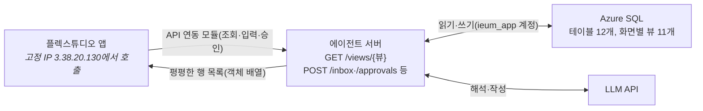

# 이음 — 연동 계획

2026-10-25 · 파이브 가이즈(임준현)

플렉스튜디오 화면, 에이전트 서버, Azure SQL을 어떻게 잇는지와 그렇게 정한 배경, 그리고 각자 해야 할 작업을 정리합니다. 테이블·뷰·API의 자세한 형식은 [MVP 스펙](이음-MVP-스펙.md)을 따릅니다.

## 한 줄 요약

Azure SQL에는 에이전트 서버만 접속합니다. 플렉스튜디오는 DB를 직접 보지 않고, 화면 조회와 넘기기·승인을 모두 API 연동 모듈로 서버 API에 보냅니다.



## 배경: 왜 이렇게 정했나

| 순서 | 검토한 안 | 결론 |
| --- | --- | --- |
| 1 | Supabase(Postgres) | 팀이 MSSQL 쪽을 원해 Azure SQL로 바꿈 |
| 2 | FlexDB(플렉스튜디오 내장 DB) + FlexSQL | FlexDB는 MySQL 기반이고, 바깥 서버가 직접 붙는 방법이 문서에 없음. 에이전트 서버와 같은 DB를 쓸 수 없어 제외 |
| 3 | Azure SQL을 FlexSQL 외부 DB로 연결해 화면이 뷰를 바로 조회 | 외부 DB 연동과 FlexSQL은 Business 플랜 이상인데, 우리 플랜은 Business가 아님. 쓸 수 없음 |
| 4 | 화면 스크립트에서 DB에 직접 fetch | DB는 HTTP가 아닌 TDS(1433)로만 받고, 화면 코드에 DB 접속 정보가 그대로 드러남. 불가 |
| 5 | **API 연동 모듈로 에이전트 서버 API 호출** | 문서가 안내하는 방식. 서버가 뷰를 읽어 행 목록으로 돌려주면 응답이 컬렉션에 바로 들어감. **채택** |

API 연동 모듈을 기본으로 고른 이유는 세 가지입니다.

- **호출 출처가 고정됨:** 호출이 플렉스튜디오 서버의 고정 IP(3.38.20.130)에서 나가서, 에이전트 서버는 이 IP만 허용하면 되고 CORS를 신경 쓰지 않아도 됩니다.
- **응답이 화면에 바로 붙음:** 객체 배열 응답은 2차원 배열(Result)로 자동 변환되고, 이벤트의 API 액션에서 카테고리에 "화면에 반영하기·덮어쓰기"로 넣을 수 있습니다.
- **스크립트 fetch는 문서에 없음:** 이벤트 스크립트가 Javascript인 것은 맞지만, 그 안에서 fetch가 되는지와 어디서 실행되는지는 문서에 나오지 않습니다. 그래서 모듈이 막혔을 때의 대안으로만 둡니다.

참고 문서: [API 연동](https://docs.flextudio.com/flextudio/workspace/interface/data/api.md), [API 호출 액션](https://docs.flextudio.com/flextudio/scenario/dev-mode/event/api.md), [스크립트 에디터](https://docs.flextudio.com/flextudio/scenario/dev-mode/event/script-editor.md), [외부 DB 연동](https://docs.flextudio.com/flextudio/reference/data-connection/db.md)

## 연동 방식

### 조회

조회 API는 `GET /views/{뷰}` 하나입니다. 서버는 스펙의 [화면별 뷰](이음-MVP-스펙.md#화면별-뷰) 11개만 받고(목록에 없는 이름은 거절), `SELECT * FROM v_xxx`에 쿼리 파라미터 조건(`child_id`, `application_id` 등)을 붙여 읽은 행을 그대로 객체 배열로 돌려줍니다. 아래 컬럼 이름은 예시이고, 실제 이름은 화면 담당과 합의해 정합니다.

```http
GET /views/v_usage?child_id=1
X-Api-Key: <서버 키>
```

```json
[
  {"usage_id": 7, "used_on": "2026-10-20", "org_name": "A 언어센터", "amount": 30000, "match_status": "결석일 결제", "quote": "10/20 지우 결석 처리되었습니다"},
  {"usage_id": 8, "used_on": "2026-10-21", "org_name": "B 감각통합센터", "amount": 40000, "match_status": "일치", "quote": null}
]
```

- 뷰의 컬럼 이름이 곧 플렉스튜디오 컬렉션 키입니다. 화면 쪽과 컬럼 이름을 먼저 맞춥니다.
- 중첩 JSON은 쓰지 않습니다. 어긋나는 게 생기면 API 연동의 Result Convert Script로 맞춥니다.
- 플렉스튜디오에는 이 모듈 하나를 등록하고, 뷰 이름과 조건은 Event Config Key로 넘깁니다.

### 쓰기

넘기기·승인·프로필·시연 제어는 스펙의 [API](이음-MVP-스펙.md#api) 절대로 POST API를 부릅니다. 플렉스튜디오에는 자동 새로고침이 없으므로, 쓰기 API를 부른 같은 이벤트에서 해당 화면의 `GET /views/{뷰}`를 이어서 부릅니다. LLM이 걸리는 처리는 run id를 먼저 돌려주고, '결과 보기' 버튼으로 `GET /runs/{id}`를 부릅니다.

### 보안

- 에이전트 서버는 HTTPS로 열고, 플렉스튜디오 IP(3.38.20.130)와 개발자 IP만 허용합니다.
- 서버 키는 요청 헤더로 받고, 플렉스튜디오 쪽에는 Secret Key로 보관합니다.
- DB 접속 정보는 서버 환경 변수에만 둡니다. 저장소에 올리지 않습니다.

## 현재 Azure 상태

| 항목 | 값 |
| --- | --- |
| 구독 | Azure for Students(만들 수 있는 리전: koreacentral, japaneast, eastasia, malaysiawest, uaenorth) |
| 리소스 그룹 | `ieum-rg`(koreacentral) |
| SQL 서버 | `ieum-sql-d09cb3.database.windows.net` |
| DB | `ieum`, 서버리스 GP_S_Gen5, Azure SQL 무료 혜택 적용, 정렬 `Korean_Wansung_CI_AS`. 아직 테이블 없음 |
| 계정 | `ieumadmin`(관리자, 스키마 작업용), `ieum_app`(서버용, 읽기·쓰기·프로시저 실행) |
| 방화벽 | `dev-pc` 하나(119.205.75.234) |
| 접속 정보 | 임준현 PC의 `~/.config/ieum/azure-sql.env`. 팀원에게는 따로 전달 |

알아 둘 점이 세 가지 있습니다.

- **자동 일시 정지:** 1시간 동안 쓰지 않으면 DB가 멈추고, 깨어날 때 첫 접속이 실패하거나 수십 초 걸립니다. 서버는 연결을 재시도하게 만들고, 시연 직전에 한 번 조회해서 깨워 둡니다.
- **무료 한도:** 매달 100,000 vCore초까지 무료이고, 다 쓰면 과금 대신 그 달 말까지 멈춥니다. 리허설을 몰아서 할 때는 Azure 포털에서 남은 한도를 봅니다.
- **IP 변경:** 개발자 IP가 바뀌면 방화벽 규칙을 새로 넣어야 합니다.

## 해야 할 작업

### 플렉스튜디오 화면

- [ ] 워크스페이스 [데이터] 메뉴에서 API 연동을 지금 플랜에서 쓸 수 있는지 확인 **(가장 먼저)**
- [ ] 서버가 열리기 전에는 고정 JSON을 돌려주는 임시 주소로 API 연동 모듈 등록, 응답 객체 배열이 컬렉션 반복 영역에 그대로 들어가는지 시험
- [ ] `GET /views/{뷰}` 모듈 하나 등록(뷰 이름·조건은 Event Config Key, 서버 키는 Secret Key)
- [ ] 화면마다 진입 이벤트에서 해당 뷰를 불러 카테고리에 덮어쓰기
- [ ] 넘기기·승인·시연 제어 버튼에 POST API를 붙이고, 이어서 해당 화면 조회를 다시 부르기
- [ ] FileUpload로 올린 파일을 서버로 넘길 수 있는지 시험(안 되면 서버에 미리 올린 서류 이미지를 고르는 방식)
- [ ] API 호출이 응답을 얼마나 기다리는지 실측
- [ ] API 연동 모듈을 못 쓰면: 이벤트 스크립트에서 fetch로 서버를 부를 수 있는지 시험하고 서버 담당에게 CORS 허용 요청

### 에이전트 서버

- [ ] 서버를 올릴 곳 정하기. Azure App Service(koreacentral)를 쓰면 `az provider register -n Microsoft.Web` 먼저
- [ ] 정한 곳의 나가는 IP를 Azure SQL 방화벽에 추가(App Service라면 outbound IP 목록 전체)
- [ ] 테이블 12개·뷰 11개 DDL과 시드 데이터 스크립트 작성, `ieumadmin`으로 적용
- [ ] `GET /views/{뷰}`: 뷰 이름 허용 목록, 쿼리 파라미터 조건, 객체 배열 응답
- [ ] 화면 담당과 뷰별 컬럼 이름(=컬렉션 키) 합의
- [ ] POST /profile, /inbox, /approvals/{id}, /demo/* 와 GET /outputs/{id}, /runs/{id}
- [ ] 플렉스튜디오 IP 허용, 서버 키 헤더 검사, `ieum_app` 계정으로 DB 접속, 일시 정지 대비 연결 재시도
- [ ] LLM 호출 시간 제한(8초)과 대체 결과([스펙](이음-MVP-스펙.md#llm-호출과-대체-결과))

### 시나리오·발표

- [ ] 시드 데이터에 들어갈 가상 데이터(문자 12개, 이용 내역 6건, 공고 5건, 서류) 확정
- [ ] 리허설 때 LLM 대체 결과 파일 만들기
- [ ] 시연 직전 DB 깨우기와 방화벽 확인을 리허설 체크리스트에 넣기
