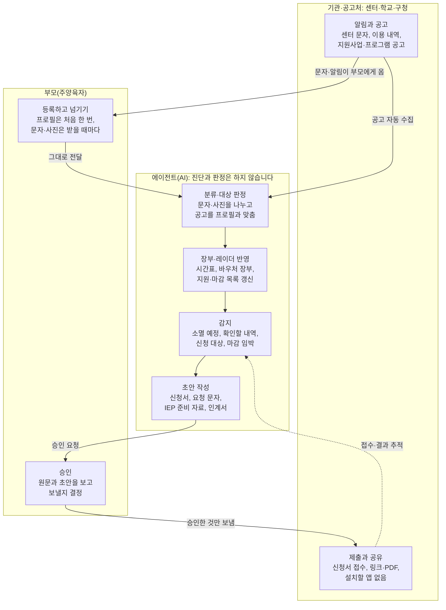

# 이음 — 흩어진 장애아동 지원을 하나로 묶어주는 AI

2026-10-24 · 파이브 가이즈(임준현) · 2026 캡스톤 디자인 및 AI 해커톤

## 개요

이음은 장애·발달지연 아동 부모가 여러 기관에 흩어진 바우처, 일정, 지원 공고, 치료 기록을 손으로 엮는 일을 AI가 아이 한 명 기준으로 묶어 대신하는 서비스입니다. 받을 수 있는 지원은 먼저 찾아 신청까지 돕고, 부모는 승인만 합니다. 플렉스튜디오 해커톤 자유공모 트랙 출품작입니다.

> 문제는 지원이 아니라, 지원의 연결입니다. 저희는 AI로 끊어진 연결을 잇겠습니다.

- **한 줄 피치:** 문자와 서류를 넘기면 AI가 아이 한 명 기준으로 묶고 정리하고, 부모는 승인만 합니다. 받을 수 있는 지원은 AI가 먼저 찾아 신청까지 준비합니다.
- **핵심 기능 세 가지:** 한 장 장부(바우처·일정·결제를 한 장부로), 맞춤 지원 레이더(우리 아이 지원만 찾아 신청까지), 아이 이력서(여러 기관의 기록을 IEP 준비·인계서 한 장으로)
- **핵심 논지:** 지원이 없어서가 아니라, 흩어진 지원을 아이 한 명 기준으로 묶어 줄 사람이 없어서 쓰이지 못합니다. AI가 그 사람이 됩니다.
- **이름:** '이음'은 기관마다 끊어진 지원을 아이 한 명에게 잇는다는 뜻입니다. 설계는 ERP를 아이 한 명 단위로 옮긴 IRP(Individual Resource Planning)를 바탕으로 합니다([설계 배경](#설계-배경-erp를-아이-한-명-단위로)).

## 문제

장애·발달지연 아동 부모는 여러 기관과 제도에 흩어진 일정, 바우처, 지원 정보, 치료 기록을 혼자 엮고 있습니다. 대상 아동은 늘고, 지원은 있는데 쓰이지 못하며, 제도는 담당 기관마다 따로 돌아 그 빈틈을 부모가 메웁니다.

> "암 진단을 받으면 병원에서 치료 일정을 함께 짜주잖아요. 그런데 발달지연은 진단 이후 모든 게 부모 몫이에요." — 발달지연 아동 어머니([투데이신문, 2025](https://www.ntoday.co.kr/news/articleView.html?idxno=117191))

### 아이는 줄고, 도움이 필요한 아이는 늘었습니다

- 2015년에서 2025년 사이 18세 미만 아동은 25.5% 줄었지만, 등록 장애아동은 7만 2,583명에서 9만 2,094명으로 26.9% 늘었습니다. 그중 76.6%가 발달장애입니다(한국장애인개발원 「통계로 보는 장애아동」, 2026.8; [서울신문](https://www.seoul.co.kr/news/society/2026/08/13/20260813012002), [더인디고](https://theindigo.co.kr/archives/69312)).
- 그 돌봄은 부모의 몫입니다. 발달장애 자녀를 둔 어머니 1,903명 중 74.9%가 돌봄 때문에 일을 그만둔 경험이 있었습니다([국민일보](https://www.kmib.co.kr/article/view.asp?arcid=9000022876&code=61121111&sid1=soc), 서울대 연구팀).
- 발달재활 바우처를 쓰는 아이는 2026년 11만 명이고, 2027년 11만 6,000명으로 늘어날 예정입니다([파이낸셜뉴스](https://www.fnnews.com/news/202609100901313074)).
- 등록 전 단계인 발달지연 아동도 2019년 6만 8,748명에서 2024년 14만 4,169명으로 늘었습니다([매일신문](https://www.imaeil.com/page/view/2025111315133422886)). 등록 장애아동과는 집계 기준이 달라 합산하지 않습니다.

### 지원은 있는데, 쓰이지 못했습니다

- 2025년 발달재활 바우처 생성액 2,908.1억 원 중 755.1억 원(26%)이 쓰이지 않았습니다. 같은 시기 바우처를 기다리는 아이도 있었습니다(보건복지부 국정감사 자료, 박지원 의원실; [뉴스포털1](http://www.civilreporter.co.kr/news/articleView.html?idxno=544923), [알파경제](https://www.alphabiz.co.kr/news/articleView.html?idxno=184495)).
- 지원이 없어서가 아니라, 흩어진 지원을 아이 한 명 기준으로 묶어 줄 사람이 없어서입니다. 다만 쓰이지 않은 원인은 자료에서 나뉘지 않으므로, 그중 정보·일정 문제의 비중은 검증할 가설입니다.

### 제도는 담당 기관마다 따로 돌아갑니다

현장 전문가들은 서비스 간 연계 부족과 분절된 전달체계를 꼽습니다. 경기복지재단 조사에서 지역사회 서비스 연계가 원활하지 않다는 응답은 47.6%였고, 보건복지·교육 전달체계가 나뉘어 부모가 서비스를 직접 알아보고 각각 신청해야 한다는 점이 지적됐습니다([경기복지재단, 2025.12](https://ggwf.gg.go.kr/archives/69693)). 의료, 교육, 돌봄이 따로 돌면서 생긴 빈틈은 부모가 메웁니다.

| 제도 | 담당 | 부모가 챙길 것 |
| --- | --- | --- |
| 발달재활서비스 바우처 | 시·군·구, 국민행복카드 | 소득별 월 18만\~26만 원, 본인부담 0\~8만 원, 쓰지 않은 금액은 월말일에 소멸([금천구청](https://geumcheon.go.kr/portal/contents.do?key=4901)) |
| 교육청 치료지원 | 교육청, 학교 | 서울 기준 월 16만 원 별도 카드, 복지부 바우처와 같은 영역은 중복 불가([서울시교육청](https://www.sen.go.kr/www/eduinfo/specialedu/specialinfo/specialinfo_2.jsp)) |
| 개별화교육계획(IEP) | 학교 개별화교육지원팀 | 매 학기 시작 30일 안에 작성, 보호자는 법정 팀원([특수교육법 시행규칙](https://www.law.go.kr/법령/장애인등에대한특수교육법시행규칙)) |
| 장애아가족 양육지원 | 주민센터 신청 | 2026년 연 1,200시간, 2027년 1,320시간으로 확대([파이낸셜뉴스](https://www.fnnews.com/news/202609100901313074)) |
| 장애아동수당 | 주민센터 | 중증 월 최대 22만 원, 경증 월 최대 11만 원([인천시](https://www.incheon.go.kr/welfare/WE010207)) |
| 지자체·복지관 프로그램 | 구청, 복지관, 장애아동지원센터 | 기관마다 따로 올라오는 모집 공고와 마감 |

### 정보와 시간은 부모에게서 새어 나갑니다

- 대구 실태조사(2023)에서 행정기관을 통해 복지 정보를 얻은 비율은 8.9%였습니다([매일신문](https://www.imaeil.com/page/view/2025111315133422886)).
- 발달장애인 부모상담 바우처 이용률은 62.1%에 그쳤습니다([더인디고](https://theindigo.co.kr/archives/69726)).
- 장애 미등록 아동 중 발달재활 바우처를 기다리는 아이는 5,360명(2026년 5월)이었습니다([뉴스포털1](http://www.civilreporter.co.kr/news/articleView.html?idxno=544923), [알파경제](https://www.alphabiz.co.kr/news/articleView.html?idxno=184495)).

### 부모가 지금 손으로 하는 일

1. 언어치료, 감각통합, 놀이치료, 병원, 학교 일정을 달력에 옮기고 결석과 보강을 맞춥니다.
2. 이번 달 바우처가 얼마 남았는지, 본인부담금이 얼마인지 계산합니다.
3. 이용 내역을 기억과 대조합니다. 정부가 꼽은 전자바우처 부정수급 최대 유형도 서비스가 없던 날의 결제(13개 사업 전체 146억 원, 31%)입니다([정책브리핑](https://www.korea.kr/news/policyNewsView.do?newsId=148973557), [KDI 경제정보센터](https://eiec.kdi.re.kr/policy/materialView.do?num=288127)).
4. 구청, 복지관, 교육청에 따로 올라오는 지원사업과 프로그램 공고를 찾아보고, 신청서와 서류를 준비합니다.
5. 학기마다 IEP를 하거나 기관을 옮길 때, 지금까지의 치료 이력을 처음부터 다시 정리합니다.

## 해결: 이음

**문자와 서류를 넘기면 → AI가 묶고 정리 → 부모는 승인만.** 아이 정보와 찾고 싶은 지원 유형은 처음 한 번 등록하고, 그다음엔 부모가 받은 문자와 서류를 넘기기만 합니다. 지원 공고는 AI가 직접 가져오고, 분류부터 신청 준비까지 AI가 아이 한 명 기준으로 묶어 처리하며 부모는 승인만 합니다.

| 구분 | 하는 일 |
| --- | --- |
| AI가 알아서 | 문자·사진 분류, 일정·장부 반영, 이용 내역과 출석 대조, 지원 공고 수집과 대상 판정, 마감·유효기간 감지, 신청서와 문서 초안 작성 |
| 부모 승인 후 | 기관에 보내는 모든 메시지, 신청서 제출, 문서 공유 |
| 부모가 직접 | 본인 인증이 필요한 발급과 제출(정부24 등). AI는 단계별 안내와 붙여넣을 내용을 준비 |
| 하지 않음 | 진단, 치료 방향 판단, 기관 평가, 부정수급 여부 판정 |

### 입력은 세 갈래입니다

- **처음 한 번:** 아이 프로필(나이·학년, 장애 유형, 사는 곳, 바우처 소득 구간, 다니는 기관)과 찾고 싶은 지원 유형. 결정통지서 사진으로 채울 수도 있습니다.
- **받을 때마다:** 센터 알림 문자와 앱 알림 전달, 결정통지서·안내문·검사지 사진, 원할 때만 부모의 한마디("오늘 처음으로 '물'이라고 했어요")
- **연동으로 자동:** 바우처 이용 내역과 발달센터의 일정 변경·결석 안내. 연동 전이거나 연동되지 않는 기관은 부모가 이용 내역 화면 캡처와 문자를 넘기는 방식으로 시작하고, 연동 범위를 넓혀 갑니다.
- **AI가 직접:** 정부·지자체·교육청·복지관의 지원사업과 프로그램 공고. 공공데이터 API 같은 공식 연계를 먼저 쓰고, 공개된 공고 수집은 보조로 씁니다.

## 사용자와 역할

앱을 쓰는 사람은 주양육자 한 명이고, 기관은 앱을 깔지 않고 결과물만 받습니다. 쓰는 사람이 늘수록 실패한다는 것이 육아 IRP에서 얻은 교훈입니다.

| 누구 | 역할 | 쓰는 방식 |
| --- | --- | --- |
| 주양육자 | 프로필 등록, 문자·서류 전달, 승인 | 앱 |
| 다른 보호자(배우자, 조부모) | 시간표와 기록 열람 | 공유 링크(선택) |
| 치료사, 특수교사 | 인계서·IEP 준비 자료 받기 | 링크·PDF, 설치 없음 |
| 복지관, 구청, 장애아동지원센터 | 공고를 내고 신청서를 받음 | 평소 쓰던 접수 방식 그대로(이메일, 온라인 접수 등) |

대상은 미취학부터 초등 저학년까지의 발달장애·발달지연 아동 가정입니다. 만 9세 미만은 장애 등록 없이 의뢰서와 검사 자료로 발달재활 바우처를 신청할 수 있어, 등록 전 단계 가정도 포함합니다([금천구청](https://geumcheon.go.kr/portal/contents.do?key=4901)).

## 핵심 기능

기능은 세 가지이고, 각각 부모의 질문 하나에 답합니다. 발표 시연의 주인공은 한 장 장부와 맞춤 지원 레이더입니다. 쓰이지 못하고 사라지는 지원(755억 원)을 바로 겨냥하는 기능이기 때문입니다. 아이 이력서는 장부와 레이더가 쌓은 기록을 용도별 한 장으로 바꾸는 세 번째 기능입니다.

| 기능 | 한 줄 정의 | 답하는 질문 | 넣는 것 | AI가 하는 일 | 부모가 하는 일 |
| --- | --- | --- | --- | --- | --- |
| 1. 한 장 장부 | 바우처·일정·결제를 한 장부로 묶고, 사라지기 전에 알림 | "이번 달 돈과 시간, 괜찮아?" | 센터 문자·앱 알림, 바우처 이용 내역 | 시간표·바우처 잔액·본인부담을 정리하고, 월말 소멸 예정이면 보강을 제안. 이용 내역과 출석이 안 맞으면 확인할 곳을 안내하고, 복지부·교육청 같은 영역 중복을 경고 | 보강·확인 요청 승인 |
| 2. 맞춤 지원 레이더 | 흩어진 지원 공고에서 우리 아이 것만 찾아 신청까지 | "우리 아이가 받을 수 있는 것, 해야 할 것은?" | 아이 프로필, 서류 사진(공고는 AI가 직접 수집) | 흩어진 지원사업·프로그램 공고에서 아이에게 맞는 것만 골라 알리고, 신청서 초안·필요 서류 확인·제출·결과 추적까지 진행. 서류 유효기간과 IEP 기한도 챙김 | 신청 승인, 본인 인증 단계 |
| 3. 아이 이력서 | 여러 기관의 기록을 IEP 준비·인계서 한 장으로 | "우리 아이를 어떻게 설명하지?" | 쌓인 치료 피드백, 검사지 사진, 부모 한마디 | 기관별 목표와 진척을 엮어 IEP 협의 준비 자료, 새 선생님 인계서, 진료 전 요약, 신청서용 아이 소개를 한 장으로 만듦 | 확인 후 공유 |

### 신청 도우미: 레이더가 찾은 지원을 끝까지 가져갑니다

1. **찾기:** 공고를 모아 아이 프로필(나이, 장애 유형, 사는 곳, 소득 구간)과 맞춰 보고, 해당하는 것만 "왜 해당하는지"와 함께 알립니다.
2. **준비:** 신청서 빈칸은 프로필과 아이 이력서로 채우고, 필요한 서류를 서류함에서 찾습니다. 없거나 만료된 서류는 발급 방법을 안내합니다.
3. **제출:** 이메일·온라인 접수처럼 대신 낼 수 있는 곳은 부모 승인 뒤에 제출합니다. 정부24처럼 본인 인증이 필요한 곳은 단계별 안내와 붙여넣을 내용을 준비합니다.
4. **추적:** 접수 확인, 보완 요청, 결과 발표일을 레이더에 올리고, 선정되면 일정과 장부에 반영합니다.

**부모는 한 번 등록하고, 넘기고, 승인만 합니다**

기관의 문자는 부모가 넘기고, 공고는 에이전트가 직접 모읍니다. 분류부터 초안까지 에이전트가 처리하고, 부모가 승인한 것만 기관으로 나가며, 접수와 결과는 다시 레이더가 추적합니다.

## 설계 배경: ERP를 아이 한 명 단위로

이음의 엔진은 ERP의 통합 원장, 예산, 대사, 구매, 결재를 아이 한 명 단위로 옮긴 IRP(Individual Resource Planning)입니다. 3분 발표에는 넣지 않고, ERP 회사 심사위원의 질문에 답할 때 서비스를 가장 익숙한 언어로 설명하는 장치로 씁니다.

| ERP 개념 | 이음에서 | 기능 |
| --- | --- | --- |
| 통합 원장 | 기관마다 흩어진 기록을 하나로 모음 | 공통 |
| 예산·집행 관리 | 바우처는 예산, 본인부담금은 비용, 월말 소멸은 불용액 | 한 장 장부 |
| 대사·감사 | 이용 내역과 출석을 대조 | 한 장 장부 |
| 생산계획 | 주간 치료 시간표와 보강 배치 | 한 장 장부 |
| 소싱·구매 | 아이에게 맞는 지원·프로그램을 찾아 신청(구매 요청 → 발주 → 입고 확인) | 맞춤 지원 레이더 |
| 문서·계약 관리 | 결정통지서와 서류 유효기간, IEP 기한 | 맞춤 지원 레이더 |
| 이력 추적 | 치료 이력, 목표 대비 진척 | 아이 이력서 |
| 결재 | 바깥으로 나가는 모든 것은 부모 승인 | 공통 |

관리하는 리소스는 넷이고, 모두 한도나 기한이 있어서 계획이 필요합니다.

| 리소스 | 한도·기한 | 이음이 하는 일 |
| --- | --- | --- |
| 돈 | 발달재활 바우처 월 18만\~26만 원, 쓰지 않으면 월말 소멸 | 소멸 전에 보강을 제안 |
| 시간 | 장애아가족 양육지원 2026년 연 1,200시간 | 남은 시간을 알리고 신청 초안을 준비 |
| 자리 | 치료 시간표, 바우처 대기 | 보강과 기관 이동 일정을 배치 |
| 기회 | 지원사업·프로그램의 모집 정원과 마감 | 맞는 공고를 찾아 마감 전에 신청 |

## 경험 설계 원칙

엔진은 ERP처럼 일하고, 화면은 가족의 언어로 말합니다. 지친 부모에게 또 하나의 관리 도구가 되지 않는 것이 첫 번째 기준입니다.

- **매일 쓰는 입력 폼이 없습니다.** 아이 프로필은 처음 한 번만 등록하고, 그다음엔 전달과 사진이 전부입니다. 화면에 '손으로 하던 일 n단계 → 승인 n번' 카운터를 띄워 줄어든 일을 보여 줍니다.
- **승인만 합니다.** 기관에 나가는 메시지, 신청서, 문서는 모두 부모가 확인한 뒤에 나갑니다. 승인 전에는 AI가 읽은 원문을 옆에 함께 보여 줍니다.
- **대신 낼 수 있는 것만 대신 냅니다.** 본인 인증이 필요한 발급과 제출은 부모가 직접 하고, AI는 단계별 안내와 붙여넣을 내용을 준비합니다.
- **알림은 적게, 이유와 함께 보냅니다.** 지원 공고는 아이에게 해당하는 것만, "왜 해당하는지"와 마감일을 붙여 알립니다.
- **기관은 아무것도 설치하지 않습니다.** 치료사와 교사는 링크나 PDF로, 복지관은 평소 쓰던 접수 방식으로 받습니다.
- **판단하지 않습니다.** 진단과 치료 방향은 치료사가, 부정수급 여부는 담당 기관이, 결정은 부모가 합니다. AI는 기록, 정리, 마감, 대조, 준비만 합니다.
- **가족의 언어로 말합니다.** '불일치 1건' 대신 "확인이 필요한 이용 내역이 1건 있어요"라고 말합니다. 진척은 성적표가 아니라 성장 기록으로 보여 줍니다.
- **작은 처음을 남깁니다.** 부모의 한마디 중 '처음 해낸 날'을 따로 모아 아이 이력서에 담습니다.
- **쉼도 리소스입니다.** 양육지원 시간이 남았으면 "이번 주 토요일 오후, 돌봄 지원을 신청해 둘까요?"라고 먼저 묻습니다.

## 비즈니스 모델과 확산

**가정은 무료, 가정을 돕는 곳이 냅니다.** 부모의 일을 덜어 주는 서비스라 부모에게는 받지 않습니다. 비즈니스 모델은 B2G가 중심이고, 핵심 고객은 지자체 예산으로 움직이는 장애아동지원센터입니다. 아래 구조는 아직 검증 전인 가설이고, 국내에서 지자체가 부모용 민간 앱을 구매한 선례는 찾지 못했습니다. 국내는 시범 운영으로 검증합니다.

| 구분 | 고객 | 그들이 얻는 것 | 과금(가설) |
| --- | --- | --- | --- |
| 1. 핵심 고객 | 장애아동지원센터(지자체) | 센터가 세우는 아이별 지원계획에 부모가 정리한 한 장이 바로 들어가고, 지원사업이 대상 가정에 정확히 닿음 | 지자체 예산 · 가정별 라이선스 |
| 2. 확장 고객 | 기업 복지 | 돌봄 때문에 일을 그만두는 직원을 줄임 | 임직원 복지 상품 |
| 3. 연동 파트너 | 발달센터 | 일정 변경·결석 안내가 부모 장부에 바로 반영돼 문의와 정산 확인이 줄어듦 | 연동 수수료 |

핵심 고객은 시점이 근거입니다. 2026년 7월 대구와 경기가 장애아동지원센터를 열고 '원스톱'과 '끊김 없는 통합 지원'을 목표로 내걸었습니다([경북매일](https://kbmaeil.com/article/20260714500551), [서울신문](https://m.go.seoul.co.kr/news/2026/07/15/20260715500229)). 레이더는 이 센터와 지자체의 프로그램이 대상 가정에 닿는 통로가 됩니다. 해외에는 정부가 비용을 내는 선례가 있습니다. 호주 NDIS는 가족의 계획·청구 대행에 참여자 1명당 월 최대 104.45호주달러를 지급하고([Leap in!](https://www.leapin.com.au/news/changes-to-ndis-price-limits-from-1-july-2025/)), 영국 지자체는 AI로 지원계획 초안을 쓰는 도구를 정부 조달 플랫폼에서 구매합니다([G-Cloud 14](https://www.applytosupply.digitalmarketplace.service.gov.uk/g-cloud-14/services/790022504915662)).

확장 고객은 미국에서 작동하는 시장이 근거입니다. 돌봄 내비게이션 서비스 Wellthy는 고용주 약 350곳에 팔립니다([TechCrunch](https://techcrunch.com/2023/05/11/wellthy-lands-25m-to-grow-its-tech-enabled-care-concierge-business)). 국내에서는 발달장애 자녀를 둔 어머니의 74.9%가 돌봄 때문에 일을 그만둔 경험이 있다는 점이 직원 이탈 위험의 근거입니다([국민일보](https://www.kmib.co.kr/article/view.asp?arcid=9000022876&code=61121111&sid1=soc)). 연동 파트너는 센터가 이미 관리 소프트웨어에 월 4만 4,000원을 내고 있다는 점이 근거입니다([케어플센터](https://www.careplecenter.com/)).

가정에 구독료를 받지 않는 이유는 치료비 부담이 이미 크기 때문입니다. 정부 지원 단가는 회기당 3만 원인데 제공기관 평균 단가는 5만 3,795원입니다([뉴스포털1](http://www.civilreporter.co.kr/news/articleView.html?idxno=544923)).

### 확산 채널

- **처음 걱정하는 순간:** 영유아 건강검진에서 심화평가 권고를 받은 가정과 첫 발달센터 상담 때, "지금까지 기록 한 장 정리"를 무료로 제공
- **장애아동지원센터:** 신설 센터의 첫 상담에서 아이 프로필 등록을 함께 진행
- **지원 기관:** 발달장애인지원센터와 장애인복지관의 부모 교육 프로그램
- **부모 커뮤니티:** 실제로 쓰는 부모가 공유한 '한 장'이 다음 가정을 데려옴

## 리스크와 대응

가장 큰 리스크는 '센터 앱이나 정부 포털로 충분하다'는 반론과 '부모가 또 입력해야 한다'는 의심입니다. 둘 다 시연에서 직접 보여 주는 방식으로 답합니다.

| 예상 질문·리스크 | 대응 |
| --- | --- |
| 센터 앱이 이미 있지 않나요? | [케어플센터](https://www.careplecenter.com/)와 [크로노젠](https://blog.cronozen.com/post/1271)은 센터 한 곳의 창입니다. 여러 기관과 학교, 구청을 엮는 건 부모 쪽 통합이고, 센터 앱 알림도 재료로 씁니다. |
| 복지로나 온맘 같은 정부 포털이 있지 않나요? | 온맘은 양육·교육 정보를 한눈에 보여 주는 포털입니다([정책브리핑](https://www.korea.kr/news/policyNewsView.do?newsId=148932970)). 이음은 기관마다 따로 올라오는 작은 공고까지 모아 우리 아이 기준으로 거르고, 신청서 작성과 결과 추적까지 이어 갑니다. |
| 바우처 이용 내역 연동이 실제로 되나요? | 시연은 연동된 상태를 목업으로 보여 줍니다. 실서비스는 부모가 이용 내역 화면 캡처를 넘기는 방식으로 시작하고(지금도 동작하며 바로 보여 드릴 수 있습니다), B2G 시범 운영과 발달센터 연동 파트너를 통해 공식 연동으로 확장합니다. |
| 부모가 또 입력해야 하지 않나요? | 처음 한 번 프로필을 등록한 뒤로는 전달과 사진뿐입니다. 시연 카운터로 줄어든 일을 보여 줍니다. |
| 결석한 날 결제는 부정수급 아닌가요? | 맞습니다. 그래서 AI는 판정하지 않고 "센터에 확인 요청"과 "신고 상담 안내" 두 선택지를 보여 줍니다. 바우처 카드는 본인이 소지하는 것이 원칙입니다([복지로](https://www.bokjiro.go.kr/ssis-tbu/cms/pc/news/promotion/1305491_1118.html)). |
| 2027년 QR·생체인증 결제가 도입되면요? | 정부도 '이용자 승인'을 해법으로 택했습니다([KDI 경제정보센터](https://eiec.kdi.re.kr/policy/materialView.do?num=288127)). 결제 수단이 바뀌어도 월말 소멸, 본인부담, 교육청 카드와의 영역 중복, 보강 배치는 남고, 핵심은 레이더와 이력서입니다. |
| 공고를 크롤링해도 되나요? | 공공데이터 API 같은 공식 연계를 먼저 쓰고, 공개된 공고 수집은 보조로만 씁니다. 알림마다 원문 출처 링크를 붙입니다. |
| AI가 대신 신청하다 잘못 내면요? | 제출은 부모가 신청서 전체를 확인하고 승인한 뒤에만 나갑니다. 본인 인증이 필요한 곳은 부모가 직접 냅니다. |
| 장애·건강 정보는 민감정보입니다 | 시연은 가상 데이터로 합니다. 실서비스는 가족 단위로 저장하고, 공유와 제출은 건별 승인, 원문 대신 필요한 항목만 내보냅니다. |
| 돈은 누가 내나요? | 가정은 무료이고, 지자체 예산으로 장애아동지원센터가 가정별 라이선스를 냅니다. 기업 복지와 발달센터 연동으로 넓힙니다(비즈니스 모델 절). |
| 지자체가 부모용 앱을 산 사례가 있나요? | 국내에는 아직 없습니다. 호주 NDIS는 정부가 가족의 계획·청구 대행에 1인당 월 최대 104.45호주달러를 지급합니다. 국내는 시범 운영으로 검증하겠습니다. |
| 당사자 검증은 했나요? | 정부 통계와 법령으로 문제를 확인했고, 부모 커뮤니티 글 분석과 치료사·특수교사 인터뷰를 발표 전에 더합니다. 부모의 행정·조율 시간을 잰 국내 조사는 아직 없어, 우리가 처음 측정할 지표로 제시합니다. |

### 확인할 가정

- [ ] 한 가정이 실제로 다니는 기관 수(전국 통계 없음). 치료 2가지 이상을 받는 아이는 73.4%였습니다(2018년, 부모 276명, [e-CSD](https://www.e-csd.org/journal/view.php?viewtype=pubreader&number=906)).
- [ ] 바우처 이용 내역을 공식 연동으로 받을 수 있는 경로(전자바우처 시스템, 마이데이터, 발달센터 관리 소프트웨어)
- [ ] 연동 전 대안: 바우처 이용 내역을 부모가 어느 화면에서 볼 수 있는지, 결제 때 문자가 오는지
- [ ] 시범 지역 한 곳의 지원사업·프로그램 공고를 어떤 경로(공식 API, 공개 게시판)로 가져올 수 있는지
- [ ] 교육청 치료지원 중복 규정의 다른 시·도 기준(서울은 같은 영역 중복 불가)

## 시연 시나리오와 발표

발표 시연은 지우네의 두 순간, 한 장 장부와 맞춤 지원 레이더를 보여 줍니다. 아이 이력서는 기능 소개에서만 다루고 시연하지 않습니다("오늘은 앞의 두 가지를 보여 드리겠습니다"). 장면마다 화면 아래 '손으로 하던 일 → 승인' 카운터로 줄어든 일을 보여 줍니다. 주인공 지우(7세, 가명)는 초등학교 1학년 특수학급에 다니고, 언어치료·감각통합·놀이치료를 세 기관에서 받습니다. 아이 프로필은 미리 등록돼 있고, 센터 문자는 받을 때마다 넘겨 둔 상태로 시작합니다.

### 두 장면

1. **월말 일주일 전 — 한 장 장부.** 엄마가 연동해 둔 이번 달 바우처 이용 내역이 들어오면, 이음이 남은 예산(한도 20만 원 중 3만 원)을 계산하고 '먼저 확인해 주세요' 카드 두 장을 올립니다.
   - 확인 카드 1: "결석으로 안내받은 날 결제 내역이 있어요." 10월 20일 언어치료 센터 문자는 결석 안내인데, 이용 내역에는 3만 원 결제가 있습니다. 같은 날의 두 기록을 나란히 보여 주고, 센터에 보낼 확인 문자 초안을 준비합니다. 엄마는 '확인 문자 승인하기'만 누릅니다(신고 상담 안내는 선택지로만).
   - 확인 카드 2: "3만 원이 7일 뒤 만료 예정이에요." 지우 일정에 맞는 언어치료 보강 1회(10월 28일 수요일 오후 4시)를 찾아 센터에 보낼 보강 요청까지 준비합니다. 엄마는 '이 시간으로 보강 요청 승인'만 누릅니다.
   - 메시지: 쓰이지 못해 사라질 뻔한 3만 원이 아이가 한 번 더 자라는 기회가 됩니다.
   - 카운터: 손으로 하던 일 6단계 → 승인 2번
2. **엄마가 찾지 않아도 — 맞춤 지원 레이더.** 레이더가 새로 올라온 공고 중 '주말 사회성 교실'(초등 저학년 발달장애 아동, 가족복지관)을 찾아 마감 5일 전에 알립니다. 지우가 왜 대상인지(학년, 장애 유형, 거주 지역)도 함께 보여 줍니다.
   - 신청서는 프로필로 이미 채워져 있고, 서류함에서 장애인증명서를 찾았습니다. 빠진 서류는 주민등록등본 한 장뿐이라, 정부24 발급 안내를 띄우고 엄마는 등본만 떼어 올립니다.
   - 보낼 내용(신청서, 장애인증명서, 등본)과 받는 곳을 확인하고 '신청 제출 승인'을 누르면 신청이 복지관으로 전달되고, 결과 발표일이 일정에 들어갑니다.
   - 메시지: 공고 찾기, 신청서 쓰기, 결과 확인을 엄마는 등본 한 장과 승인 한 번으로 끝냅니다.
   - 카운터: 손으로 하던 일 6단계(공고 찾기, 대상 확인, 신청서 작성, 서류 준비, 제출, 결과 확인) → 승인 1번, 직접 1번

시연 합계는 '손 작업 12단계 → 승인 3번, 직접 1번'입니다. 아이 이력서 장면(새 학기 IEP 협의 안내문 사진 → 'IEP 준비 한 장', 인계서 전환)은 앱에 남겨 두고 질문이 나오면 보여 줍니다.

### 발표 흐름

3분 발표, 9장입니다. 대본은 `이음_발표대본.pptx`의 슬라이드 노트에 있습니다.

| 시간 | 슬라이드 | 메시지 |
| --- | --- | --- |
| 0:00–0:07 | 표지 | 흩어진 장애아동 지원을 하나로 잇는 AI, 이음 |
| 0:07–0:27 | 문제 ① 숫자 | 아동 25.5% 감소, 장애아동 26.9% 증가, 어머니 74.9%가 돌봄 때문에 일을 그만둠 |
| 0:27–0:42 | 문제 ② 755억 | 지원은 있는데 쓰이지 못했다. 발달재활 바우처 755억 원(26%) |
| 0:42–0:55 | 문제 ③ 분절 | 서비스 간 연계 부족과 분절된 전달체계, 그 빈틈은 부모 혼자 메움 |
| 0:55–1:24 | 솔루션 | 문자와 서류를 넘기면 → AI가 묶고 정리 → 부모는 승인만. 기능 세 가지 |
| 1:24–1:48 | 시연 ① | 월말 일주일 전, 한 장 장부 |
| 1:48–2:22 | 시연 ② | 맞춤 지원 레이더, 등본 한 장과 승인 한 번 |
| 2:22–2:41 | 사업화 | 가정은 무료, 가정을 돕는 곳이 냄(B2G) |
| 2:41–3:00 | 마무리 | 문제는 지원이 아니라, 지원의 연결. AI로 끊어진 연결을 잇겠습니다 |

IEP 30일 기한, 바우처 월말 소멸, 정부가 택한 '이용자 승인' 같은 제도 근거와 ERP 매핑은 발표에서 빼고 질의응답에서 씁니다.

### 구현 방식

화면은 플렉스튜디오로 만들고, 판단과 문서 작성, 공고 수집은 에이전트 서버가, 상태 저장은 Azure SQL이 맡습니다. 플렉스튜디오는 화면에 띄울 데이터를 FlexSQL로 Azure SQL에서 바로 읽고, 넘기기와 승인처럼 DB에 쓰는 일은 에이전트 서버 API를 거쳐 서버가 처리합니다. 시연 공고는 시범 지역 한 곳의 실제 공고 형식을 본뜬 가상 데이터이고, 제출은 테스트 메일함으로 보냅니다.

## 선택 근거

육아 IRP는 없던 관리를 새로 만들었지만, 이음은 제도가 이미 부모에게 맡긴 일을 덜어 줍니다. 세 기능에는 법령과 공식 규정이 하나씩 붙고, 부모 쪽에서 여러 기관을 묶어 신청까지 돕는 국내 서비스는 찾지 못했습니다.

| 기준 | 육아 IRP | 이음 |
| --- | --- | --- |
| 없애는 손 작업 | 거의 없음, 새 관리 거리를 만듦 | 일정 맞추기, 바우처 계산, 내역 대조, 공고 찾기와 신청, 이력 정리 |
| 자원의 한도 | 느슨함 | 바우처, 돌봄 시간, 치료 자리, 모집 정원 모두 한도나 마감이 있음 |
| 제도 근거 | 약함 | IEP 30일 기한, 바우처 월말 소멸, 정부의 '이용자 승인' 방향 |
| 진짜 경쟁자 | 전화 한 통과 카톡 | 센터 한 곳 단위 앱, 전국 단위 정보 포털 |
| 사회적 가치 | 보통 | 아동은 25.5% 줄었는데 장애아동은 26.9% 늘었음 |

### 국내 유사 서비스

| 서비스 | 대상 | 하는 일 | 비어 있는 곳 |
| --- | --- | --- | --- |
| [케어플센터](https://www.careplecenter.com/) | 발달센터 | 일정, 바우처 수납, 치료 일지, 보호자 알림 앱 | 센터 한 곳 단위 |
| [센터다이어리](https://www.centerdiary.com/) | 센터 운영자, 치료사 | 일정, 바우처별 매출과 급여, 자동 문자 | 부모 기능 없음 |
| [크로노젠](https://blog.cronozen.com/post/1271) | 재활 기관, 보호자 | 회기 기록을 보호자 앱으로 전달(2026) | 기관 단위, 일정·바우처·신청 없음 |
| [아이보리(IVORY)](https://kormedi.com/1549893/) | 보호자(병원 연구팀) | 검사 결과지 OCR 정리(2022) | 일정·바우처·제도 관리 없음 |
| [사이이음](https://apps.apple.com/kr/app/%EC%82%AC%EC%9D%B4%EC%9D%B4%EC%9D%8C-%EB%82%B4-%EC%95%84%EC%9D%B4-%EB%B0%9C%EB%8B%AC%EA%B3%BC-%EA%B4%80%EB%A0%A8%ED%95%9C-%EB%AA%A8%EB%93%A0-%EA%B6%81%EA%B8%88%EC%A6%9D-%ED%95%B4%EA%B2%B0/id6471832303) | 부모 | 센터 찾기, 커뮤니티 | 기록·관리 없음 |
| [온맘](https://www.korea.kr/news/policyNewsView.do?newsId=148932970) | 부모 | 양육·교육 정보를 한눈에 안내하는 정부 포털 | 정보 안내 중심(세부 기능은 미확인) |

### 해커톤 수상 패턴과 맞닿는 점

- 영림원·한국컴퓨터정보학회 해커톤의 심사위원은 학회 교수진과 산업계였고, 기준은 독창성, 사회적 영향력, 사업성, 실현 가능성, 발표력이었습니다([벤처스퀘어](https://www.venturesquare.net/993542)).
- 2026 K-해커톤 대상은 식자재 재고 앱, 우수상은 ERP 개념을 현장 작업에 적용한 앱이었습니다. ERP를 작은 단위로 옮긴 작품이 상을 받았습니다([디지털타임스](https://www.dt.co.kr/article/12072035)).
- 국내 수상작은 AI가 이미 있는 문서를 읽어 취약한 사용자의 일을 덜어 주는 구조가 많았습니다. 시니어용 문서 요약 디누리([대학저널](https://www.dhnews.co.kr/news/view/1065574149568220))와 전세사기 위험 탐지 ASGI([뉴스서울](https://newsseoul.co.kr/news/view/1065601804287587))가 대상을 받았습니다.

### 출처

- **법령·정부:** [특수교육법](https://www.law.go.kr/법령/장애인등에대한특수교육법), [특수교육법 시행규칙](https://www.law.go.kr/법령/장애인등에대한특수교육법시행규칙), [정책브리핑: 전자바우처 부정수급 관리강화(2026.10)](https://www.korea.kr/news/policyNewsView.do?newsId=148973557), [KDI 경제정보센터: 같은 방안 별첨](https://eiec.kdi.re.kr/policy/materialView.do?num=288127), [금천구청: 발달재활서비스](https://geumcheon.go.kr/portal/contents.do?key=4901), [서울시교육청: 치료지원](https://www.sen.go.kr/www/eduinfo/specialedu/specialinfo/specialinfo_2.jsp), [인천시: 장애아동수당](https://www.incheon.go.kr/welfare/WE010207), [복지로: 바우처 카드 소지](https://www.bokjiro.go.kr/ssis-tbu/cms/pc/news/promotion/1305491_1118.html), [정책브리핑: 온맘](https://www.korea.kr/news/policyNewsView.do?newsId=148932970)
- **통계·보도:** [서울신문(2026.8)](https://www.seoul.co.kr/news/society/2026/08/13/20260813012002), [더인디고: 장애아동 통계](https://theindigo.co.kr/archives/69312), [더인디고: 부모상담 바우처](https://theindigo.co.kr/archives/69726), [파이낸셜뉴스(2026.9)](https://www.fnnews.com/news/202609100901313074), [매일신문(2025.11)](https://www.imaeil.com/page/view/2025111315133422886), [국민일보(2026.10)](https://www.kmib.co.kr/article/view.asp?arcid=9000022876&code=61121111&sid1=soc), [뉴스포털1](http://www.civilreporter.co.kr/news/articleView.html?idxno=544923), [알파경제](https://www.alphabiz.co.kr/news/articleView.html?idxno=184495), [투데이신문(2025.7)](https://www.ntoday.co.kr/news/articleView.html?idxno=117191), [경북매일(2026.7)](https://kbmaeil.com/article/20260714500551), [서울신문(2026.7)](https://m.go.seoul.co.kr/news/2026/07/15/20260715500229), [e-CSD(2018)](https://www.e-csd.org/journal/view.php?viewtype=pubreader&number=906)
- **해외·시장:** [Leap in!](https://www.leapin.com.au/news/changes-to-ndis-price-limits-from-1-july-2025/), [G-Cloud 14](https://www.applytosupply.digitalmarketplace.service.gov.uk/g-cloud-14/services/790022504915662), [TechCrunch](https://techcrunch.com/2023/05/11/wellthy-lands-25m-to-grow-its-tech-enabled-care-concierge-business)
- **유사 서비스·수상 패턴:** [케어플센터](https://www.careplecenter.com/), [센터다이어리](https://www.centerdiary.com/), [코메디닷컴](https://kormedi.com/1549893/), [벤처스퀘어](https://www.venturesquare.net/993542), [디지털타임스](https://www.dt.co.kr/article/12072035), [대학저널](https://www.dhnews.co.kr/news/view/1065574149568220), [뉴스서울](https://newsseoul.co.kr/news/view/1065601804287587)
