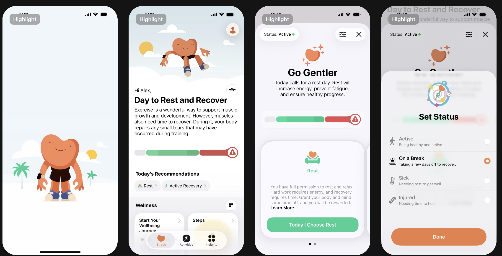
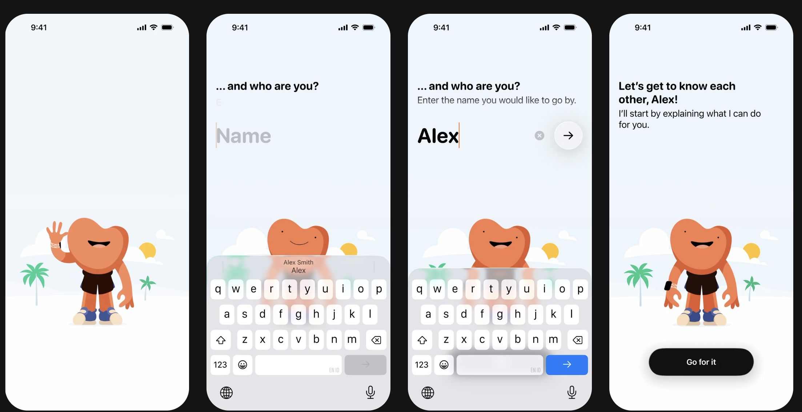
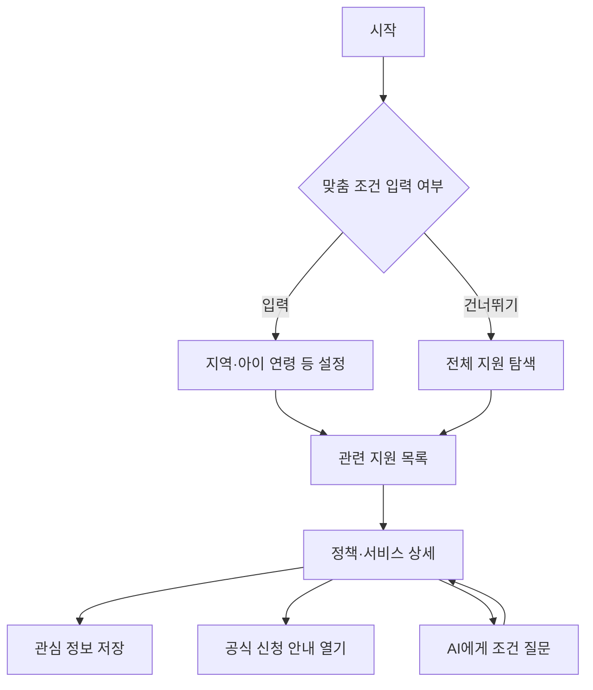

# 장애아동 지원 서비스 디자인 설계서

> AI 에이전트가 흩어진 지원 정책·서비스 정보를 모아 보호자에게 쉽게 안내하는 서비스  
> 작성일: 2026-10-24 · 버전: 2.0 · 용도: UI 디자인 및 구현 전달

## 1. 서비스 정의와 문서 기준

장애아동의 보호자가 여러 기관에 흩어진 지원 정책과 서비스를 한곳에서 확인하고, 자신의 상황에 관련 있는 정보를 이해하며, 공식 신청 경로까지 찾아갈 수 있게 돕는다. AI 에이전트는 정책 정보를 수집·정리하고, 보호자에게 조건·혜택·신청 방법을 읽기 쉬운 형태로 제공한다.

서비스명은 미정이다. 이 문서에서는 **장애아동 지원 서비스**라는 설명용 명칭을 사용한다. IRP라는 명칭과 약어의 유지 여부는 별도로 결정한다.

### 디자인 기준

최신 첨부 이미지 두 장을 시각적 기준으로 사용한다. 첫 번째는 홈·상세·상태 선택의 구조, 두 번째는 온보딩·큰 이름 입력·키보드 대응의 기준이다.

- **관찰:** 이미지에서 확인되는 구조와 시각적 특징.
- **제안:** 서비스에 맞게 새로 정한 화면·동작·수치. 별도 표시가 없는 규격과 기능은 제안이다.

원본 디자인 소스가 없으므로 폰트명·HEX·간격·모션 시간은 실측값이 아니다. 아래 수치는 구현 시작값이며 실제 화면에서 조정한다. 정책명·금액·자격요건의 실제 사례는 넣지 않았다. UI 예시 문구는 정보 구조를 설명하기 위한 가상 데이터다.

### 참조 이미지 A · 홈과 상세

### 참조 이미지 B · 온보딩과 입력

`Highlight` 배지와 원본 영문 문구는 구현하지 않는다. 상태바·키보드는 운영체제 기본 UI를 사용하고 화면 바깥의 검정 배경·기기 프레임은 앱 내부에 넣지 않는다.

## 2. 핵심 사용자와 해결할 문제

| 사용자 상황 | 필요한 경험 | 설계 방향 |
| --- | --- | --- |
| 어느 기관부터 찾아야 할지 모름 | 여러 출처를 모은 시작점 | 통합 탐색과 분야 분류 |
| 정책 문구가 길고 어려움 | 짧은 설명과 원문 확인 | 쉬운 요약 → 상세 조건 → 공식 원문 |
| 내 아이에게 관련 있는지 모름 | 관련 조건과 부족한 정보 확인 | 관련 이유·확인할 조건을 함께 표시 |
| 신청 시기와 방법을 놓침 | 신청 기간·서류·접수처 확인 | 상세 화면의 고정된 신청 정보 영역 |
| 검색을 반복해야 함 | 관심 정보를 다시 찾기 | 저장 목록과 최근 확인일 |
| 조부모 등 다른 보호자가 함께 확인 | 쉬운 문구와 큰 조작 영역 | 같은 화면 구조에서 접근성 강화 |

부모·조부모라는 가족 역할보다 **지원 정보를 찾는 보호자**의 과업을 기준으로 구성한다. 연령에 따라 별도의 복잡한 모드를 만들지 않는다.

## 3. 디자인 목표

**차분하고 따뜻한 화면에서, 필요한 지원 정보와 그 근거를 빠르게 이해하게 한다.**

| 원칙 | 적용 |
| --- | --- |
| 편안함 | 옅은 하늘색 배경, 넓은 여백, 둥근 흰색 카드 |
| 명확함 | 쉬운 한국어, 짧은 제목, 핵심 조건 먼저 표시 |
| 신뢰 | 출처·확인일·공식 링크를 정보 옆에 배치 |
| 통제감 | 맞춤 조건 수정·저장·초기화가 쉬운 구조 |
| 접근성 | 큰 글자·명확한 터치 영역·일관된 탐색 |

이미지의 오렌지·민트와 부드러운 곡선은 유지한다. 지원 정보가 중심이므로 일러스트는 시작 화면과 빈 화면 위주로 제한한다. 장애아동과 보호자를 수동적인 도움의 대상으로 묘사하지 않고 일상적인 인물로 표현한다.

## 4. 레퍼런스의 적용 방식

| 원본 관찰 | 서비스 적용 |
| --- | --- |
| 하늘색에서 흰색으로 이어지는 배경 | 온보딩·홈 공통 배경 |
| 큰 캐릭터와 구름·해 | 시작 화면의 보호자·아이 또는 안내 일러스트 |
| 굵은 검정 제목 | 화면 목적을 설명하는 1–2줄 제목 |
| 둥근 흰색 카드 | 정책·서비스 목록과 요약 |
| 떠 있는 하단 탭 | 홈·찾기·저장 3개 메뉴 |
| 밝은 상세 배경과 대표 카드 | 지원 내용과 신청 정보 상세 |
| 둥근 바텀시트와 라디오 목록 | 지역·분야·신청 상태 필터 |
| 큰 무테 입력과 원형 다음 버튼 | 선택적인 보호자 호칭 입력 |

원본의 상태 막대는 정책 적합도를 숫자로 표현하는 데 사용하지 않는다. 정확해 보이는 점수 대신 `조건 확인 필요`, `신청 기간 확인`처럼 근거가 있는 설명을 쓴다.

## 5. 디자인 토큰

### 5.1 색상 · 제안값

| 토큰 | 값 | 용도 |
| --- | --- | --- |
| `bg-sky` | `#EDF6FB` | 기본 배경 |
| `bg-sky-deep` | `#DCECF2` | 상단 히어로 |
| `surface` | `#FFFFFF` | 카드·시트 |
| `bg-soft` | `#F6F4FA` | 보조 배경 |
| `orange` | `#F47C44` | 브랜드 장식 |
| `orange-strong` | `#B74316` | 주요 버튼 |
| `orange-soft` | `#FFF1E8` | 선택 배경 |
| `mint` | `#29C792` | 보조 장식 |
| `mint-strong` | `#08785C` | 출처 확인·보조 강조 글자 |
| `mint-soft` | `#E5F6EF` | 근거·확인 정보 면 |
| `text-primary` | `#18181C` | 제목·본문 |
| `text-secondary` | `#56616D` | 부가 설명 |
| `text-placeholder` | `#707C87` | 입력 힌트 |
| `border` | `#D9E3EB` | 구분선·테두리 |
| `disabled-bg` | `#E8EDF1` | 비활성 면 |
| `disabled-text` | `#626D77` | 비활성 글자 |
| `danger` | `#B93838` | 입력·요청 오류 |
| `scrim` | `rgba(20,28,36,0.36)` | 시트 뒤 딤 |

밝은 오렌지·민트는 작은 흰 글자의 배경으로 쓰지 않는다. 주요 버튼은 진한 오렌지와 흰 글자, 선택 카드는 연한 오렌지와 어두운 글자를 기본으로 한다. 실제 색상 조합의 대비를 검수한다.

### 5.2 타이포그래피

원본 폰트는 미확인이다. 한국어 구현은 Pretendard, 대체는 시스템 sans-serif를 제안한다. 폰트 도입 시 배포 조건을 확인한다.

| 스타일 | 크기 / 행간 | 굵기 | 사용 |
| --- | --- | --- | --- |
| Display | 34 / 44px | 700 | 시작 화면 |
| Screen title | 28 / 36px | 700 | 화면 제목 |
| Section title | 22 / 30px | 700 | 섹션 |
| Card title | 20 / 28px | 600–700 | 정책명 |
| Body large | 18 / 28px | 500 | 핵심 설명 |
| Body | 16 / 24px | 400–500 | 일반 본문 |
| Label | 16 / 24px | 600 | 버튼·필터 |
| Caption | 14 / 20px | 400–500 | 출처·날짜 |
| Name input | 40 / 48px | 600 | 선택적 호칭 입력 |

필수 조건과 신청 기간을 작은 보조 글자로 밀어내지 않는다. 제목은 단어 단위 줄바꿈을 우선하고, 공식 정책명이 길면 줄 수를 늘린다. 큰 글자 설정에서도 중요한 문구를 말줄임하지 않는다.

### 5.3 공간과 형태

| 항목 | 제안값 |
| --- | --- |
| 기준 프레임 | 390 × 844 논리 px |
| 간격 체계 | 4px 단위 |
| 화면 좌우 패딩 | 20px, 좁은 폭 16px |
| 카드 내부 패딩 | 20px |
| 카드 간격 | 12–16px |
| 섹션 간격 | 28–32px |
| 카드 반경 | 20–28px |
| 시트 상단 반경 | 32px |
| 버튼·탭 반경 | 999px |
| 주요 버튼 높이 | 최소 56px |
| 터치 영역 | 최소 48 × 48px |
| 선택 목록 행 | 최소 높이 64px |
| 카드 그림자 | `0 8px 28px rgba(35,61,78,0.07)` |
| 플로팅 그림자 | `0 6px 24px rgba(35,61,78,0.10)` |

상태바와 하단 Safe Area는 운영체제 값을 따른다. 고정 높이로 흉내 내지 않는다.

## 6. 정보 구조와 주요 흐름

### 기본 내비게이션

| 탭 | 내용 | 대표 행동 |
| --- | --- | --- |
| 홈 | 맞춤 조건 요약·관련 지원·최근 확인 정보 | 맞춤 지원 보기 |
| 찾기 | 검색·분야·지역·신청 기간 필터 | 정책 상세 열기 |
| 저장 | 관심 정책·서비스 목록 | 공식 신청 안내 확인 |

설정과 맞춤 조건은 상단 프로필 아이콘에서 접근한다. AI 안내는 홈의 질문 입력 또는 상세의 `이 조건이 궁금해요`로 진입하며 별도의 필수 탭을 늘리지 않는다.

### 주요 사용자 흐름

검색과 목록 확인은 맞춤 정보 입력 없이도 가능하다. 맞춤 조건을 입력하지 않았다는 이유로 탐색을 막지 않는다.

## 7. 화면별 설계

### O-01. 서비스 시작

- 제목: `필요한 지원, 한곳에서 찾아보세요`.
- 설명: `흩어진 장애아동 지원 정보를 모아 쉽게 안내해 드려요.`
- 하단 보호자·아이 또는 따뜻한 안내 일러스트.
- 주요 버튼: `나에게 맞는 지원 찾기`.
- 보조 버튼: `먼저 둘러보기`.

서비스명이 확정되기 전 임의의 로고나 IRP 확장명을 고정하지 않는다. 일러스트는 화면 높이의 약 25–35%로 제한하고 작은 화면에서는 줄인다.

### O-02. 보호자 호칭 입력 · 선택 단계

레퍼런스의 큰 무테 입력과 원형 다음 버튼을 적용한다.

| 항목 | 명세 |
| --- | --- |
| 제목 | `어떻게 불러드릴까요?` |
| 설명 | `편하게 사용할 호칭을 알려주세요.` |
| 입력 힌트 | `이름 또는 호칭` |
| 길이 | 앞뒤 공백 제거 후 1–12자 |
| 다음 | 원형 화살표, 접근성 이름 `다음 단계` |
| 건너뛰기 | 입력 없이 진행 가능 |

실명은 필수가 아니다. 입력값이 없으면 `보호자님`으로 표시한다. 키보드가 올라오면 일러스트를 축소·숨기고 입력과 다음 행동을 보이게 한다. 한글 조합 중 제출하지 않는다.

### O-03. 맞춤 조건 설정

한 화면에 모든 조건을 쌓지 않고 2–3단계로 나눈다.

| 단계 | 입력 | 설계 규칙 |
| --- | --- | --- |
| 1 | 거주 지역 | 시·도, 시·군·구 선택. 상세 주소 불필요 |
| 2 | 아이 연령 | 나이 또는 연령대. 생년월일 수집은 필요성 확인 후 결정 |
| 3 | 관심 분야·추가 조건 | 복수 선택, 모름·건너뛰기 지원 |

관심 분야 예시는 `의료·재활`, `교육`, `생활·경제`, `이동·접근`, `가족 지원`이다. 운영 데이터 분류에 맞춰 최종 조정한다.

장애 등록 여부·장애 유형·소득 등 민감할 수 있는 추가 조건은 해당 정책을 확인하는 데 필요한 시점에만 선택적으로 묻는다. 기본값을 임의로 추정하지 않는다. 입력 목적과 저장 여부를 짧게 설명한다. 초기 MVP에서는 첨부 증빙서류와 상세 의료기록을 받지 않는다.

주요 버튼은 `이 조건으로 찾아보기`, 보조 행동은 `나중에 설정하기`다. 입력 조건은 목록 상단에서 다시 확인·수정할 수 있다.

### H-01. 홈

**정보 순서**

1. 짧은 인사와 `우리 아이에게 필요한 지원을 찾아보세요`.
2. 검색 입력: `어떤 지원이 궁금하신가요?`.
3. 현재 맞춤 조건 칩: `선택 지역`, `아이 연령`, `조건 수정`.
4. `확인해 볼 지원` 정책 카드 3개 내외.
5. 관심 분야 바로가기.
6. 하단 홈·찾기·저장 탭.

첫 화면에서 검색·조건·정책 카드가 보이게 히어로를 짧게 만든다. `받을 수 있어요`처럼 확정적인 제목보다 `확인해 볼 지원`을 사용한다. 맞춤 정보가 없으면 `관심 있는 분야부터 살펴보세요`와 분야 탐색을 보여준다.

### L-01. 정책·서비스 목록

상단 검색창 아래에 지역·분야·신청 기간 필터를 배치한다. 검색어와 필터를 함께 유지하고 결과 수를 표시한다.

**정책 카드 구조**

1. 분야 칩과 운영 기관.
2. 공식 정책·서비스명.
3. 쉬운 한 줄 설명.
4. 관련 이유: `선택한 지역의 지원 정보예요` 등 확인된 근거.
5. 핵심 조건 또는 `추가 조건 확인 필요`.
6. 신청 기간: 날짜 또는 원문에 근거한 `상시`, 불명확하면 `기간 확인 필요`.
7. 저장 버튼.

카드 전체는 상세 진입 영역이다. 저장 버튼은 별도 터치 영역으로 두고 상세 이동과 중복 실행되지 않게 한다. 공식명이 길면 별도 쉬운 설명을 붙이되 공식명을 바꿔 저장하지 않는다.

**정렬 제안:** `관련도순 / 최근 확인순`. 관련도 기준이 준비되지 않았으면 해당 정렬을 노출하지 않는다. 마감순은 명확한 종료일이 있는 데이터에만 적용한다.

### L-02. 필터 바텀시트

레퍼런스의 둥근 흰색 시트·딤·전체 행 라디오를 적용한다.

- 제목: `어떤 지원을 찾으세요?`.
- 지역은 단일 선택, 분야는 복수 선택으로 일관되게 표시한다.
- 주요 버튼: `결과 보기`.
- 보조 버튼: `초기화`.
- 상단 닫기 버튼 제공, 드래그에만 의존하지 않는다.
- 선택 즉시 목록을 변경하지 않고 `결과 보기`에서 적용한다.
- 닫으면 적용 전 변경을 취소한다. 초기화도 적용 버튼을 눌렀을 때 반영한다.

### D-01. 정책·서비스 상세

정보를 읽는 순서가 곧 판단 순서가 되게 구성한다.

| 순서 | 구역 | 필수 내용 |
| --- | --- | --- |
| 1 | 제목 | 공식명·운영 기관·분야 |
| 2 | 쉬운 요약 | 무엇을 지원하는지 2–3문장 |
| 3 | 관련 이유 | 입력 조건 중 일치한 항목·미확인 조건 |
| 4 | 지원 내용 | 서비스 형태·금액·횟수 등 원문에 있는 범위 |
| 5 | 대상과 조건 | 연령·지역·등록·소득 등 해당 정책 조건 |
| 6 | 신청 기간 | 시작·종료·상시 여부·기준 연도 |
| 7 | 신청 방법 | 접수처·온라인/방문·필요서류 |
| 8 | 문의처 | 기관·전화번호·공식 안내 |
| 9 | 근거 | 공식 출처 링크·공고/수정일·최근 확인일 |

하단 주요 버튼은 `공식 신청 안내 보기`, 보조 행동은 `저장`이다. 현재 서비스가 외부 신청을 대신 접수하지 않는 한 `신청 완료`나 `바로 신청됨`으로 표현하지 않는다. 링크가 신청 페이지인지 정보 페이지인지 구분해 표시한다.

출처가 확인되지 않은 금액·조건은 AI가 채워 넣지 않는다. 없는 값은 `공식 안내에서 확인해 주세요`로 표시한다. 같은 이름의 사업이라도 지역·연도·공고가 다르면 다른 버전으로 구분한다.

### A-01. AI 안내

**목적:** 정책 문구를 풀어주고 관련 정보를 찾도록 돕는다.

- 입력 예시: `이 서비스는 어떤 지원인가요?`, `신청할 때 무엇이 필요한가요?`.
- 응답 순서: 짧은 답 → 관련 조건 → 확인이 필요한 점 → 공식 출처.
- 답변의 각 주요 주장에 연결되는 출처를 표시한다.
- 조건이 부족하면 한 번에 하나씩 질문하고 `모르겠어요`를 허용한다.
- 출처가 없으면 근거 부족을 알리고 관련 공식 안내로 연결한다.
- 정책이 확인되지 않은 상황에서 그럴듯한 후보를 만들어 제시하지 않는다.
- 최종 수급 자격·선정 결과는 확정하지 않는다. `입력한 조건과 관련 있어요`와 `추가 확인이 필요해요`를 구분한다.

**처리 중 표현:** `관련 정보를 찾고 있어요` → `출처를 확인하고 있어요`는 실제 처리 단계가 있을 때만 표시한다. 임의 진행률·가짜 완료 단계를 넣지 않는다. 긴 작업에는 취소와 재시도를 제공한다.

초기 MVP는 수집된 공식 자료를 기반으로 요약·질문 응답을 제공한다. 실시간 웹 전역 탐색·신청 대행·자격 자동 판정은 별도 확장 범위다.

### S-01. 저장 목록

- 제목 `저장한 지원`.
- 정책명·운영 기관·신청 기간·최근 확인일.
- `전체 / 신청 기간 확인 필요` 등 실제 데이터로 계산 가능한 필터만 제공.
- 저장 해제는 즉시 반영하고 짧은 실행 취소를 제공한다.
- 빈 화면: `관심 있는 지원을 저장해 보세요`와 `지원 찾아보기`.
- 과거 공고는 삭제해 숨기지 않고 `지난 공고`로 구분해 현재 공고 여부를 확인할 수 있게 한다.

자동 알림이 구현되지 않았다면 마감 알림을 약속하는 문구를 쓰지 않는다.

### M-01. 맞춤 정보와 설정

지역·연령·관심 분야·선택적으로 입력한 조건을 한곳에서 수정한다. `정보 초기화`와 `저장한 정보 관리`를 명확히 구분한다. 큰 글자·시스템 접근성 설정을 지원하며 조부모에게 별도 기능 학습을 요구하지 않는다.

## 8. 공통 컴포넌트

| 컴포넌트 | 구조 | 상태 |
| --- | --- | --- |
| PrimaryButton | 라벨·선택적 방향 아이콘 | 기본·누름·로딩·비활성 |
| SearchField | 검색 아이콘·입력·지우기 | 비어 있음·입력·검색 중 |
| PolicyCard | 기관·공식명·요약·조건·기간·저장 | 기본·저장됨·지난 공고 |
| SourceBlock | 기관·공식 링크·발행/수정일·확인일 | 확인됨·재확인 필요 |
| MatchReason | 관련 조건·미확인 조건 | 관련 있음·정보 부족 |
| FilterChip | 라벨·선택·해제 | 선택·비선택 |
| ChoiceRow | 라벨·설명·라디오/체크 | 선택·비선택·포커스 |
| InfoSection | 제목·짧은 본문·펼치기 | 접힘·펼침 |
| FloatingTabBar | 아이콘·텍스트 3개 | 현재 탭 표시 |
| BottomSheet | 닫기·제목·내용·CTA | 열림·적용 중 |
| EmptyState | 짧은 안내·다음 행동 | 결과 없음·저장 없음 |

원문 전체를 카드에 넣지 않는다. 목록은 핵심 정보, 상세는 조건과 신청 안내, 원문은 공식 링크로 단계적으로 제공한다. `AI 요약`과 `공식 원문`을 명시적으로 표시한다.

## 9. 데이터와 AI 처리 설계

### 수집·제공 흐름

수집 도구·연동 방식이 정해지기 전에는 모든 기관을 자동 연결한 것으로 표현하지 않는다. 초기에는 관리자가 검토한 제한된 공식 자료로도 동일한 UI를 제공할 수 있게 설계한다.

### 최소 데이터

| 데이터 | 항목 |
| --- | --- |
| 정책 식별 | 내부 ID·공식명·운영 기관·분야·지역·적용 연도·공고 식별자 |
| 지원 내용 | 원문 지원 내용·구조화된 조건·신청 기간·접수 방법·서류·문의처 |
| 출처 | 공식 URL·발행/수정일·수집 시각·최근 검증 시각 |
| 요약 | 쉬운 설명·조건 요약·근거 문서/문단 참조·생성 시각 |
| 보호자 조건 | 선택 지역·연령·관심 분야·선택적인 추가 조건 |
| 저장 | 사용자/세션 ID·정책 ID·저장 시각 |

원문 발행일, 수집일, 검증일은 다르다. 화면의 `최근 확인일`은 실제 검증 시각을 사용한다. 연도를 모르는 데이터를 현재 연도 지원으로 표시하지 않는다. 개인정보 저장 방식·보존 기간·로그 정책은 구현 전 별도 결정하며, 민감 조건이 일반 분석 로그에 섞이지 않게 한다.

### 화면 상태

| 상태 | 표시 | 처리 |
| --- | --- | --- |
| 검색 중 | `지원을 찾고 있어요` | 입력·필터 유지 |
| 결과 있음 | 카드와 결과 수 | 상세·저장 |
| 결과 없음 | `조건에 맞는 정보를 찾지 못했어요` | 지역·분야 조건 완화 |
| 근거 부족 | `공식 안내 확인이 필요해요` | 원문·문의처 제공 |
| 기간 불명확 | `신청 기간 확인 필요` | 임의 마감일 생성 금지 |
| 정보 오래됨 | `최근 공고를 다시 확인해 주세요` | 마지막 확인일·공식 링크 |
| 수집·조회 실패 | `정보를 불러오지 못했어요` | 재시도·기존 결과 유지 |
| AI 응답 실패 | `답변을 만들지 못했어요` | 원문 보기·다시 질문 |

‘정보가 없다’와 ‘지원 대상이 아니다’는 다르다. 검색 결과가 없다고 자격 미충족으로 단정하지 않는다. 관련성 라벨은 검증 가능한 조건에 근거하고 숫자 확률을 임의 생성하지 않는다.

## 10. 인터랙션·접근성·반응형

### 기본 동작

- 탭 이동 시 검색 조건과 목록 위치를 보존한다.
- 상세에서 뒤로 가면 이전 결과 위치로 돌아간다.
- 공식 링크는 외부 페이지 이동임을 알 수 있게 표시한다.
- 저장 버튼은 선택 상태와 접근성 라벨을 함께 변경한다.
- 시트가 열리면 초점을 내부로 옮기고 닫을 때 원래 버튼으로 복귀한다.
- 긴 결과와 상세는 스크롤 가능하고 고정 CTA가 본문을 덮지 않게 여백을 둔다.

### 접근성

- 일반 글자 대비 4.5:1, 큰 글자 3:1을 검수 목표로 한다.
- 색상 외에 문구·체크·아이콘으로 상태를 전달한다.
- 시스템 글자 확대를 지원하며 필수 조건을 잘라내지 않는다.
- 버튼 높이는 콘텐츠에 따라 늘린다. 아이콘 버튼에는 읽을 수 있는 이름을 제공한다.
- 복잡한 정책 용어는 쉬운 설명을 붙이고 공식 용어도 함께 확인할 수 있게 한다.
- 화면 읽기 순서는 제목 → 요약 → 조건 → 신청 안내 → 출처다.
- 키보드 탐색과 포커스 링을 지원한다.

### 반응형

- 360·390·430px 폭과 320px 최소 폭에서 검수한다.
- 넓은 화면의 모바일 본문은 최대 480px 중앙 정렬을 시작점으로 한다.
- 필터 칩은 줄바꿈·더보기로 확장하고 주요 조건을 가로 스크롤 뒤에만 숨기지 않는다.
- 큰 글자에서는 가로 나열 항목을 세로 목록으로 바꾼다.
- 키보드 표시 상태에서 검색 입력·질문 전송·다음 버튼이 가려지지 않아야 한다.

### 모션 · 제안값

| 동작 | 시간 | 표현 |
| --- | --- | --- |
| 화면 이동 | 200–260ms | 짧은 페이드·이동 |
| 시트 | 240–300ms | 하단 진입·딤 변화 |
| 선택 | 120–160ms | 배경·테두리 변화 |

동작 감소 설정에서는 이동을 제거한다. 반복 캐릭터 애니메이션과 과한 완료 효과는 정보 탐색을 방해하지 않게 한다.

## 11. 일러스트와 아이콘

- 따뜻한 플랫 스타일·부드러운 곡선·크림/오렌지/민트 의상을 사용한다.
- 다양한 보호자와 아이를 자연스러운 일상 장면으로 표현한다.
- 장애를 특정 보조기기 하나로만 대표하지 않는다.
- 일러스트는 시작·빈 화면에 집중하고 목록·상세는 정보 밀도를 우선한다.
- 텍스트는 이미지에 합성하지 않고 실제 UI 레이어로 둔다.
- 아이콘은 가능한 SVG, 인물 일러스트는 투명 PNG/WebP로 분리한다.

| 자산 | 용도 |
| --- | --- |
| `welcome-family` | 시작 화면 |
| `support-guide` | 안내·빈 화면 |
| `icon-search / bookmark / filter` | 탐색·저장 |
| `icon-source / external-link / calendar` | 근거·외부 이동·기간 |
| `icon-medical / education / living / mobility / family` | 분야 분류 |
| `cloud / sun / plant` | 제한적 장식 |

## 12. MVP와 확장 범위

### MVP

1. 검토된 공식 정책·서비스 데이터 등록·조회.
2. 지역·연령·분야 기반 검색과 필터.
3. 공식 출처가 연결된 쉬운 AI 요약.
4. 조건·혜택·신청 기간·서류·문의처 상세.
5. 관심 정책 저장.
6. 수집된 자료에 근거한 AI 질문 응답.
7. 공식 신청 안내로 연결.

인증·사용자 저장 방식을 정하기 전에는 기기 내 저장인지 계정 동기화인지 제품에서 약속하지 않는다. 프로토타입에는 가상 데이터 표시를 하고 운영 데이터와 혼동하지 않게 한다.

### 확장

공식 기관 연동 확대, 새 공고·마감 알림, 변경 이력 비교, 여러 아이 프로필, 보호자 간 공유, 문서 업로드, 신청 진행 관리, 기관별 신청 연동은 별도 검토한다. AI가 수급 여부를 확정하거나 신청을 자동 대행하는 기능은 기본 범위에 포함하지 않는다.

## 13. 디자인 산출물과 검수

### 디자인 파일 페이지

| 페이지 | 프레임 |
| --- | --- |
| `00 References` | 첨부 이미지·관찰 메모 |
| `01 Foundations` | 컬러·타입·간격·아이콘 |
| `02 Components` | 카드·검색·필터·버튼·시트 |
| `03 Onboarding` | 시작·호칭·조건 입력·키보드 |
| `04 Discovery` | 홈·검색·목록·필터 |
| `05 Policy Detail` | 상세·출처·신청 안내 |
| `06 AI Guide` | 질문·근거 응답·정보 부족 |
| `07 Saved and Settings` | 저장·조건 수정 |
| `08 Edge Cases` | 오류·빈 결과·큰 글자·좁은 화면 |

### 완료 체크리스트

- [ ] 서비스 목적이 장애아동 지원 정책·서비스 안내로 일관되는가?
- [ ] 하늘빛 배경·흰색 카드·오렌지/민트 테마가 유지되는가?
- [ ] 지원 목록·조건·신청 안내가 일러스트보다 우선하는가?
- [ ] 정보 입력을 건너뛰고 탐색할 수 있는가?
- [ ] 공식명과 쉬운 설명이 구분되는가?
- [ ] 관련성 안내와 최종 자격 판단이 구분되는가?
- [ ] 출처·기준 연도·최근 확인일이 보이는가?
- [ ] 없는 금액·조건·신청 기간을 생성하지 않는가?
- [ ] 결과 없음과 자격 미충족을 혼동하지 않는가?
- [ ] 외부 안내 이동과 실제 신청 완료가 구분되는가?
- [ ] 입력·검색·저장 실패 시 기존 상태가 유지되는가?
- [ ] 큰 글자·키보드·좁은 폭에서 핵심 행동이 보이는가?
- [ ] 색상 대비·터치 크기·읽기 순서를 검수했는가?

## 14. 디자이너·구현자 전달용 핵심 지시문

> 장애아동의 보호자가 흩어진 지원 정책과 서비스를 한곳에서 쉽게 이해하도록 돕는 모바일 서비스를 디자인한다. AI 에이전트는 공식 자료를 수집·정리하고 근거가 연결된 요약과 질문 응답을 제공한다. 첨부 레퍼런스의 옅은 하늘색 배경, 흰 곡면, 큰 둥근 카드, 부드러운 그림자, 굵은 검정 제목, 오렌지와 민트 포인트를 적용한다. 핵심 화면은 시작·맞춤 조건·홈·검색 목록·정책 상세·AI 안내·저장이다. 관련 이유와 미확인 조건을 구분하고 출처·신청 기간·공식 신청 경로를 쉽게 찾게 한다. 정보는 큰 글자와 짧은 한국어로 전달하며, 자동 자격 확정과 근거 없는 수치를 표시하지 않는다. 수치와 토큰은 구현 시작값이며 실제 기기 가독성 검수 후 조정한다.
